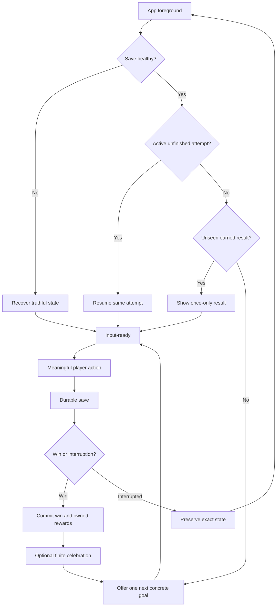

# Player Motivation Lifecycle & Cross-session Experience

## Глубокое исследование: почему игрок возвращается к маленькой головоломке и как проектировать опыт между сессиями

**Дата:** 11 ноября 2026 года  
**Область применения:** небольшие offline-first / Android / RuStore casual-puzzle игры: «Семечки» (Number Match), «Стрелки» (Arrows), «Водная сортировка», «Дороги / Fill», блок-пазл 8×8, солитёр ассоциаций.  
**Статус:** исследование и инженерные проектные гипотезы; не подтверждение прироста D1/D7 в наших приложениях.  
**Принцип:** сначала доказать полезность обычного игрового опыта, затем выбрать минимальное вмешательство, а не строить максимальную машину удержания.

> **Обязательная поправка к старым проектным документам:** по прямому сообщению владельца от 11.11.2026 «Семечки» **ещё не опубликованы в RuStore и не отправлены на модерацию**. Подписанная APK и отчёты CI не означают релиз. Предварительные данные AppMetrica имеют неустановленное происхождение установок; владелец указал, что не генерировал эти события сам. Их нельзя объявлять результатами магазинного запуска или по ним выводить рыночную конверсию.

---

## 0. Краткие выводы, которые меняют практику

1. **Возврат — не продолжение удовольствия по инерции.** Между удовлетворённостью текущей сессией и фактическим следующим запуском лежат внешние обстоятельства, привычный контекст, доступное время, память о цели и затраты на повторный вход. Исследование 2026 года, связавшее самоотчёты и игровые логи, обнаружило слабые либо нулевые краткосрочные связи психологического удовлетворения с временем до следующей игры и длительностью сессии [S01]. Это препринт, но уже важный антидот против «приятная сессия автоматически повышает D7».
2. **Не надо путать три разные сущности:** удовольствие от действия, решение открыть игру и превращение открытия в привычный ритуал. Их могут стимулировать разные механизмы, и одна метрика не измеряет все три.
3. **Незавершённое — не всегда лучше.** Метаанализ 2025 года не подтвердил универсального улучшения запоминания незавершённых заданий (популярный «эффект Зейгарник»), но подтвердил общую тенденцию возобновлять прерванную деятельность — эффект Овсянкиной [S02]. Поэтому следует отличать естественную прерванную партию от намеренно созданного обрыва «на самом интересном».
4. **Завершение ценно само по себе.** В серии из шести экспериментов возможность именно закончить задачу увеличивала её привлекательность даже по сравнению с альтернативой, имеющей более высокую награду [S03]. Следовательно, маленькая честная победа может работать лучше бесконечной шкалы.
5. **Слишком трудная дневная обязанность препятствует ритуалу.** Duolingo в A/B-тесте отделила дневную серию от крупной ежедневной цели: одного урока стало достаточно. Компания сообщила о +3,3% **относительного**, а не процентно-пунктового роста D14, одновременно снизилась доля людей, выполняющих более крупную цель [S04].
6. **Потеря серии — не безобидный мотиватор.** Семь исследований Silverman & Barasch показали, что отображение сохранённой серии увеличивает последующее участие по сравнению с отображением прерванной, независимо от фактической предыдущей активности. Возможность восстановить серию смягчает негативный эффект разрыва [S05].
7. **Сама привычка не равна счётчику streak.** В психологии привычка — автоматизированная реакция на контекст; повторение в схожих обстоятельствах постепенно формирует связь «ситуация → действие» [S06, S07]. Число дней на бейдже — лишь интерфейсное представление.
8. **«21 день до привычки» — миф.** В исследовании Lally et al. 95% индивидуального плато автоматичности достигалось за 18–254 дня, а один пропуск существенно не разрушал процесс [S07]. Это исследование повседневных здоровых действий, не мобильных игр; нельзя переносить сроки напрямую на пазлы.
9. **Напоминания способны увеличивать открытия без улучшения долгосрочного исхода.** В микрорандомизированном исследовании приложение открывали в следующий час в 3,5 раза чаще после уведомления, но три политики уведомлений не отличались статистически по времени до прекращения использования [S08]. Это данные приложения по изменению поведения, а не головоломки.
10. **Смысл возвращения должен переживать пропущенный день.** Пустой экран с угрозой потерять серию — слабый долгосрочный контракт. Сохранённая решённая задача, собственное достижение, достижимая следующая цель и понятный вход продолжают существовать без уведомления.
11. **Память о незавершённом состоянии нужно восстанавливать по контексту.** Лабораторные исследования прерываний показали преимущества релевантных подсказок и сохранения визуальных ориентиров для возвращения к задаче [S09, S10]; это не прямое доказательство D1, но хорошая HCI-основа для интерфейса Resume.
12. **Текущая низкая активность не доказывает, что игроку нужно уведомление или подарок.** Нужно проверять изменение поведения *из-за* вмешательства (uplift), а не только прогнозировать уход [S11].
13. **Долгосрочное удержание не обязано означать ежедневный запуск.** Качественный пазл может быть недельным ритуалом или игрой для коротких передышек; exact-day D7 не видит все модели положительных возвращений.
14. **Cross-session Director — это не ML и не три новых меню.** Для маленькой команды наибольший потенциал имеют точное сохранение состояния, умный безопасный Resume, одна правдивая следующая цель, контекстное предложение короткой задачи и отказ от навязчивых вмешательств.
15. **Необходим контрфакт.** Если человек вернулся после напоминания, это не значит, что он не вернулся бы без него. Если активные игроки чаще получают награды, это не значит, что награды их сделали активными.

### Карта доказательности

В документе используются обозначения:

- **[П] Прямые данные:** исследование конкретного эффекта с экспериментом или контролем; перенос на наши игры всё равно требует проверки.
- **[О] Ограниченная экстраполяция:** данные из образования, маркетинга, HCI, других игровых жанров; механизм правдоподобен, эффект в puzzle неизвестен.
- **[Г] Гипотеза:** инженерный дизайн, который мы предлагаем исследовать, но не выдаём за доказанную оптимальную политику.
- **[Н] Наблюдение:** документированное поведение продукта или собственных игровых сборок, без доступа к закрытым алгоритмам и без причинного вывода.

**Ни один из приведённых ниже числовых параметров длительности, таймингов, весов и порогов [Г] не объявляется доказанным оптимумом.**

---

## 1. Разделить вопросы: почему включают, почему играют и почему возвращаются

### 1.1. Пять последовательных барьеров

Между окончанием прошлой сессии и следующим успешным игровым эпизодом находятся разные решения:

1. **Появилась возможность играть.** У человека есть свободная минута, телефон под рукой, нет более важного дела. У игры почти нет власти над этим обстоятельством.
2. **Игра пришла на ум.** О ней напомнил собственный ритуал, иконка, друг, ежедневная задача, заметка или уведомление.
3. **Предполагаемая ценность оказалась положительной.** Ожидаются отдых, освоение, завершение, рекорд, новизна или общение. Возникает вопрос: «Что я получу, открыв приложение?»
4. **Цена входа оказалась приемлемой.** Не нужно вспоминать сложные правила, ждать загрузку, смотреть длинный экран наград, выбирать из десяти режимов или опасаться немедленной рекламы.
5. **После открытия игра дала обещанную ценность.** Важен не только «open» в аналитике, но и содержательный контакт с игрой.

Это **предлагаемая диагностическая модель [Г]**, а не пять доказанных универсальных стадий человеческой психологии. Она полезна тем, что каждой точке соответствует отдельная проверка.

| Наблюдаемое явление | Возможное объяснение | Что проверять | Чего нельзя заключать |
|---|---|---|---|
| Нет D1 | Не вспомнил / не было времени / не увидел причины | Дневные возвраты, интервью, видимость ценности | «Слишком сложно» |
| Открывает, быстро уходит | Возвратное трение / пустой экран / неверное ожидание | `open → meaningful_action`, задержки | «Отсутствует привычка» |
| Возвращается, но избегает Classic | Предпочтение конечным задачам / длинный эпизод / иная цель | Переходы режимов, качественный плейтест | «Игрок слабый» |
| Запускает много коротких сессий | Ритуал / сбои / навигационные переключения | Сессия SDK, действительно сыгранные ходы | «Он очень вовлечён» |
| Играет долго и исчезает | Насыщение / внешняя занятость / законченный интерес | Последний эпизод, неделя наблюдений, интервью | «Нужно оборвать сессию раньше» |
| Заходит по push, ничего не делает | Push-подхват без ценности | `notification_open → action`, отключения | «Уведомления повысили retention» |

### 1.2. Три горизонта и три уровня оптимизации

**Микро:** приятно ли конкретное действие. Это уже исследовалось в наших Experience Director документах.  
**Мезо:** получилась ли из нескольких действий удачная сессия. Это драматургия, темп, понятная точка остановки.  
**Макро:** существует ли в жизни человека причина ещё раз открыть игру. Это основная тема настоящего документа.

Ошибка: улучшить только микроуровень и обещать D7. Приятное переливание или удаление цифр может повышать удовольствие, но даже удовлетворённый человек может не запускать игру завтра. Работа Ballou et al. [S01] особенно явно предупреждает о разрыве между психологической оценкой и фактическим расписанием игры.

### 1.3. Для чего игрок вообще использует простую головоломку?

Не надо автоматически считать, что каждый игрок хочет «развивать навык» или «сохранять streak». Возможные **рабочие предложения продукта [Г]**:

- **Разрядка:** 2–5 минут безопасного знакомого действия; цель — облегчение, а не достижение.
- **Компетентность:** увидеть удачную последовательность, решить интеллектуальную задачу, улучшить рекорд.
- **Порядок:** превратить беспорядочную структуру в завершённую (сортировка, заполнение маршрута).
- **Коллекционирование:** заполнить страницу, серию, медаль или альбом.
- **Любопытство:** увидеть новую форму поля, правило, карточку, узор комбинации.
- **Ритуал:** ежедневное небольшое задание в привычный момент.
- **Социальное сравнение:** решать то же, что друзья, обмениваться результатами.

Это **не подтверждённые стабильные типы личности**. Один человек может выбирать разные предложения в разные дни. Если делать сегменты, считать их изменяемыми гипотезами о поведении, не психологическими диагнозами.

---

## 2. Что наука действительно знает про мотивацию игр

### 2.1. Self-Determination Theory (SDT): сильная теория удовольствия, но не всесильный прогноз retention

Ryan, Rigby & Przybylski в серии исследований 2006 года связывали субъективное удовлетворение потребностей **компетентности, автономии и связанности** с удовольствием, игровыми предпочтениями и намерением играть в будущем [S12]. В исследовании онлайн-игр с двухволновыми опросами и объективными логами 546 участников удовлетворение компетентности и автономии было связано с намерением продолжать и реальным использованием [S13].

Однако работа Ballou et al. (препринт, 2026) совместила более 11 тыс. дневных наблюдений 555 игроков и более 102 тыс. сессий примерно 9 тыс. участников PowerWash Simulator: психологические переживания сильно объясняли оценки самочувствия, но слабо объясняли дальнейшую игровую активность [S01].

**Не выбирать одну из работ как «единственную истину».** Они различаются игровыми жанрами, выборками, методами, горизонтом и способами измерений. Проверяемая позиция: SDT полезна для оценки *качества* опыта, но не является готовой функцией `retention = f(competence, autonomy)`.

**Для наших игр [Г]:** создавать возможность заслужить успех, самостоятельно управлять темпом и выбирать следующую цель. Но оценивать итог не по опросу «нравится ли» отдельно, а ещё и по фактической добровольной игре, последующему возвращению и отсутствию раздражения.

### 2.2. Мастерство и соответствие ожиданий

Работа *Leveling up fun* (2025) исследовала оценки сотен тысяч уровней в головоломке, гонках и платформере. Игрокам в среднем больше нравились уровни умеренной сложности; важны были также соответствие **предыдущим ожиданиям** и успех, а не только абстрактная кривизна сложности [S14].

**Вывод [О]:** плохой опыт — не всегда «слишком трудно». Он может быть *неожиданно* трудным в момент, когда игра обещала расслабление. И наоборот, сложное поле может быть желанным, если человек сам выбрал «испытание» и оно честно обозначено.

### 2.3. Привычка как связь с контекстом

Lally et al. просили участников выбирать повседневное действие и повторять его в постоянном контексте. Повторение способствовало автоматичности, но сроки сильно разнились; один пропуск не обнулял процесс [S07]. Gardner et al. объясняют, что контекстом может быть время или привычное событие — например, «после завтрака» [S06].

**Не переносить 66 дней на мобильные игры как обещание.** Разумная переносимая идея [О]: стабильный небольшой ритуал важнее агрессивного принуждения к длинной сессии. Он может возникнуть и без push, если продукт хорошо вписывается в повторяющийся момент дня.

### 2.4. Implementation intentions: явная связь «когда — что»

Метаанализ 2006 года объединил 94 независимых теста и обнаружил пользу конкретных планов формата «если ситуация X, сделаю Y» для достижения целей (d≈0,65) [S15]. Обновлённый метаанализ 2024 года охватил 642 теста и показал эффекты на разных исходах, особенно когда план действительно имеет условную форму и существует мотивация [S16]. Это литература по саморегуляции, не A/B-тест игровых напоминаний.

**Применение [Г]:** если игрок **сам пожелал** ежедневный ритуал, дать ему понятный выбор времени и короткую цель. Не заставлять человека обещать то, чего он не собирался делать. «Ежедневно в 12:30» должно быть удобной опцией, а не подстроенной по умолчанию обязанностью без объяснения.

### 2.5. Fresh start: граница периода позволяет начать заново

Dai, Milkman & Riis обнаружили повышение активности по достижению целей около начала недели, месяца, года и других временных рубежей на данных нескольких полевых исследований [S17]. Это не означает, что «каждый понедельник надо обнулять прогресс». Скорее, **связь “новый период — новый шанс” может быть мотивирующей**, если предыдущие достижения не уничтожаются.

**Применение [Г]:** новый месяц в календаре — мягкое приглашение к следующей серии; если месяц пропущен, показать новую доступную цель без чувства поражения. Позиционировать как новое окно возможностей, а не штраф за отсутствие.

### 2.6. Goal gradient и то, сколько осталось

Kivetz, Urminsky & Zheng демонстрировали ускорение поведения по мере приближения к награде на данных кофейных карт и онлайн-сервиса [S18]. Fishbach, Dhar & Zhang обнаружили важную зависимость от уверенности в обязательстве: когда вовлечённость ещё не сформирована, полезнее может быть акцент «сколько уже сделал»; при устойчивом обязательстве — «сколько осталось» [S19].

**Это тоньше стандартного “всегда показывай 80% шкалы”.** На старте человеку может быть нужно доказательство, что он *уже справился*. Возвращающемуся — напоминание о близком конкретном финише. При этом нельзя уменьшать реальные заработанные достижения или подменять честный остаток выдуманным.

### 2.7. Завершённость как самостоятельная награда

Шесть экспериментов, описанных в *The value of mere completion*, показали: наличие доступного завершения задачи способно изменить выбор в пользу менее выгодной альтернативы; именно **достижимость финального шага** играет особую роль [S03]. Это данные про решения в задачах, а не доказательство повышения D7 у пазлов.

**Наша дешёвая гипотеза [Г]:** короткая законченная задача с ясным финалом может мотивировать вернуться эффективнее большой бесконечной сессии с абстрактным счётом. Не заменять Classic, а дать рядом другой формат.

### 2.8. Эффект Зейгарник и эффект Овсянкиной нужно различать

Метаанализ Ghibellini & Meier (2025) не подтвердил общее преимущество незаконченных задач при вспоминании, но обнаружил склонность возобновлять прерванные дела [S02]. **Оба результата получены из лабораторных задач и не дают разрешения искусственно прерывать успешную игровую сессию.**

Рабочая граница:

- естественная пауза с точным сохранением текущей задачи — **поддержка возврата**;
- завершённая задача и явно обозначенная новая цель — **поддержка нового цикла**;
- искусственно задержанный финал, скрытый запрет закончить или намеренное создание незавершённости для принуждения к открытию — **манипулятивная гипотеза без оправданной игровой ценности**.

---

## 3. Самая важная конструкция: завершение сессии определяет тип следующего входа

Обычный туториал ведёт человека из незнакомого состояния в игру. **Возврат после прерывания — другой процесс.** Он начинается не с любопытства, а с восстановления контекста.

### 3.1. Три принципиально разных выхода

**A. Завершил задачу и добровольно остановился.** Человек уже получил ценность. При следующем запуске ему нужна новая обозримая цель, а не повторная демонстрация уже полученной медали. Празднование завершилось; долг сохранён; следующий шаг виден.

**B. Прервал незавершённую задачу.** Возможно, его отвлекли, он устал, у него закончился перерыв. При следующем запуске нужны прежнее поле, положение, контекст и минимальные действия до первого осмысленного хода. Ни один из факторов не позволяет автоматически ставить эмоциональный диагноз.

**C. Ушёл после ошибки, сбоя или непонятного состояния.** Здесь первична корректность: восстановление без потери прогресса и честное объяснение. Мотивационная обвязка не должна маскировать сломанную игру.

**Отдельный случай:** игрок вернулся после пропуска дейлика. Это не обязательно тот же случай, что C. Не навязывать восстановление streak как основной смысл захода.

### 3.2. Что должны помнить интерфейс и игра

Исследования по управлению прерываниями показывают, что восстановление текущей цели зависит от доступных ориентиров, и что изменённые или ненадёжные подсказки ухудшают восстановление [S09, S10].

**Для пазлов [Г]:**

- сохранять **точную** раскладку, выбранную задачу, прогресс, камеру/скролл, действующие ресурсы и права на помощь;
- по возвращении избегать заставок и цепочки промежуточных модальных окон;
- дать 1 короткое **фактическое** напоминание, только если оно нужно: «Тетрадь 2 · задача 5 из 6», а не «Мы скучали 3 дня»;
- не показывать автоматически подсказку, которая делает часть решения за игрока;
- сохранять ссылку на ближайшую понятную цель: «Осталось закончить одну задачу на странице»;
- не воспроизводить повторно награду, уже зачисленную и показанную в прошлой сессии;
- если сохранение было прервано — показать честное состояние последней **подтверждённой** записи.

### 3.3. Стабильное положение элементов как retrieval cue

**Стрелки:** запомненная форма поля и оставшиеся линии служат опорой; возврат не должен неожиданно переносить камеру и менять расположение силуета.  
**Водная сортировка:** сохранённые цвета и порядок колб важнее длинного текста «что делать».  
**Блоки:** поле и три текущие фигуры обязаны переживать закрытие; нельзя незаметно заменить выдачу.  
**Семечки:** исходная область прокрутки, выбранные цифры (если нужно), последовательность текущей партии, последний успешный ход.  
**Солитёр:** тот же порядок колоды, положение открытых групп и незакрытые категории.  
**Дороги:** точный текущий маршрут, а не начало уровня.

### 3.4. Парадокс незавершённости

Хочется оставить игрока в состоянии «почти награда». Однако если это ухудшает чувство завершённости, человек может запомнить не интригу, а обязанность. Здоровая конструкция: **завершить сегодняшний эпизод, но показать, что мир игры не исчерпан**.

Пример для тетрадей: «Задача пройдена → страница 4/6 → следующая задача существует». Нет необходимости специально не выдавать награду за текущую задачу.

### 3.5. Контракт честной остановки

Каждая игра должна позволять:

- легко остановиться;
- уверенно знать, что сохранено;
- не лишаться заработанного за паузу;
- вернуться без переобучения;
- не попадать в обязательный interstitial до восстановления контекста;
- получать в следующем входе *продолжение или новую задачу*, а не повтор бесконечного предложения «заберите подарок».

**Это UX-контракт [Г], а не требование каждый раз показывать кнопку “Завершить сессию”.** На мобильном телефоне выход часто происходит системным жестом или сворачиванием.

## 4. Lifecycle первых 30 дней: не расписание пушей, а последовательность освоения ценности

Ни один из источников не устанавливает универсального правильного события на «день 3», «день 7» или «день 14» для Number Match. Приведённая далее схема — **[Г] дизайн-модель для проверки**, где календарные дни обозначают удобные горизонты измерения, а сами игровые события зависят от *реально достигнутого состояния*. Новому игроку, который установил игру и не открывал её неделю, не нужно автоматически показывать «седьмой этап».

### 4.1. Стадия D0: понять обещание и получить первую самостоятельную победу

**Задача продукта:** показать ценность без предварительного доверия. Игрок должен освоить действие, получить результат и увидеть, что будет дальше.

**Главная ошибка:** в первые минуты демонстрировать сразу все системы: монеты, календарь, медали, баночки, задания, рекламную подсказку. Это не доказательство глубины — это переключение внимания до освоения ядра.

**Сценарий для «Семечек» [Г]:**

1. Наглядно показать удаление одной пары и результат на поле.
2. Быстро дать **самостоятельно** найти пару (задача достижима, без автоматического решения за игрока).
3. Показать прогресс, причинно связанный с успешным действием — освобождённое место, полученные семечки, минимальный счётчик.
4. Предложить законченную короткую тетрадную задачу, но **не блокировать** желающего остаться в Classic.
5. После завершения дать человечески понятную следующую цель: следующая задача / продолжить классику / закончить сейчас с сохранённым результатом.

**Измерять:** долю игроков, которые самостоятельно сделали первую пару, достигли первого завершения, начали содержательное действие после победы, и отдельно — возвращение в течение 1–3 дней у таких пользователей. Это корреляция до эксперимента.

**Антипаттерн:** выдавать достижение «Великолепно!» до момента, когда человек действительно совершил умное действие.

### 4.2. Стадия первого возвращения: восстановить, а не обучить заново

**Задача:** первое повторное открытие не должно заставлять игрока восстанавливать весь контекст, заново проходить онбординг или вспоминать, где лежит продолжение.

Схема [Г]: `app_foreground → оценить последнее подтверждённое состояние → показать один релевантный путь → первый осмысленный ход`.

Что проверять:

- Сохранилась ли точная партия?
- Не возникло ли сначала несколько модальных предложений?
- Возврат в нужный режим требует одного нажатия или пяти?
- Понимает ли человек, что он уже сделал и что ему осталось?
- Если вчера закончил, видит ли новую короткую задачу?
- Если вчера прервал, предлагается ли естественное «Продолжить»?

Здесь **время до первого осмысленного действия после возврата** полезнее, чем только время загрузки интерфейса.

### 4.3. Дни 2–3: доказать, что игра не одноразовая

**Задача:** повторное открытие должно предложить ценность, отличающуюся от вчерашнего конкретного результата, но не требующую заново учить правила.

Возможные формы [Г]: другая геометрия знакомого пазла, новая комбинация освоенных правил, конкретное новое достижение, удобный формат короткого сеанса. Не обязательно новая валюта.

**Опасность:** выдавать столько нового, что опыт перестанет быть знакомым и расслабляющим. Принцип из предыдущего исследования Novelty Director: новизна — **управляемый контраст**, а не постоянный поток функций.

**Измерять:** повторный старт партии, переключение режимов, добровольные запуски ещё одной задачи, использование инструкции повторно, время до первого хода.

### 4.4. Дни 4–7: испытать устойчивость «повода вернуться»

**Задача:** есть ли повторяющееся ценностное предложение: «за 3 минуты решу задачу», «добью страницу», «сегодня попробую новый силуэт», «побью собственный результат»?

**Гипотеза для проверки:** один легко достижимый ритуал может быть сильнее нескольких параллельных систем обязательств. Поддержка: эксперимент Duolingo по отделению ежедневной серии от большого дневного плана [S04]. Но это другая категория продукта, и она не доказывает идентичного эффекта в пазлах.

Если человек пропустил день, не создавать ощущение, будто вся недельная работа уничтожена. Прогресс коллекции, рекорд и завершённые задачи остаются навсегда; streak может иметь отдельную мягкую семантику.

### 4.5. Дни 8–14: первая проверка насыщения

Новые игроки, которые доходят сюда, уже не обязательно нуждаются в новом обучении. Возможные риски: повторение одной задачи, слишком предсказуемые награды, большие непрозрачные дистанции до цели.

**Измерять:** частоту завершений на активный день, динамику первых самостоятельных успехов, сокращение/рост числа осмысленных действий до награды, распределение длительности задач и долю бесцельной навигации. Длительный сеанс не равен лучшему сеансу.

**Действие [Г]:** предложить цели другой природы — не просто «ещё 10 задач», а при существующих правилах «закончить страницу», «улучшить лучший результат», «сегодня другая форма испытания».

### 4.6. Дни 15–30: обновлять интерес без обнуления смысла

Долгосрочная мотивация не может бесконечно опираться на первый «вау». Игрок научился. Требуются либо развивающиеся задачи, либо спокойный повтор любимой процедуры, либо личная коллекция достижений. Это разные стратегии.

**Наблюдение [О]:** в исследованиях привычки автоматичность вырастает при повторении стабильной процедуры [S06, S07]. **Противоречие [О]:** игровая новизна и освоение тоже связаны с удовольствием [S14]. Поэтому [Г] ритуальный вход можно делать знакомым, а **содержание задачи** — умеренно переменным. Не надо ежедневно переделывать и ритуал, и правила одновременно.

### 4.7. Пример событийной, а не календарной прогрессии

| Эпизод | Наблюдаемое условие | Что должно быть доступно | Что НЕ следует навязывать |
|---|---|---|---|
| Первый самостоятельный успех | Первая подтверждённая пара/очистка | Небольшое последствие действия, видимая цель | Меню всех достижений |
| Первая законченная задача | Фактическая победа + надёжное сохранение | Законченный результат и конкретное продолжение | Автоматическую новую игру |
| Первый добровольный выход | Приложение ушло в фон/закрылось | Точное сохранение и спокойная точка остановки | Пуш через 5 минут |
| Первый возврат | Новый foreground после закрытой сессии | Релевантный Resume/следующая цель | Второй туториал |
| Повтор того же ритуала | Два и более независимых дня активности | Короткий привычный доступ к любимому формату | Сложный новый режим |
| Первый пропуск дневной задачи | Целевой день прошёл | Архив/новый день и сохранённый прогресс | Сообщение «Вы всё потеряли» |
| Первое месячное достижение | Все условия выполнены | Честное завершение и обзор следующего этапа | Бесконечное расширение прежнего финиша |

### 4.8. Полный календарь идей для исследования, не для обязательного внедрения

| Дни жизненного цикла | Потенциальная ценность | Первичный наблюдаемый показатель | Решение, которое можно проверить |
|---|---|---|---|
| D0 | Самостоятельное понимание | first meaningful move; first completion | Меньше меню до первой победы |
| D1 | Узнаваемость | время до первого хода на возврате | Стабильный Resume + точная цель |
| D2–3 | Новое в знакомом | второй/третий завершённый эпизод | Комбинация знакомых правил |
| D4–6 | Ритуал без нагрузки | повторные дни + добровольные занятия | Одна маленькая ежедневная цель |
| D7 | Неделя без наказания | доля возобновлений после пропуска | Сохранить достижения при разрыве серии |
| D8–10 | Переход к мастерству | успехи по классам ситуаций | Предложить другой тип вызова |
| D11–14 | Устойчивость смысла | возвраты после завершённых задач | Предпросмотр следующей осмысленной цели |
| D15–20 | Первое насыщение | осмысленные ходы/сессия, интервью | Разнообразие не за счёт сложности |
| D21–27 | Стабильный режим | недельные активные дни / добровольные возвращения | Упростить ритуальный вход |
| D28–30+ | Продолжение смысла | D30, недельная активность, добровольные повторы | Следующий месяц/том без обнуления прошлого |

**Важно:** D7 — не единый игровой триггер, а календарный контрольный горизонт для *новых когорт*. В производственном коде не следует автоматически выводить «седьмой сценарий» из `daysSinceInstall === 7`.

---

## 5. Серии, ежедневные задачи и мягкое формирование привычки

### 5.1. Четыре разных счётчика, которые нельзя смешивать

1. **Количество дней с игрой** — фактическая частота.
2. **Последовательная серия дней** — отображённая непрерывность, зависимая от календарной политики.
3. **Накопленные выполненные задачи** — невозвратное достижение, например 12/30 дней месяца.
4. **Сила поведенческой привычки** — психологическая автоматичность, по простому игровому журналу непосредственно не измеряется.

**Технический вывод:** `streakLength = 8` не является `habitStrength = 8`. Любая модель, использующая streak как «силу сформированной привычки», должна явно называть это суррогатом, а не психологическим измерением.

### 5.2. Опыты Duolingo: не копировать числа без контекста

В официальном материале об эксперименте с *Streak Wager* Duolingo сообщает прирост активности и D7 примерно на 14% в экспериментальной группе [S20]. Это эффект в конкретной реализации языкового сервиса; компания не раскрывает в том материале всех необходимых деталей сравнения и не говорит о пазлах.

Другой эксперимент *Weekend Amulet* позволял сохранить серию на выходных; компания сообщала о 4% большей вероятности вернуться через неделю и снижении потери серии на 5% [S20].

Самый практически ценный пример — позднейший эксперимент: компания разрешила поддерживать streak одним уроком вместо выполнения всего дневного плана. **D14 вырос на 3,3% относительно контроля**, но выполнение большого дневного плана снизилось [S04].

Три разных конструктивных вывода:

- **Вызов** может работать для уже согласившихся принять обязательство, но не обязан быть хорошим первым экраном для всех.
- **Возможность перерыва** иногда поддерживает дальнейшее участие лучше сурового наказания.
- **Маленький порог ритуала** может сохранять ежедневность, не превращая игру в ещё одну обязанность.

### 5.3. Серия как самодовлеющая цель: полезный и рискованный эффект

Silverman & Barasch в семи исследованиях показали, что отрисовка сохранённой серии влияет на дальнейшее поведение сама по себе [S05]. Важное следствие для нашего UX: акцент на «вы потеряли 17 дней» способен изменить отношение к игре даже при неизменной сумме реальных достижений. Возможность восстановления смягчает отрицательный эффект.

**Наша продуктовая граница [Г]:**

- streak не должен уничтожать честно заработанную медаль или архив;
- разрыв нельзя выдавать за обнуление всего труда;
- восстановление не должно требовать обязательного просмотра рекламы, если это единственный способ сохранить смысл уже сделанного;
- дни, выполненные задним числом, могут пополнять календарную коллекцию, но не обязаны задним числом восстанавливать *live streak*;
- если политике нужны «freeze» или «repair», они должны быть понятны и однозначны.

### 5.4. Не каждый пазл выиграет от ежедневного streak

Сильная роль streak оправдана, если маленькое повседневное действие само по себе имеет ценность. В некоторых расслабляющих играх человек хочет свободно пропускать недели. Навязчивые серии могут превращать отдых в обязанность. Это не антигеймификационная догма, а продуктовая гипотеза: **измерять удовольствие, добровольность и продолжительность участия одновременно**.

### 5.5. Разделить минимум ритуала и амбициозную цель

Конструкция [Г]:

- **Минимум:** одна законченная короткая задача или один другой значимый результат по выбору игрока.
- **Амбиция:** 6 задач страницы, 7 разных дней месяца, новый личный рекорд.
- **Постоянный след:** все уже закрытые задачи, рекорды и коллекционные предметы не исчезают из-за пропуска дня.

Это логика опыта Duolingo, адаптированная к продукту, **не копия конкретной формулы**. В наших приложениях нужно проверить, полезна ли вообще механика live streak до её усложнения.

---

## 6. Ежедневное ограничение как отдельная концепция: почему Wordle не нуждается в бесконечной ленте

**Наблюдение [Н]:** базовый формат Wordle предлагает общую дневную задачу с ограниченным числом попыток и возможность поделиться результатом без раскрытия ответа. В таком дизайне дневной эпизод конечен. Комментарии исследователей и опросы связывали популярность Wordle в том числе с ритуальностью и общим опытом [S21, S22].

**Это не A/B-доказательство**, что ограничение одной задачей повысило retention относительно бесконечной версии. Сравнение таких версий в доступных нам данных не обнаружено. Но Wordle показывает допустимую *продуктовую стратегию*, противоположную бесконечному прохождению: короткое завершение + социально синхронизированный новый день.

### 6.1. Шесть составляющих такого контракта [Г]

1. **Одна понятная цель:** можно закончить за короткий промежуток.
2. **Общий контекст:** знакомые или другие игроки могут обсуждать *одну и ту же* задачу.
3. **Однозначный финиш:** невозможно бесконечно «ещё чуть-чуть» двигать горизонт.
4. **Новый день:** существует реальная дата появления новой задачи.
5. **Узнаваемость:** базовые правила не переобучаются ежедневно.
6. **Самостоятельная игра:** результат определяют действия и одинаковые условия, а не персональная скрытая подстройка.

### 6.2. Что переносить, а что нет

**Переносимо:** ежедневная конечная головоломка с реальной наградой и календарём; отдельный архив, позволяющий играть в другом ритме; лёгкий вход в сегодняшнюю задачу.

**Не переносить без причины:** запрет играть в другие режимы до завтра; онлайн-лидерборды; требование делиться; соревновательные ранги при маленькой аудитории; намеренное ухудшение доступа к контенту.

В «Семечках» архив ежедневных задач уже существует. Если игрок решит 12 архивных задач за один вечер, это 12 **прохождений**, но не 12 дней сформированного ритуала. Нельзя смешивать эти измерения.

---

## 7. Уведомления: как не принять искусственный всплеск открытий за здоровье игры

### 7.1. Прямой экспериментальный контрпример

В микрорандомизированном исследовании приложения *Drink Less* (350 участников в основной MRT-группе, 30 дней, ежедневная рандомизация стандартного/нового уведомления или отсутствия уведомления) вероятность открыть приложение в течение следующего часа после уведомления выросла в **3,52 раза**. При этом по времени до прекращения использования между тремя сравниваемыми политиками не обнаружили статистически значимого различия; `p = 0,42` в анализе выживаемости [S08].

Это сильный аргумент в пользу разделения **proximal outcome** («открыл сейчас») и **distal outcome** («продолжает пользоваться спустя недели»). Разные типы приложений могут иметь разные реакции; нельзя обещать одинаковый эффект в casual game.

### 7.2. Системное различие Push и Pull

- **Push:** инициированная системой коммуникация — локальный reminder, push, письмо. Способна привлечь внимание, но расходует доверие и прерывает жизнь пользователя.
- **Pull:** пользователь уже открыл игру и сам видит сохранённую задачу, новый день, коллекцию. Не требует внешнего вторжения и чаще дешевле производственно.

Для маленьких пазлов я бы **сначала оптимизировал Pull**: быстрый запуск, понятный Resume, видимая сегодняшняя задача, контекст следующего достижения. Push включать лишь там, где он сообщает о **реально доступной ценности** и человек этого хочет.

### 7.3. Как выбирать момент просьбы о разрешении

Android 13+ требует runtime `POST_NOTIFICATIONS`. Google рекомендует давать контекст и запрашивать разрешение тогда, когда пользователь понимает пользу функции, а не сразу при запуске [S23].

Пример [Г]: игрок самостоятельно завершил первую ежедневную задачу и видит естественную опцию «Напоминать о новой задаче в удобное время». При отказе основная игра полностью работает; повторное навязывание недопустимо.

Для «Семечек» актуальный код и документация описывали `reminders = true` для новых настроек и системный запрос после завершения дейлика. Это уже лучше системного диалога на первом кадре, но **отдельно проверить**, понимает ли пользователь, что опция включена, и удобно ли её отклонить. Не требовать изменения до результатов конкретного UX-теста.

### 7.4. Жёсткие предохранители для напоминаний [Г]

- По умолчанию предпочитать **явный пользовательский выбор** ритуала и времени.
- Никогда не уведомлять, если задача уже завершена или приложение сейчас активно.
- Не ставить ложных ограничений по времени и не изображать обычный дейлик «срочным».
- Учитывать локальный часовой пояс и согласованное время; при изменении часового пояса политика должна быть определена заранее.
- Один контекст — одно сообщение, без повторных «вы ещё не ответили».
- Тихие часы, выключатель, отсутствие звука для низкоприоритетных сообщений, подавление после отказа.
- Уведомление открывает релевантный контент, а не промежуточную рекламу.
- Нельзя отправлять уведомление о недоступной задаче, несохранённой награде или уже прошедшем событии.
- Ограничения частоты (`max 1/day`, `min 24–48h gap`, и т.д.) — **стартовые параметры [Г]**, а не научно доказанные оптимумы; для локального standalone-проекта можно быть ещё консервативнее.

### 7.5. Что нужно измерять

`reminder_eligible` — было ли вообще законное окно отправки; `reminder_scheduled`, `reminder_cancelled`, `reminder_opened`, `first_meaningful_action_after_open`; `opt_out` и если доступно — фактическую доставку. **Не подменять “запланировано” “доставлено”.** В offline Android могут существовать ограничения OEM/энергосбережения, так что доставку на реальном телефоне придётся проверять.

**Контроль:** кому уведомление не было отправлено при аналогичном состоянии. Без holdout нельзя вычислить причинную дополнительную активность.

---

## 8. Четыре кейса, которые полезнее десятка общих советов

### Кейс A. Duolingo: уменьшение обязательства вместо удвоения награды

- **Механика:** дневной streak отделили от выбранного количества уроков. Одного урока достаточно для сохранения серии.
- **Эксперимент:** официально сообщён относительный рост D14 на 3,3%; меньше пользователей выполняли собственный большой дневной план [S04].
- **Что изменилось причинно:** барьер входа в дневной ритуал, а не «в целом стало больше подарков».
- **Неочевидный компромисс:** повседневная частота выросла, глубина отдельных дней снизилась.
- **Перенос:** минимальная достижимая ежедневная победа отдельно от амбициозной прогрессии.
- **Чего нельзя заявить:** такую же величину роста для Number Match, Block Blast или RuStore.

### Кейс B. Duolingo: разрешить человеку не играть — иногда способ помочь ему вернуться

- **Механика:** Weekend Amulet позволял сохранить streak при перерыве.
- **Наблюдение:** компания сообщила 4% больше возвратов через неделю и 5% меньше утраченных серий в A/B-тесте [S20].
- **Интерпретация:** снижение риска безвозвратного «я всё испортил».
- **Перенос:** архив достижений, streak repair без унижения, отсутствие обнуления других систем при пропуске.
- **Риск:** превращение системы страховки от отсутствия в дополнительную платную обязаловку.

### Кейс C. Wordle: у игрока может быть хорошая причина *закончить* сегодня

- **Механика:** единая ежедневная задача, скромный объём контента на день, социально сравнимый результат.
- **Вывод [О]:** возможная синхронизация ожидания, ритуала и завершения. Но нет надёжного причинного сравнения с безлимитной версией [S21, S22].
- **Перенос:** отдельный короткий законченный эпизод с ясной следующей датой, без запрета играть в другие режимы.

### Кейс D. Top Eleven: реальное персонализированное возвращение — но дорогой контекст

Статья об *Early churn prediction with personalized targeting in mobile social games* использовала данные около **двух миллионов игроков Top Eleven** для раннего прогноза ухода и персонализированных сообщений. Авторы сообщали об уменьшении churn вплоть до 28% в рамках описанных экспериментов/сценариев [S24].

**Осторожность:** это онлайн-футбольный менеджер с социальными механиками и большим трафиком, а не offline puzzle. Не масштабировать его ML и инфраструктуру на маленький портфель. Переносить можно только принцип: сообщение должно быть связано с *реальным интересом пользователя*, а не универсальным «Вернись, мы соскучились».

### Кейс E. Рандомизированные уведомления: успех на близком горизонте не гарантирует пользы на дальнем

Исследование Drink Less уже показало этот разрыв [S08]. Это особенно опасный продуктовый антипример для рекламных игр: отчёт может показывать рост `notification_open` и количества коротких сессий, а устойчивость аудитории не улучшится.

### Кейс F. Психологическая оценка vs цифровые следы

Препринт Ballou et al. [S01] и работа об удовлетворённости в онлайн-играх [S13] дают разный масштаб связи субъективного опыта с фактическим будущим поведением. **Практика:** измерять оба класса метрик, не выдавать один за другой и не считать «положительную оценку игры» гарантией будущей установки/возвращения.

## 9. Cross-session Experience Director v0: из чего система должна состоять

Это **предлагаемая архитектура [Г]**, не описание существующего движка конкретного конкурента.

### 9.1. Чем он принципиально отличается от Puzzle Director

| Подсистема | Вопрос | Может менять | Не должна менять |
|---|---|---|---|
| Challenge / Puzzle Director | Какова следующая ситуация? | Следующую выдачу, уровень, темп сложности | Уже показанное поле, исходную историю, результат рекламы |
| Experience Director | Как представить действие/результат? | Эффекты, приоритет звука, длительность визуальных акцентов | Истину игрового состояния, получение награды |
| Novelty Director | Какой тип следующего открытия подходит? | Очередность новых сочетаний/темп предъявления | Обещанные заранее условия общей daily-задачи |
| **Cross-session Director** | Как восстановить полезный опыт при следующем входе? | Путь входа, контекст, одну следующую цель, необязательное напоминание | Сохранённую партию, права игрока, стабильность достижений |

**Не создавать четыре крупных сервиса только из-за четырёх красивых названий.** С точки зрения кода сначала может быть одна pure-функция `selectReturnPresentation(state, context)`, а затем — отдельная функция `selectNextGoal(...)`. В `mini-games-kit` имеет смысл переносить лишь то, что доказало ценность на нескольких играх.

### 9.2. Источники данных без “чтения мыслей”

Разумный набор *наблюдаемых* переменных:

- Есть ли подтверждённая незавершённая попытка? (`boolean`)
- Доступно ли её точное продолжение? (`boolean`)
- Что было подтверждённым последним исходом: победа / без результата / явно отменил / неизвестно?
- Какая задача/режим была последней?
- Какая одна следующая цель фактически доступна?
- Сколько независимых календарных дней человек запускал игру? (не путать с D1)
- Сколько прошло со времени последней активности? (время из устройства может быть неточным)
- Есть ли непрочитанное **заработанное** достижение?
- Есть ли новая дневная задача, с той же датой в принятой календарной политике?
- Явно ли пользователь отключил напоминания/вибрацию/празднование?
- Есть ли нерешённая ошибка сохранения или pending рекламная награда?

Ненадёжные переменные, которые **не стоит считать известными**:

- «Пользователь устал» по факту ухода;
- «Пользователь скучает» из большого времени на ход;
- «Пользователь испугался проиграть» без явного исследования;
- «Пользователь согласится на рекламу» по истории открытий;
- «Игрок забыл правила» только потому, что отсутствовал 12 дней.

### 9.3. Семь видов возвращения

| Состояние | Правдивый сигнал | Предлагаемый первый экран/действие | Чего избегать |
|---|---|---|---|
| **FIRST_LAUNCH** | Ещё нет содержательного действия | Быстрый вход в первую задачу | Экран коллекций и рекламы |
| **INTERRUPTED** | Есть активная незавершённая партия | «Продолжить» с точным контекстом | Подмена уровня/поля |
| **AFTER_WIN** | Предыдущая задача завершена и сохранена | Следующая короткая цель | Повторная выдача той же медали |
| **AFTER_FAILURE** | Явный проигрыш/рестарт, если жанр поддерживает | Повторить / другое испытание / доступная помощь | Оскорбительные сообщения, скрытая подкрутка |
| **DAILY_AVAILABLE** | Сегодняшняя daily ещё не выполнена | Ненавязчивый переход к сегодняшней задаче | Делать daily единственным входом |
| **RETURN_AFTER_GAP** | Был реальный календарный перерыв | Сохранённая цель + доступный новый эпизод | «Вас не было 14 дней, вы всё потеряли» |
| **RECOVERY_PENDING** | Не закончена транзакция / ошибка сохранения | Сначала восстановление правды и наград | Новая мета поверх ошибки |

Состояния **могут пересекаться**. Например, `INTERRUPTED + DAILY_AVAILABLE + RETURN_AFTER_GAP`. Нужны приоритеты, а не семь взаимоисключающих отдельных экранов.

### 9.4. Предлагаемый приоритет решений

1. **Integrity:** ошибки сохранений, pending reward, устаревшая миграция — защищают игровой результат.
2. **User intent:** если человек явно выбрал «Продолжить классику», дать это, даже если daily доступна.
3. **Resume:** незавершённая партия должна быть легко доступна.
4. **Completed milestone:** честно отметить ранее заработанное, но только один раз и без повторного начисления.
5. **One next goal:** предоставить один ясный шаг, если нет более приоритетного.
6. **Optional discovery:** маленький предпросмотр того, что существует ещё.
7. **No intervention:** допустимый и иногда лучший исход.

### 9.5. Safety gates — не рекомендации, а обязательные ограничения

- **Никакой подмены сохранённой задачи.** Cross-session слой не владеет RNG и не меняет раскладку.
- **Никакого начисления из анимации.** Награда фиксируется в durable progress, затем отображается.
- **Никаких двойных событий/наград при повторном foreground.** Применять идемпотентные `receiptId`, `milestoneId`.
- **Никакой рекламы на пути восстановления.** Если пользователь возвращается в прерванный ход, не подменять его путь межстраничным показом.
- **Никакого ложного “почти готово”.** Следующая цель вычисляется по постоянным правилам, а не по выгодному сообщению.
- **Пользовательские настройки имеют приоритет над адаптацией.** Уменьшение движения, звук, напоминания, запрет подсказок, если такой режим существует.
- **При сомнении — отсутствие вмешательства.** Неверный “умный” экран хуже привычного предсказуемого продолжения.

### 9.6. Не одно число «мотивации», а раздельные наблюдения

Откажемся от `motivationScore = 0.63`. Вместо него:

```text
CanResume       = true/false    // целостность сохранённого состояния
LastOutcome     = WIN | LOSS | IN_PROGRESS | UNKNOWN
AvailableGoals  = [действительно доступные варианты]
LastMode        = CLASSIC | NOTEBOOK | DAILY | ...
ActiveDays      = целое число за фиксированное окно
DaysSinceActive = целое число, если часы надёжны
RewardPending   = true/false
StreakStatus    = ACTIVE | FROZEN | BROKEN | NOT_APPLICABLE
ReminderOptIn   = true/false
```

На этих наблюдениях можно принять понятное и тестируемое решение. **Суммировать всё в одну «потребность в удержании» не следует.**

---

## 10. Реализация: данные и минимальные контракты

### 10.1. Durable state vs одноразовая презентация

Предлагаемый **TypeScript-подобный** контракт; это не код, скопированный из текущего `seeds-bits`:

```ts
type Mode = "classic" | "notebook" | "daily";
type Outcome = "won" | "lost" | "in_progress" | "unknown";

type DurableProgress = {
  schema: 6;
  installedContentVersion: string;
  currentMode: Mode;
  activeAttemptId: string | null;
  currentGame: SerializedGame;          // точная игровая истина
  completedIds: string[];
  acceptedRewardReceiptIds: string[];
  seenMilestonePresentationIds: string[];
  localDayHistory: string[];            // политика дней фиксируется отдельно
  userPreferences: {
    remindersEnabled: boolean;
    preferredReminderMinutes?: number;
    reducedMotion: boolean;
  };
};

type ReturnSummary = {
  previousOutcome: Outcome;
  savedAtUtc: string | null;
  lastMode: Mode;
  activeAttemptResumable: boolean;
  recoverableReward: boolean;
  nextConcreteGoalId: string | null;
  todayDailyAvailable: boolean;
  saveHealth: "ok" | "uncertain" | "failed";
};

type ReturnAction =
  | { kind: "resume"; attemptId: string }
  | { kind: "show_next_goal"; goalId: string }
  | { kind: "present_earned_receipt"; receiptId: string }
  | { kind: "repair_state" }
  | { kind: "show_menu" };
```

Поле `lastOutcome` должно быть подтверждено игрой, а не выведено из `appStateChange`. Уход приложения в фон — не доказательство отказа, усталости или добровольного завершения.

### 10.2. Pure-функция политики возвращения

```ts
function selectReturnAction(
  save: DurableProgress,
  summary: ReturnSummary,
  context: { explicitUserAction?: "resume" | "daily" | "menu" }
): ReturnAction {
  // Safety и явное намерение важнее персонализации.
  if (summary.saveHealth !== "ok" || summary.recoverableReward)
    return { kind: "repair_state" };

  if (context.explicitUserAction === "menu")
    return { kind: "show_menu" };

  if (context.explicitUserAction === "daily") {
    const today = deriveAvailableDailyGoal(save);
    if (today) return { kind: "show_next_goal", goalId: today };
  }

  if (summary.activeAttemptResumable && save.activeAttemptId)
    return { kind: "resume", attemptId: save.activeAttemptId };

  const unseen = getNextEarnedUnseenReceipt(save);
  if (unseen)
    return { kind: "present_earned_receipt", receiptId: unseen };

  if (summary.nextConcreteGoalId)
    return { kind: "show_next_goal", goalId: summary.nextConcreteGoalId };

  return { kind: "show_menu" };
}
```

**Важное ограничение:** эта функция выбирает *подачу существующей истины*, а не создаёт награды, меняет календарь или начинает задачу без действия игрока. `show_next_goal` показывает доступный путь, но автоматический запуск предпочтителен только если так явно настроено или принято в конкретном режиме.

### 10.3. Выбор следующей цели: bounded scoring, а не рекомендательная платформа

Для игр с несколькими допустимыми целями (например, тетрадь/дневная задача/Classic) можно задать небольшой формальный скоринг [Г]:

```text
score(goal) =
  4 * alreadyStarted(goal)
+ 3 * oneStepFromHonestCompletion(goal)
+ 2 * matchesLastChosenMode(goal)
+ 1 * isTodayFiniteChallenge(goal)
- 5 * requiresUnlearnedMechanic(goal)
- 6 * blockedByIntegrityIssue(goal)
```

Значения **примерные проектные веса**, не найденные исследованиями. Ключевой принцип — ограниченный набор понятных кандидатов, одна рекомендуемая цель, сохранённый полный выбор режимов. Выбор пользователя должен обновлять предпочтение сильнее, чем случайная эвристика.

**Нельзя оценивать цель по величине дохода от рекламы**, обещанию rewarded или склонности платить за помощь. Это другой конфликт интересов и другая категория экспериментов.

### 10.4. Разделить решение и показ

```text
persist game truth
      ↓
commit reward + milestone ownership
      ↓
build return summary from saved state
      ↓
select one presentation intent
      ↓
mark presentation as seen (durable receipt if needed)
      ↓
play optional finite visual/audio feedback
      ↓
return control immediately
```

Презентация может быть пропущена, приложение может уйти в фон, а анимация — упасть из-за WebGL context loss. **Право игрока на награду и возможность продолжить никогда не зависят от завершения анимации.**

### 10.5. Параметры первой лабораторной версии [Г]

| Параметр | Рабочая граница | Зачем | Как проверить |
|---|---|---|---|
| `maxReturnModalCount` | 0–1 | Минимизировать трение возврата | Сколько действий до первого хода |
| `maxNextGoalCountVisible` | 1 акцент + список режимов | Не превращать главную в список обязательств | Быстрая ориентация в первом экране |
| `streakRepairDefault` | Не отнимать earned rewards | Сохранить доверие | Обсуждение пропуска и добровольный возврат |
| `preResumeAd` | Запрещено | Сохранить контекст | Native smoke после возврата |
| `hiddenDifficultyAdjustOnReturn` | Запрещено | Не менять правила без основания | Детерминированные контрольные seeds |
| `newGoalThreshold` | Только после подтверждённого завершения | Сохранить причинность | Receipt и сохранение |
| `reentryDelay` | Без искусственного ожидания | Быстро вернуть управление | p95 input-ready |
| `noIntervention` | Всегда разрешённый вариант | Не перегружать систему | Контрольная группа, частота пропуска вмешательств |

### 10.6. Что делать с временем и часовыми поясами

- Для календарных задач должна быть единая **объявленная** политика дня: локальный день или единый глобальный день. Не переключать её молча.
- Сохранять ISO UTC для событий и отдельный `localDayKey`, вычисленный согласно политике игры.
- Переход через полночь обновляет доступность следующей задачи, но **не пересоздаёт текущую сохранённую раскладку**.
- Для повторного запуска из системного уведомления хранить целевой `dateKey`; при просроченной дате открыть актуальный каталог с понятной подсказкой, а не несуществующий уровень.
- Если на устройстве часы сильно изменились или сохранённый timestamp расположен в будущем, переходить к консервативному отображению; не конфисковывать streak автоматически.
- Offline-игра не способна гарантированно защититься от ручного изменения системного времени без сервера. Не строить на этом финансово значимые или соревновательные права.

### 10.7. Стратегия отсутствия данных

Первые 1–2 сессии не дают оснований уверенно сегментировать игрока. Никаких категорий «специалист», «любитель», «высокая уязвимость к FOMO» из двух запусков.

**Правило [Г]:** пока нет достаточного количества независимых наблюдений, показывать обычную понятную цель и сохранять право свободного выбора. Даже после накопления данных предпочитать легко объяснимые локальные эвристики тяжёлой персонализации.

---

## 11. Стейт-машина: “вход — эпизод — выход — восстановление”

Простая модель помогает избежать типичных багов между жизненным циклом Android, рекламой и игровыми результатами.



**Mermaid — концептуальная схема, не буквальная транзакционная последовательность одного процесса.** Проблемные сценарии: приложение ушло в фон *до* `save`, приложение возобновилось *после* rewarded callback, игрок дважды нажал «Продолжить», перезапустился WebView, часы изменили дату.

### 11.1. Несколько экранов — несколько разных источников блокировки

Блокировками ввода могут быть реклама, системное разрешение, диалог восстановления, окно паузы, переход ориентации, фон приложения. Их нельзя трактовать как `user_abandoned_game`. Если механика анализа «выхода» считает такие события уходами, Cross-session Director будет принимать неправильные решения.

### 11.2. Слои хранения

**Gameplay state:** доска, RNG, undo, выбранный режим, pending progress.  
**Meta state:** задания, коллекция, даты, streak, earned rewards.  
**Presentation state:** показанная медаль, одноразовое уведомление, положение декоративных элементов.  
**Analytics state:** контрольный вариант, версии правил и политики, события, без полномочий менять игру.

Только gameplay и meta владеют заработанными правами. Presentation может повториться после технического сбоя, но не должна повторно начислять ресурс. Analytics может потерять пакет событий, но это не должно лишать человека победы.

---

## 12. Конкретные UX-рецепты на границе двух сессий

Каждый рецепт — **[Г]**, который требует проверки на людях и на целевом телефоне.

### Рецепт 1. «Продолжить» с памятью о задаче

**Условие:** существует незавершённая подтверждённая попытка.  
**Действие:** первая кнопка ведёт в неё. В кратком заголовке режим и реальный прогресс.  
**Запрет:** заменять раскладку, навязывать подсказку или рекламу.  
**Метрика:** `time_to_first_meaningful_action`, resume success, restart-after-resume.

### Рецепт 2. «Ещё одна короткая задача», если предыдущая завершена

**Условие:** последняя задача закончена и пользователь находится на результате/домашнем экране.  
**Действие:** предложить ближайшую конечную задачу, которая действительно доступна.  
**Запрет:** автоматически запускать следующую без согласия.  
**Метрика:** voluntary next-task start и возвращение на будущих днях, не только время в сессии.

### Рецепт 3. Показать накопленное, когда обязательство ещё не сформировано

**Условие:** ранние достижения или новый пользователь.  
**Действие:** после победы показать «уже 2 задачи выполнены» вместо одного пугающего «ещё 98» (ссылка на Fishbach et al. [S19]).  
**Запрет:** скрывать истинный общий объём, если игрок хочет видеть каталог.  
**Метрика:** понимание цели в UX-тесте и активные действия, не только CTR кнопки.

### Рецепт 4. Показать остаток, когда конкретная цель уже принята

**Условие:** человек сознательно работает над страницей/медалью, до финиша осталось немного.  
**Действие:** «Осталась одна задача страницы».  
**Запрет:** бесконечно двигать финиш или подменять закрытие новой страницей.  
**Метрика:** честное завершение цели и повторное добровольное открытие приложения.

### Рецепт 5. После пропуска — предложить новый доступный день, не обвиняя

**Условие:** вчерашний дейлик не закрыт, доступен сегодняшний.  
**Действие:** сегодняшний день + архив прошлых дней в явном каталоге.  
**Запрет:** «Вы потеряли все награды!» при сохранённых медалях и архиве.  
**Метрика:** reactivation-to-task, жалобы на streak, повторные дни.

### Рецепт 6. После долгого отсутствия — не показывать всё, что произошло

**Условие:** возвращение через длительный интервал.  
**Действие:** сохранить выбор продолжить старую задачу и отдельно показать одну новую актуальную.  
**Запрет:** стопка окон «получи бонус», «новая коллекция», «новая дата», «оцените нас».  
**Метрика:** число закрытых модалок до хода, drop-off в 30/60 секунд после входа.

### Рецепт 7. Самостоятельно выбранная сложность

**Условие:** игрок ищет новый вызов либо предпочитает спокойный режим.  
**Действие:** дать понятный выбор типа задачи, не «определять эмоцию» по времени.  
**Запрет:** незаметно усиливать сложность потому, что человек хорошо играет, и обесценивать рекорды.  
**Метрика:** повторное использование выбранного режима, отзывы о честности.

### Рецепт 8. Контекстная помощь после доказанного тупика

**Условие:** по игровым правилам нет допустимого полезного продолжения или пользователь запросил помощь.  
**Действие:** предложить ограниченный вариант восстановления, который действительно помогает.  
**Запрет:** искусственно создавать тупик для rewarded-показа.  
**Метрика:** продолжение после помощи, повторные ошибки, добровольный отказ от подсказки.

### Рецепт 9. Новая дата — новый маленький договор

**Условие:** появляется новая действительно существующая задача дня.  
**Действие:** короткое понятное приглашение, если пользователь открыл соответствующий раздел.  
**Запрет:** лживое «последний шанс» без реального срока.  
**Метрика:** самостоятельные входы в daily и завершения сегодняшнего дня.

### Рецепт 10. Отказ от уведомлений как нормальное состояние

**Условие:** пользователь выключил напоминания или отказал разрешению.  
**Действие:** ничего не отправлять, сохранить ценность внутри игры.  
**Запрет:** повторно спрашивать при каждом запуске.  
**Метрика:** отсутствие нежелательных запросов, возвраты без push.

### Рецепт 11. Награду показали один раз — второй раз подтверждение спокойное

**Условие:** награда уже зачислена и показана, а игрок повторно открывает экран коллекции.  
**Действие:** постоянная отметка получения, без повторного полного праздника.  
**Запрет:** второй раз менять баланс, ставить обязательную задержку перед продолжением.  
**Метрика:** отсутствие двойных начислений, время до интерактивности.

### Рецепт 12. Временно ничего не рекомендовать

**Условие:** игра не располагает надёжными данными о следующей полезной цели или игрок явно выбрал меню.  
**Действие:** показать обычный интерфейс и все режимы.  
**Запрет:** придумывать историю «под тебя специально подготовили подарок».  
**Метрика:** низкая доля бесполезных или закрываемых рекомендаций, доверие.

## 13. Применение к каждому проекту: одно исследование, шесть разных причин возвращаться

Раздел опирается на проектные описания и текущие README, которые были доступны в `DanilaH/*` на 11.11.2026. **Это не повторная независимая визуальная экспертиза всех APK.** README некоторых проектов содержит устаревшие статусы и не должен подменять более свежие HANDOFF/решения. Проектные рекомендации — **[Г]**, требующие отдельной оценки затрат и пользовательской ценности.

### 13.1. «Семечки» — самый ценный полигон

**Проверенный продуктовый контекст:** Number Match, `classic`, тетради с конечными задачами, архив ежедневных задач, награды/банки, месячные достижения, общий запас подсказок, Android-реклама и AppMetrica. Игра по сообщению владельца **не отправлена на модерацию**. Предварительные файлы AppMetrica имеются, но источник установок не установлен. Не считать это магазинным ретеншном.

**Почему это нестандартная задача для Cross-session:** в одном приложении сосуществуют три разных договора с игроком.

| Режим | Привлекательность следующей сессии | Риск плохого возврата | Следующая полезная цель |
|---|---|---|---|
| Classic | Снова делать приятные пары / улучшать собственный результат | Слишком длинная доска, потеря позиции, отсутствие ясного финиша | Точное продолжение или свободный новый старт |
| Тетради | Закрыть задачу / страницу / том | Трудно найти незавершённую страницу, новая цель не видна | Одна ближайшая незаконченная задача |
| Daily | Решить конкретный день / пополнить месячную медаль | Чувство ежедневной обязанности, сложный вход в архив | Сегодняшняя задача, без обнуления прошлых медалей |

**Наиболее полезное действие до релиза:** проверить путь `первая самостоятельная пара → первая законченная короткая задача → понятное следующее действие → выход → возврат в то же состояние`. Не добавлять ещё одну валюту, сезон или ML.

**Конкретные тестовые гипотезы [Г]:**

1. **Одна короткая задача после освоения пары:** предложить необязательный переход в тетрадь для человека, который впервые понял правила, вместо автоматического бесконечного Classic. Проверять добровольную конверсию и отсутствие потери интереса к Classic.
2. **Кнопка “Продолжить” с источником:** после возвращения показывать незаконченный режим и точное поле; при сохранённой активной Classic не подменять её очередным дейликом. Проверять время до осмысленного хода.
3. **После закрытия страницы:** показать заслуженную награду и фактически существующую следующую страницу, не заставляя прокликивать каталог.
4. **Daily без наказания:** предложить текущую дату, а архив и уже полученные медали оставить доступными. Проверять, не воспринимается ли streak как требование.
5. **Минимизировать трение “после победы”:** завершённая награда и приглашение следующего действия не должны блокироваться повторяющимся межстраничным показом.
6. **Не выдавать высокие завершения за D7:** в предварительном отчёте множество `game_complete` могло происходить в одном user-day; архивный daily не означает ежедневную привычку.

**Текущие известные ограничения измерения:**

- `game_open` означает также переключение режима и рестарт, не только запуск приложения;
- `game_start` отправлял `attempt`, а `game_complete` — нет, что мешает попарной проверке;
- `game_complete` вызывался до подтверждения сохранения результата;
- `save_error` встречался в ранних данных, но причина не доказана;
- статус релиза в исторических README/STATUS противоречит прямому уточнению владельца.

**Точка проверки:** дождаться результатов параллельного продуктового агента, устранить подтверждённые проблемы хранения/аналитики, затем спокойно исследовать первый возврат. Не создавать здесь второй параллельный большой рефакторинг во время работы другого агента.

### 13.2. «Стрелки» — ритуал короткого освобождения плюс большое испытание

**Доступный контекст:** 120 фиксированных полей, компактное начало, крупные Hard/Nightmare, 20 семейств силуэтов, ежедневные задачи, календарь, месячные кубки и сохранение незавершённого поля. В проекте уже отслеживаются ограничения поля (плотность, свобода начальных ходов, глубина зависимостей), но это **структурные** критерии, а не доказательство человеческой сложности.

**Мотивационное обещание:** «Я разберу запутанную форму и запущу цепочку освобождений». Главное здесь — видеть естественное изменение поля, а не копить валюту.

**Полезная cross-session политика [Г]:**

- после сохранённой большой Nightmare-задачи — точное восстановление камеры и оставшихся стрелок;
- после завершённого большого испытания — короткий контрастный обычный уровень и видимый путь дальше;
- текущая ежедневная задача доступна с меню, но не перебивает продолжение кампании;
- месячная коллекция отображает накопленные завершения даже после пропущенных дней;
- нельзя возвращать потраченные/восстановленные жизни незаметно по истечении времени, если правила этого не предусматривают.

**Что исследовать:** ценность *возвращения в большую незавершённую форму* против запуска новой маленькой. Для качественного плейтеста вопрос: «Вы хотите продолжить вчерашний большой силуэт или сначала выполнить что-то короткое?» Не выводить ответ из времени отсутствия.

**Метрики:** `resume_big_level`, `resume_success`, `first_action_after_reentry`, `voluntary_next_level_start`, `completion_hard` с версией банка; сожаления о неявном сбросе состояния.

**Что не переносить:** скрытый reroll уже выбранного поля, казино-подобный приз за каждую стрелку, лишние валюты, три обязательных ежедневных ритуала.

### 13.3. Сортировка воды — возвращение к сохранённому порядку

**Контекст:** около 60 задач в кампании, дополнительные колбы, undo, подсказки, различные правила и материальный feel жидкости. Некоторые состояния усложняют условия решения, а не только количество цветов.

**Мотивационное обещание:** «Я восстановлю порядок, красиво завершу колбы и почувствую ясность».

**Риск:** игрок прервался в середине сложной раскладки. При следующем входе он не помнит, какая колба была временным буфером и что он собирался перелить. Нельзя лечить это автоматической подменой уровня.

**Подход [Г]:**

- возвращать точную позицию и расположение колб;
- сохранять возможность отмены, не отбирать из-за перерыва;
- после длинного отсутствия необязательная кнопка «Напомнить допустимый ход» с корректным поиском, не автоматическое переливание;
- после завершения сложной задачи короткая понятная следующая цель/облегчённая передышка по заранее построенному банку;
- следить, чтобы праздник каждой заполненной колбы не превращался в длинный обязательный барьер.

**Метрика:** latency до первого осмысленного переливания на возврате, отказ от навязчивой подсказки, повторный undo, корректность восстановления.

### 13.4. «Дороги / Fill» — законченные фигуры и накопленная коллекция

**Контекст:** банк из 90 задач в трёх наборах по 30 (по документу `BANK_VALIDATION.md`); стартовые уровни/некоторые README могут отставать от свежего банка. Есть звёзды, темы, награды, колесо, постоянное сохранение маршрутов.

**Мотивационное обещание:** «Я дотяну непрерывную ленту до финиша и закончу узнаваемую фигуру».

**Риск:** после победы игрок получает так много последовательных окошек (звёзды → монеты → подарок → колесо → предложение темы → “дальше”), что обычная следующая задача начинает восприниматься как административная работа.

**Подход [Г]:**

- «одна победа — одно общее завершение», с возможностью пропуска анимаций;
- отдельно обозримый прогресс набора, без одновременного навязывания всех систем;
- возврат к точному недорисованному маршруту, не к первому уровню набора;
- после завершения набора — сознательный переход к другому, а не автоматический старт чужого набора;
- ежедневное колесо не должно быть единственной причиной зайти или обязательным шагом перед игрой.

**Метрики:** время от финиша до следующего осмысленного входа, сколько экранов результата закрыто вручную, качество возврата к черновику, добровольные повторения уже решённых уровней.

### 13.5. Блок-пазл 8×8 — автономия открытого цикла

**Контекст:** Classic — свободный рекордный режим с выдачей фигур, подсказками, комбо, ритмом сложных и облегчённых ситуаций. Подробная лаборатория симуляции генератора исследована ранее; здесь не дублируем её.

**Мотивационное обещание:** «Я получу несколько красивых очисток, спасу поле и попробую превзойти себя».

**Cross-session проблема:** бесконечная партия может быть увлекательной, но не иметь естественного финала. **Нельзя автоматически считать это дефектом**: открытый режим выбирают именно ради бесконечности.

**Подход [Г]:**

- точный Resume лотка и поля (включая RNG/версию выдачи);
- после законченной партии — короткий итог значимых достижений и ясная опция новой попытки;
- при новом рекорде — положительная сохранённая отметка, без повторных конфетти на каждом входе;
- не изобретать ложный сюжет, сезонный пропуск или обязательную ежедневную цель только ради D7;
- при желании предложить отдельный конечный daily/Adventure, но не приклеивать его к ядру до проверки Classic.

**Метрика:** вероятность *добровольного* повторного старта после честно завершённой партии, длительность между независимыми сессиями, доля возвратов в незаконченный Classic без потери текущей тройки.

### 13.6. Солитёр ассоциаций — ожидание раскрытия и ясная конечная цель

**Контекст:** локальные раздачи, ограниченные ходы, колода, категории, Undo, Joker, модификаторы, проверенные решения, ежедневные задачи и косметическая мета. В README описан банк из 80 кандидатных раздач; цифра должна сверяться с актуальным содержимым при дальнейшем внедрении.

**Мотивационное обещание:** «Я открываю скрытые связи, предугадываю сочетания и собираю категории».

**Риск:** прерванную раскладку трудно мысленно восстановить. Особенно важно сохранить не просто столбцы, а фактическое состояние колоды, запомненные открытые карточки и порядок категорий. Иначе возвращение будет ощущаться как нечестная перетасовка.

**Подход [Г]:**

- точное продолжение без перестройки колоды;
- контекстное напоминание: сколько категорий уже собрано и какая цель является текущей;
- после завершения — одна ясная следующая раздача, не десяток новых карточек сразу;
- планировать “неизвестное впереди” через честный выбор следующего уровня, а не искусственное сокрытие заработанного результата;
- в daily сохранять общий seed и честную сопоставимость, не применять скрытую персонализацию.

**Метрики:** возврат в точную сохранённую раздачу, число ходов до первой новой собранной категории, завершения без Joker, добровольный выбор следующей раздачи.

### 13.7. Общий вывод по шести играм

**Один универсальный Cross-session Director с одинаковыми таймингами и одинаковой метой был бы ошибкой.** Универсальна проблема «какая сохранённая ценность переносится через границу сессий». Конкретная ценность жанровая:

| Жанр | Самая важная сохраняемая ценность | Правдивый повод следующего входа |
|---|---|---|
| Number Match | Пары, недоделанная страница, коллекция | Закончить короткую задачу / продолжить поле |
| Arrows | Силуэт, цепочка освобождений, пройденный Hard | Продолжить большой силуэт / пройти следующий |
| Water Sort | Порядок колб, временные буферы | Восстановить порядок |
| Fill | Нарисованный маршрут, законченные фигуры | Завершить следующую фигуру/набор |
| Block 8×8 | Точное поле, рекорд, выдача | Продолжить рекордную партию / новая попытка |
| Association Solitaire | Колода, распознанные категории | Открыть новую связь / закончить раздачу |

---

## 14. Не подменять продуктовую ценность «механиками удержания»

### 14.1. Три основных вида return loop

**Intrinsic loop:** человек хочет снова сделать само действие, потому что оно приятно или интересно.  
**Progress loop:** хочет закончить собственную цель, получить осмысленное достижение.  
**Calendar/social loop:** хочет стать частью повторяемого события, узнать новую общую задачу, поддержать взаимодействие.

У одной игры могут быть все три, но **разные пользователи не обязаны ценить их одинаково**. Не каждый спокойный пазл должен иметь соревновательный режим; не каждая конечная задача должна продаваться как streak.

### 14.2. Как не испортить хорошую первую сессию

Не нужно заставлять человека выходить «пока ему весело» ради якобы лучшей запоминаемости, прерывать награду до завтра или уводить из выбранного режима. Эти советы не вытекают напрямую из peak-end или Zeigarnik-литературы.

Более честная стратегия [Г]: обеспечить естественную точку завершения и **не скрывать** существующую привлекательную следующую цель. Игрок сам решает, продолжать сейчас или завтра.

### 14.3. Контроль соответствия обещания и фактического опыта

| Обещание | Хороший контракт | Плохой контракт |
|---|---|---|
| «Короткая задача» | Реально ограниченная понятная партия | Шкала, которая каждый раз удлиняется |
| «Продолжить» | Те же правила, поле, награды | Незаметно новый seed или списание помощи |
| «Сегодняшняя задача» | Дата, локальная/глобальная политика известна | Таймер создаёт ложную срочность |
| «Новая медаль» | Честно достигнутый и сохранённый предмет | Декоративное “почти получено”, не ведущие к нему действия |
| «Вернуться завтра» | Будет существовать новая конкретная задача | Нет реального изменения, только пуш |
| «Серия сохранена» | Дедуплицированная подтверждённая запись | Визуальное обещание без durable commit |

## 15. Аналитика между сессиями: измерять целевые переходы, а не красивую цифру открытий

### 15.1. Словарь единиц измерения

**Install / first observed app start:** первая известная установка или первый запуск по правилам конкретного SDK. Может не соответствовать реальной установке, если счётчик сменился или данные импортированы.  
**Session:** период активности по определению SDK. Может включать несколько режимов, рестартов и задач.  
**Attempt:** одна игровая попытка с собственным стабильным идентификатором и неизменной раскладкой.  
**Meaningful action:** значимое действие игрового ядра, например подтверждённое удаление пары, допустимый перелив, размещение фигуры, вытягивание стрелки. Навигационное нажатие не подходит.  
**Active day:** отдельная дата по заранее принятой политике времени, когда зафиксирована активность.  
**Return:** открытие после предыдущей сессии, а не переключение режима.  
**Reactivation:** возвращение после явно заданного периода отсутствия, например 7 или 14 дней. Не путать с сохранением daily-streak.  
**Churn:** операционное определение отсутствия активности в выбранном горизонте, а не наблюдаемое окончательное «игрок ушёл навсегда».

**Точный D7 retention:** доля пользователей когорты, у которых есть активность *ровно на седьмой день* после определённого старта; это не «вернулся хотя бы раз в первые семь дней», не rolling и не недельный retention [S25].

### 15.2. Пять разных воронок

**A. Activation D0**

`first_app_start → first_gameplay_ready → first_meaningful_action → first_self_directed_success → first_task_complete`.

Здесь важен процент уникальных пользователей, а не число повторяющихся ходов одного пользователя.

**B. Completion → next episode**

`task_complete_committed → result_visible → user_selects_next → next_first_meaningful_action`.

Позволяет увидеть, является ли результат приятным завершением либо лишней административной остановкой.

**C. Interrupted → resume**

`active_attempt_saved → app_background → foreground → same_attempt_restored → first_meaningful_action`.

Нельзя выводить долю сохранённых попыток из `game_open` и `game_start`, если нет общего ключа или чёткой последовательности.

**D. Daily**

`daily_available → daily_open_today → daily_completed_today → another_active_day`. Архивные завершения считать отдельно, чтобы 30 задач за вечер не изображали 30 дней участия.

**E. Reminders**

`eligible → assigned_send_or_holdout → attempted/delivered if known → opened → meaningful_action → later_retention`. Без assignment/holdout нельзя делать причинный вывод.

### 15.3. Минимальный набор событий для маленькой команды

| Событие | Когда фиксируется | Нужные параметры | Главный риск неправильной трактовки |
|---|---|---|---|
| `app_cold_start` | После инициализации cold start | `build`, `channel` | Не равно установке |
| `app_foreground` | Реальный возврат из background | `resume_class`, `build` | Не считать каждый `render` |
| `gameplay_ready` | Игровое поле реально принимает ввод | `mode`, `restore_kind` | Не равно загрузке SDK |
| `attempt_started` | Создана новая попытка | `mode`, `attempt_key` в допустимом контуре | Не считать `switch` |
| `meaningful_action` | Игровое действие принято | `mode`, `action_type`, `sequence_index` | Не логировать каждую анимацию |
| `attempt_completed` | Результат **подтверждённо сохранён** | `mode`, `attempt_key`, `hints` | Не до durable commit |
| `attempt_resumed` | Открыта та же попытка | `mode`, `age_bucket` | Не равно новой партии |
| `return_presentation_shown` | Показана политика входа | `policy_id`, `kind`, `variant` | Не равно выбору пользователя |
| `return_action_selected` | Игрок выбрал путь | `kind`, `policy_id` | Кнопка без осмысленного хода |
| `goal_completed` | Цель подтверждена | `goal_type`, `goal_id` (ограниченный каталог) | Не повторять за уже полученную награду |
| `daily_completed` | Точная дата подтверждена | `is_today`, `mode`, `day_rule_version` | Не считать архивный день как возврат |
| `reminder_opt_in` | Осознанное согласие | `trigger`, `time_bucket` | Системный permission ≠ пользовательская заинтересованность |
| `reminder_open` | Действительно открыли из notification | `date_key`, `goal_kind` | Не равно дополнительному возврату |
| `save_error` | Сохранение не удалось | `stage`, `reason`, `recoverable` | Не логировать содержимое сохранения |

**Важное ограничение объёма:** для первой версии не обязательно отправлять `meaningful_action` на *каждый* ход. Можно писать только первый ход в сессии, первый ход после Resume, первую самостоятельно решённую пару, завершение задачи и аккуратные агрегаты. Иначе телеметрия, приватность и стоимость обработки превзойдут пользу.

### 15.4. Что должно быть в общем контексте события

Без этого спустя месяц нельзя отличить эффект релизной версии от разработческой:

```ts
type EventContext = {
  appVersion: string;
  buildCode: number;
  buildChannel: "dev" | "qa" | "store";
  contentVersion: string;
  gameRulesVersion: string;
  returnPolicyVersion: string;   // например "none" или "return-v1"
  locale: "ru" | "en" | string;
  mode?: string;
};
```

- `buildChannel=store` должен означать действительно магазинный дистрибутив, а не просто `production=true` или `adsTest=false`.
- Сырой `attemptId`, если необходим для QA, не обязан быть высококардинальным параметром в агрегированном кабинете. Сначала убедиться, как AppMetrica обрабатывает значения, и какие данные разрешено отправлять.
- Параметры должны быть согласованы между началом и концом попытки, иначе точных конверсий не получить.
- Никаких email, полных игровых сохранений, личных историй, постоянного отслеживания времени вне приложения или доступа к списку приложений.

Официальные определения и экспорт событий AppMetrica — [S26, S27].

### 15.5. Как интерпретировать последнее событие перед уходом

Соблазн: «последним было `hint_used`, значит игрок ушёл из-за подсказки».

Но **последнее наблюдаемое событие не является причиной ухода**. У некоторых пользователей просто закончился перерыв; у других устройство закрыло приложение; у третьих аналитика не отправила последние события. Сама подсказка может чаще встречаться именно у вовлечённых игроков.

Разумный протокол [Г]:

1. Сформировать когорту по одинаковому определению первого запуска.
2. Разбить на last-known-state: `won`, `in_progress`, `lost`, `error`, `unknown`.
3. Сравнить распределение будущих возвращений, не делая причинных утверждений.
4. Провести 5–10 качественных плейтестов с вопросом «почему остановились» и **не подсказывать возможные причины**.
5. После появления достаточного трафика выбрать контролируемое вмешательство в одной категории.

### 15.6. Негативные метрики и guardrails

Введение новой рекомендации, напоминания или награды может улучшить краткосрочный CTR и одновременно ухудшить опыт. Следить за:

- `time_to_first_meaningful_action` p50/p90/p95;
- закрытием предложений без выбора;
- быстрыми уходами после открытия из push;
- системным отключением уведомлений и явным `reminder_off`;
- долей сессий без единого игрового хода;
- увеличением рекламных показов до первого meaningful action;
- потерянным сохранением, конфликтами записи, зависшими pending наградами;
- повторным показом уже подтверждённых наград;
- жалобами «слишком много окон», «заставляет ежедневно заходить», «пропал прогресс»;
- отсутствием улучшения независимых активных дней при росте количества сессий.

### 15.7. Не все возвращения одинаковы

Использовать дополнительно к exact D1/D7/D30:

- `ever_returned_within_7d` — вернулся хотя бы раз после первого дня в пределах окна;
- `active_days_D0_D7` — сколько отдельных дней был активен;
- `second_session_latency` — время до следующей **отдельной** сессии;
- `first_return_to_meaningful_action` — состоялось ли реально первое действие;
- `week2_active` и `week4_active` — недельные горизонты;
- `voluntary_next_start_rate` — начал новую задачу после завершения;
- `reactivation_7d` — вернулся после перерыва не меньше недели;
- `retention_without_notifications` — экспериментальная группа без push, если есть достаточный трафик.

У каждой метрики определить таймзону, метод идентификации пользователя, критерий активности, достаточность наблюдения и цензурирование.

---

## 16. Дизайн экспериментов: как проверить причинность при малом трафике

### 16.1. Почему для «Семечек» пока недостаточно полноценного A/B

Имеющиеся четыре CSV из AppMetrica показывали десятки пользователей/сессий, но источник установок не идентифицирован. При неизвестной дистрибуции и маленьких когортах нельзя оценить эффект UX-политики на магазинный D7. Это данные для **диагностики**, не для победного отчёта об uplift.

Иллюстративный расчёт размера выборки для *двух независимых долей* (alpha=0,05, power=80%, равное распределение, двусторонняя проверка; без поправок на дополнительные тесты):

| Базовая доля | Цель | Эффект | Порядок нужного числа игроков **на группу** |
|---|---|---|---:|
| 10% | 15% | +5 п.п. | ~680 |
| 20% | 25% | +5 п.п. | ~1 090 |
| 4% | 8% | +4 п.п. | ~540 |
| 20% | 30% | +10 п.п. | ~290 |

**Это приблизительные оценки для независимых бинарных исходов без кластеризации, без noncompliance и без сложной политики.** Не обещать точности для AppMetrica-когорт; реальный план мощности зависит от горизонта, дисперсии, атрибуции, размера эффекта, потерь и основного критерия. Из таблицы не следует, что «маленький тест не нужен» — следует, что его нельзя объявлять достоверным эффектом на D7.

### 16.2. Лестница доказательств до и после релиза

**До релиза:**

1. Проверить сохранение, календарь, отсутствие лишних окон и детерминированность. Автотесты находят ошибки, не доказывают удовольствие.
2. Провести **структурированный плейтест** с несколькими людьми, которые не знают проект, по 15–25 минут и через повторный самостоятельный вход на следующий день.
3. Снять видео/лог последовательности: время до первого действия, где потерялся, где захотел закончить, какая цель была понятна.
4. Задать открытые вопросы без наведения: «Что хотели сделать дальше?», «Что запомнили?», «Что помешало?», «Стали бы открывать без напоминания?» Последний ответ — намерение, не прогноз фактического retention.
5. Провести безопасный `shadow evaluation` нескольких политик: вычислять решение альтернативной политики в тестах/локальных логах, **не показывая** его игроку. Это проверяет корректность выбора, не причинный эффект.

**После релиза и при достаточной аудитории:**

6. Зафиксировать baseline и одну первичную гипотезу, например «контекстное Resume уменьшает до первого хода p90 и улучшает долю meaningful sessions».
7. Случайно и стабильно закрепить A/B-вариант за установкой/идентификатором (без повторной рандомизации при каждом запуске, если оцениваем эффекты на D7).
8. Сохранить версию политики и факт **показанного** варианта.
9. Контролировать guardrails: ошибки, длительность, добровольный отказ, раздражение, рекламная нагрузка.
10. Не интерпретировать недели до созревания соответствующих когорт; не прекращать тест при первом положительном скриншоте.

### 16.3. Микрорандомизированный эксперимент — только когда уместен

В методологии JITAI / MRT решение о краткосрочном вмешательстве многократно рандомизируется в допустимых окнах; измеряется *ближайший* эффект и его изменение с контекстом [S28, S29]. Это хорошо подходит для оптимизации уведомлений, но дорого и не требуется небольшой offline-игре на старте.

Важно различать: **MRT для близкого эффекта сообщения** и **обычный A/B пакета продукта для D7/D30**. Нельзя подменять одним другой. Для огромной аудитории можно изучать оба горизонта; для нашего портфеля сначала хватит обычных контролируемых экспериментов без сети сложных ML-сервисов.

### 16.4. Uplift vs риск ухода

Ascarza в двух полевых экспериментах показала, что люди с наивысшим прогнозируемым риском ухода не обязательно наиболее восприимчивы к удерживающей программе [S11].

В наших терминах:

```text
P(return | previous behavior) ≠
P(return | show short task) - P(return | do nothing)
```

Данные одного пользователя после применения действия не показывают, что было бы без него. В малом продукте задача не в том, чтобы срочно обучать causal ML, а **не считать очевидное поведенческое совпадение доказательством эффекта**.

### 16.5. Самые полезные первые эксперименты

| Эксперимент [Г] | Изменение | Primary (приближённый) | Guardrail | Где дешевле начать |
|---|---|---|---|---|
| E01 Контекстное Resume | Старое поле и одна явная кнопка | время до первого хода после возврата | сохранение, ошибки восстановления | «Семечки», Arrows |
| E02 Одна следующая цель | После победы только релевантный следующий шаг | next-task voluntary start | закрытия окна, время до ввода | «Семечки», Road Lines |
| E03 Законченный первый эпизод | Облегчить доступ к короткой **честной** задаче | first complete unique users | отказ от Classic | «Семечки» |
| E04 No repeated earned celebration | Не повторять целиком уже показанный результат | input-ready after return | perceived reward value | Все игры |
| E05 Календарь без обнуления | Разделить live streak и permanent completion | reactivation after gap | жалобы на правила | Daily-режимы |
| E06 Без push vs consented reminder | Отправка только желающим, с контролем | meaningful return после eligible окна | opt-out, D7 | «Семечки» после релиза |
| E07 Выбор цели | Спокойная/сложная следующая задача по желанию | добровольный старт выбранного режима | путаница меню | Arrows, Water Sort |
| E08 Возврат после долгой паузы | 1 напоминание о контексте vs без него | time to meaningful action | ошибочные подсказки | Water Sort, Solitaire |
| E09 Экран после поражения | Чётко «повторить / другой вызов / помощь» | meaningful restart | нажим/реклама | Arrows, Blocks |
| E10 Конец без лишней рекламы | Не вставлять interstitial в момент восстановления контекста | retained meaningful sessions | ad revenue per cohort | После native acceptance |
| E11 Предпросмотр реальной награды | Следующая медаль/страница видна, но не обещана раньше срока | goal selection | false expectancy | Seeds, Road Lines |
| E12 Уменьшение мета-шума | Один акцент вместо нескольких | comprehension, time to action | perceived richness | Все игры |

### 16.6. Пример preregistration маленького продуктового теста

**Гипотеза:** «Контекстная первая кнопка “Продолжить незавершённую тетрадь” сокращает p90 времени от `gameplay_ready` до первого принятого действия при возврате относительно текущего нейтрального меню».

**Единица рандомизации:** установка, если есть поддерживаемый A/B-контур.  
**Точка воздействия:** первый foreground с достоверной незавершённой тетрадью.  
**Контроль:** существующее меню без разрушения состояния.  
**Тест:** контекстная кнопка, остальная логика неизменна.  
**Primary:** p90 time-to-first-meaningful-action среди всех eligible foreground с заранее определёнными случаями нулевого действия (не выкидывать ушедших как «нет времени»).  
**Guardrails:** `save_error`, `resume_wrong_attempt`, restart, доля закрывших приложение без хода, добросовестные жалобы.  
**Дальний показатель:** возвращение в следующие 7/14 дней как secondary, при созревших когортах.  
**Ограничение:** время до хода может улучшиться без изменения D7. Это полезное UX-улучшение, но не доказанное удержание.

### 16.7. Отрицательный эксперимент также даёт знание

Если напоминание повышает краткосрочное открытие, но не meaningful engagement, его стоит не разворачивать, а исследовать релевантность содержимого или вообще отказаться. Если контекстное Resume не ускоряет действия, возможно, текущий интерфейс и так хорош. **Не надо спасать гипотезу добавлением ещё трёх валют и достижений.**

---

## 17. План внедрения с минимальным production burden

### Этап A. Ничего не персонализировать: восстановить правду

- Точные сохранения и безопасная миграция.
- Разделение test/store сборок и исправленная семантика событий.
- Проверить, что победа, награда и `attempt_completed` фиксируются после успешного сохранения.
- Задокументировать источники предварительных AppMetrica событий, если возможно.
- Проверить возвращение Android после паузы, процесса kill, rotation, fullscreen reward и изменения суток.

**Критерий готовности:** нет видимых ложных побед, потери права, повторных наград и ошибочного Resume в доступных тестах. Это ещё не доказательство безошибочности на всех телефонах.

### Этап B. Один хороший первый возврат

- Один понятный `Continue` или `Next` по реальному состоянию.
- Убрать избыточное трение между результатом и следующим содержательным действием.
- Убедиться, что путь до новой короткой задачи не спрятан в каталоге.
- Проверить ошибочные и редкие состояния, включая сегодняшний daily уже пройден / ещё не появился.

**Критерий готовности:** первый самостоятельный пользователь может без подсказки разработчика восстановить правильную задачу и совершить значимое действие.

### Этап C. Мягкая мета без новой экономики

- Одно наглядное завершение.
- Один правдивый следующий шаг.
- Постоянная коллекция без обнуления.
- Необязательный дейлик с ясным календарём.

**Критерий готовности:** человек может объяснить, что именно он уже заработал, что будет доступно в следующий раз и что произойдёт, если пропустить день.

### Этап D. Только после данных — проверка интервенций

- Одна гипотеза, один primary metric, один набор guardrails.
- Контроль или экспериментальный holdout.
- Не больше одного жизненно значимого изменения одновременно.

**Критерий готовности:** воспроизводимые данные по версии, когортам и действиям; отсутствие неопределённого происхождения большей части трафика.

### Этап E. Переиспользование в `mini-games-kit`

Переносить **контракт** и небольшую утилиту только если две или три реальные игры показали одинаковую необходимость. Возможные переносимые примитивы: `ReturnIntent` (pure data), `isReceiptSeen`, `getNextConcreteGoal`, `localDayPolicy`, `ReturnAnalyticsContext`. Конкретные тексты, цены, daily-правила, целевые экраны и игра-специфическая экономика остаются в отдельных проектах.

**Не строить:** общий сервер профилей, универсальный ML player model, систему триггеров на десятки событий, ненужный CRON, notification-campaign платформу, свою рекламную аналитику поверх AppMetrica, многослойный фабричный `DirectorManager`.


---

## 18. Что ещё остаётся неизвестным: открытые исследовательские вопросы

Этот раздел не просто список идей. Он фиксирует **границы объяснительной силы** модели, чтобы не превращать правдоподобную UX-гипотезу в маркетинговый «факт».

### 18.1. Не существует единого оптимального завершения сессии

В нашем контексте обнаруживаются три конкурентные гипотезы:

1. **Закончить на успехе.** Маленькая, полностью закрытая цель создаёт ощущение компетентности и удовлетворённого обязательства [S03]. Игрок не обязан продолжать прямо сейчас.
2. **Закончить с сохраняемой незавершённостью.** Если задача действительно интересна, желание самостоятельно её завершить может побудить к возобновлению [S02]. Но это не доказательство универсального «эффекта Зейгарник».
3. **Закончить с правдивым ожиданием новой возможности.** После финала показать следующий содержательный опыт: новую механику, узнаваемую форму поля или явно доступную новую задачу. Это гипотеза о привлекательности следующего шага, а не следствие из двух предыдущих исследований.

Эти гипотезы не взаимоисключающие: один игрок может получить законченный эпизод, увидеть следующий и выбрать остановку. Более того, *навязанная* незавершённость может приводить к раздражению, а слишком длинная победная сцена — к выходу до получения ощущения завершения.

**Практическое следствие:** любой выбор директором `end_policy` должен быть ограничен честным текущим игровым состоянием и не должен менять правила, отбирать сохранения или фальсифицировать награды. Для ежедневной задачи `completed_today=true` логично показать спокойное завершение без имитации необходимости немедленно сыграть ещё.

### 18.2. Короткая сессия может быть признаком успеха, а не оттока

В пазлах с конечной ежедневной задачей пользователь заходит, решает один пазл и уходит. Высокая частота законченных эпизодов при короткой продолжительности может быть идеальным соответствием ценности продукта. Сравнивать такой режим только с бесконечной классикой по `time_spent` бессмысленно.

Введение определения **meaningful session** [Г]: человек совершил хотя бы одно намеренное игровое действие, получив право продолжать или завершив честную маленькую цель. Оно требует согласования по жанрам. У одного проекта ключевой исход — завершение задачи, у другого — добровольная попытка побить личный рекорд. Простое открытие награды без игры — не заменитель.

### 18.3. Сильная связь между метриками может скрывать отбор игроков

Пользователи, любящие тетради, могут чаще возвращаться независимо от того, показывает ли игра тетрадь первой. Если мы обнаружим, что «игроки тетрадей возвращаются лучше», нельзя автоматически заставить всех начинать с тетради.

Аналогично, одни игроки включают уведомления именно потому, что уже мотивированы; поэтому наблюдаемое превосходство opt-in группы не измеряет причинный эффект напоминаний. Нужны рандомизация при возможности либо крайне осторожные наблюдательные выводы [S08], [S11], [S28].

### 18.4. Поведение — слабый датчик эмоций

- Закрыл игру после победы: возможно, доволен и хочет закончить; возможно, появилась обязанность.
- Долго не вводит ход: возможно, думает, отвлёкся или игра зависла.
- Много рестартов: возможно, азарт, эксперименты или наказательная случайность.
- Возвращается на 7-й день: возможно, сработала цель, пришло напоминание или просто появилось свободное время.

Реальные переживания стоит проверять через короткий плейтест, наблюдение и добровольное интервью. Словами «игрок разочарован» можно обозначать лишь гипотезу; в телеметрии фиксируется только наблюдаемый факт.

### 18.5. Следующие темы, которых пока не хватает для полной производственной методологии

| Направление | Почему актуально | Как исследовать предметно |
|---|---|---|
| **Mastery-to-routine transition** | Освоенное действие перестаёт давать новизну | Тесты поздних уровней, сравнение закономерностей возврата ветеранов и новых игроков |
| **Fatigue vs boredom vs friction** | Один и тот же выход может иметь разные причины | Сессии с добровольными комментариями, задача на время без рекламы, диагностика отказов |
| **Habit discontinuity** | Отпуск, устройство и смена расписания разрывают контекст | Когорты возвращения после 3/7/14 дней, некарательный сценарий восстановления |
| **Completion without compulsion** | Продукт должен допускать хорошую точку остановки | Плейтест ощущения завершения, повторного запуска и добровольного выхода |
| **Transfer between game modes** | Три режима могут помогать друг другу или конкурировать за внимание | Порядок переходов, перезапуски, источники возвратов, раздельные meaningful actions |
| **Responsible ad frequency** | Показ может приходиться на самую уязвимую границу | Сопоставление показа с успешным сохранением, закрытием результатов и следующим действием |
| **Player-chosen commitments** | Самостоятельный выбор может быть важнее алгоритма | Сравнить кнопку «Продолжить» с двумя понятными альтернативами, без насильственного выбора |

Не начинать всё это как семь отдельных крупных программных модулей: сначала определить, **какую конкретную неопределённость мешает снять текущий продуктовый проект**.

---

## 19. QA-контракт Cross-session Director: 40 проверок

Рекомендации ниже являются инженерными критериями приёмки [Г], а не экспериментально установленными универсальными условиями удержания. Они подходят для систем с локальными сохранениями и асинхронными наградами. Приоритет — корректность и понятность, а уже потом тонкая персонализация.

### A. Правда состояния и намерения

- [ ] 01. Возврат после добровольной паузы открывает **тот же** прогресс и то же правило задачи.
- [ ] 02. Выход с незавершённым действием не записывает его как принятое.
- [ ] 03. Завершённая задача не называется незавершённой из-за старого UI-кеша.
- [ ] 04. Уже полученная награда не воспроизводится как повторно выданная.
- [ ] 05. При отсутствии сохранённой партии не появляется фиктивная кнопка `Continue`.
- [ ] 06. После смены режима не предлагается продолжать чужую или старую попытку.
- [ ] 07. Убедиться, что сброшенная игроком партия не восстанавливается против его выбора.
- [ ] 08. Результат текущего хода и награда становятся видимыми после соответствующей надёжной фиксации, без двойной выдачи.

### B. Контекст возвращения

- [ ] 09. Первое значимое действие доступно без повторного чтения всех правил.
- [ ] 10. Есть понятный визуальный якорь: цель, состояние поля, номер задачи или найденное решение.
- [ ] 11. Подсказка после паузы относится к **текущему** состоянию, а не к предыдущей ревизии.
- [ ] 12. Если прошло много дней, приветствие не заслоняет игровое поле.
- [ ] 13. При ошибке чтения сохранения предлагается безопасный, объяснимый путь восстановления.
- [ ] 14. После возврата из рекламы игра не считает внешний экран новой полноценной игровой сессией.
- [ ] 15. После смены ориентации сохраняются позиция, область просмотра и контекст.
- [ ] 16. После смены языка/темы не пересчитываются награды и состояние директора.

### C. Настоящая точка остановки

- [ ] 17. Игрок может завершить сессию после победы без рекламного принуждения к следующей задаче.
- [ ] 18. На победе виден факт завершения, не скрытый бесконечной анимацией.
- [ ] 19. Если есть `Next`, оно ведёт на **реально доступную** задачу.
- [ ] 20. При последнем уровне/достижении показывается корректная конечная точка, не пустая кнопка.
- [ ] 21. Закрытие результата не отменяет начисленное вознаграждение.
- [ ] 22. После окончания today's daily нет ложной срочности «выполни ещё сегодня».
- [ ] 23. У пользователя всегда есть безопасная возможность уйти без потери earned rights.
- [ ] 24. Восстановление после паузы не перегружено обязательными окнами наград, новостей и дневного бонуса.

### D. Daily, streak и границы календаря

- [ ] 25. Календарный день вычисляется по явной локальной политике, и переход через полночь не дублирует награды.
- [ ] 26. Завершённая старая дата не меняется после обновления каталога.
- [ ] 27. Пропуск дня не уничтожает постоянную коллекцию, если её правила это не предполагают.
- [ ] 28. В интерфейсе различаются live streak и накопленное число завершённых задач.
- [ ] 29. При возврате после пропуска нет ложного сообщения о «потерянном навсегда» прогрессе.
- [ ] 30. Если восстановление серии существует, оно честное, предсказуемое и не требует скрытого платежа.
- [ ] 31. Напоминание не приходит о задаче, уже выполненной после планирования сообщения (при доступной отмене/проверке).
- [ ] 32. Отключённые уведомления и отклонённое permission остаются отключёнными.

### E. Аналитика и эксперименты

- [ ] 33. `app_foreground`, `gameplay_ready` и `attempt_started` не смешаны в одном событии.
- [ ] 34. `attempt_completed` содержит корректную связь с началом либо явные ограничения измерения.
- [ ] 35. События, уникальные игроки и уникальные попытки не складываются в одну «конверсию».
- [ ] 36. В SDK-отчёт передаётся версия приложения и окружение, насколько позволяет контракт SDK.
- [ ] 37. Версия политики директора записывается как неизменяемый атрибут попытки/назначения.
- [ ] 38. Сбои сохранения и восстановление позволяют отличить ошибку от намеренного рестарта.
- [ ] 39. Эксперимент не меняет правила/награды для игрока при случайном переходе в новую группу после перезапуска.
- [ ] 40. Доступна явная «выключенная» политика директора для контроля и регрессии.

### 19.1. Пять обязательных сценариев из жизни игрока

**T1 — «Победил и закрыл».** Игрок завершил тетрадь, получил обещанный результат, закрывает приложение на экране награды. На следующем входе продолжение ведёт к реальной следующей доступной задаче; прошлый приз виден в коллекции и не начисляется повторно. Без рекламы, вставленной поверх восстановления контекста.

**T2 — «Оставил сложную задачу посередине».** Несколько действий приняты, затем Android отправляет процесс в фон и уничтожает. При запуске открывается тот же сохранённый прогресс; старая подсказка перепроверяется. Нет всплывающего «С возвращением, ты давно не был» поверх поля.

**T3 — «Пропустил несколько дней».** Игрок возвращается спустя неделю, старая дневная серия уже завершена по правилам. Постоянные медали не пропали. Игрок выбирает сегодняшнюю задачу или архив, без наказания в основном игровом цикле.

**T4 — «Смотрел rewarded и процесс умер».** Нативный callback или receipt прибывает поздно. Игра сохраняет и однократно применяет заработанное право к корректному состоянию; не выдаёт фиктивные награды, если просмотр не подтверждён. Директор не решает этот вопрос вместо reward ledger.

**T5 — «Не хочет сегодня играть».** Пользователь открывает меню, смотрит прогресс, выходит без начала партии. Отсутствие `meaningful_play` не трактуется ни как техническая ошибка, ни как доказательство разочарования; система не превращает его в обязательный reminder-кампейн.

### 19.2. Контрпример, который должен провалить тест

Если пользователь завершил задачу и получил награду, но приложение убито между записью и анимацией, при повторном запуске система **не должна** заново начислять её, а также не должна показывать «заработано» без фактически подтверждённого состояния. Повторная анимация возможна только по явной презентационной политике, которая не приводит к повторному durable receipt. Нельзя считать красивую анимацию доказательством успешного сохранения.

---

## 20. Приоритетная матрица для портфеля: что сделать, чего не делать

Эта матрица — продуктовая оценка [Г] для малого разработчика, а не рассчитанный uplift. Каждое решение должно пройти через реальный проектный audit: если элемент уже реализован и работает, повторная разработка не имеет смысла.

| Проект | Один лучший кандидат на проверку | Почему потенциально полезно | Затраты | Что сознательно не делать |
|---|---|---|---|---|
| **Семечки** | Контекстный возврат к короткой незавершённой задаче или следующей понятной тетради | Несколько режимов, большой банк, сложное отношение между open и completion | Низкие–средние | Никаких новых валют, ML или искусственных серий |
| **Стрелки** | Восстановление состояния + правильная следующая ступень после Hard/Nightmare | Длинное поле создаёт потребность в сохранении контекста; есть сильная finish-анимация | Низкие | Не поднимать сложность по факту долгой паузы |
| **Сортировка воды** | Контекстный обзор текущей цели и доступных ходов после паузы | Раскладку легко забыть, но нельзя подменять подсказкой решение | Низкие–средние | Не выдавать новый уровень вместо остановленного |
| **Дороги** | Явная законченная глава + честно видимое следующее достижение | Фиксированный банк, звёзды и темы уже создают мотивационный материал | Низкие | Не превращать каждую победу в обязательный переход к колесу |
| **Блоки** | Разделить возврат к рекорду и возврат после поражения | Бесконечная партия и рекорды требуют иного договора с игроком | Средние | Не скрывать подкрутку выдачи ради рекламы |
| **Солитёр** | Восстановить раскрытые карты, доступные связки и выбранную категорию | После паузы высока когнитивная стоимость повторного понимания раскладки | Низкие–средние | Не открывать автоматически новые карты и не тратить ходы на «помощь» |

**Порядок производства:** до первой публикации «Семечек» приоритет у исправления сохранения, аналитики, понятности первой сессии и корректной рекламы; затем проверка предсказуемого возврата. Большие retention-политики и игровые награды — только по результатам после старта, а не для «красивого релизного списка».

### 20.1. Порядок следующего research пакета

Исходя из полученных ограничений, я рекомендую далее не очередной каталог habitual-механик, а исследование **Mastery, Boredom & Fatigue**:

1. Понять, как отделять эффект освоения от снижения интереса и усталости.
2. Разобрать, почему маленькие игры с повторяющимся действием способны давать долгосрочную ценность.
3. Найти низкозатратные механизмы комбинаторной новизны после освоения базы.
4. Проверить, какие текущие метрики и агентные тесты могут сигнализировать об однообразии до того, как пользователь исчезнет из когорты.
5. Построить безопасные правила чередования освоенных и новых задач — без бесконечных production demands.

### 20.2. Рекомендация по «Семечкам» на ближайший релизный цикл

Поскольку агент уже получил независимый pre-release аудит, не давать второй параллельный пакет изменений без согласования конкретных файлов. Попросить в его handoff **один реальный сценарий возврата**: первый запуск → самостоятельная победа/незавершённость → Android background/kill → восстановление → первая значимая операция. Приложить реальные запись и тест с trace, указать версию и способ установки. Только после этого выбирать дополнительные retention-эксперименты.

---

## 21. Матрица доказательств: где можно быть уверенным, а где нет

| Тезис | Основная опора | Тип доказательства | Ограничение переноса |
|---|---|---|---|
| У незаконченных задач **нет универсального преимущества запоминания**, но есть склонность к возобновлению | [S02] | Метаанализ психологии | Не измерял D7 мобильных пазлов |
| Само завершение может обладать ценностью | [S03] | Шесть экспериментов по выбору задач | Не измеряли долгосрочный игровой retention |
| Одно действие для поддержки streak может поднять возвращаемость | [S04] | Публичный продуктовый эксперимент Duolingo | Обучение языку, иной базовый мотив и аудитория; метрики относительные |
| Разрыв streak может негативно менять мотивацию, recovery смягчает эффект | [S05] | Семь исследований поведения | Не гарантирует конкретного uplift в игре |
| Уведомление значительно повышает ближайшее открытие, но это не равно долгосрочной ценности | [S08] | Рандомизированное исследование | Другая предметная область, не пазлы |
| Психологические потребности связаны с субъективным опытом, но слабее с наблюдаемой игрой | [S01] | Анализ игровых сессий, препринт | Не окончательная журнальная версия и не все жанры |
| Визуальные/средовые ориентиры могут помочь возобновить прерванную задачу | [S09], [S10] | Исследования когнитивных прерываний | Для маленьких мобильных UI эффект нужно проверить |
| Возвращаемость и монетизация зависят от правил игры и аудитории | [S24], [S25] | Игровые данные + определение метрик | Корреляция не объясняет причину различий продуктов |
| Пользователь с высоким риском оттока не обязательно реагирует на предложение | [S11] | Полевые эксперименты по retention interventions | Кросс-доменный результат; технологический принцип переносим осторожно |
| Cross-session Director на state-machine + safe resume улучшит удержание | Архитектура этого отчёта | **Гипотеза, нет измерений** | Сначала тест восстановления контекста, затем D1/D7 |
| Лучшая конкретная длительность или «оптимальное» время отправки сообщения | Нет доказательства для наших игр | **Не установлено** | Настраивать после данных, не выдумывать константы |
| Более длинная игровая сессия автоматически повышает возврат | Не подтверждено; см. [S01] | **Неверное обобщение** | Короткий законченный эпизод может быть лучше |

### 21.1. Контрольные вопросы, прежде чем объявить фичу «удерживающей»

- На какую **проблему игрока** воздействует изменение — скука, потеря контекста, неопределённая цель, технический дефект, отсутствие времени?
- Есть ли у игры уже корректный минимальный путь, который можно просто сделать видимым?
- Как изменение влияет на того, кто **не хочет** играть сегодня?
- Почему оно должно помочь конкретному подмножеству игроков, а не просто людям с высокой текущей вовлечённостью?
- Какой наблюдаемый исход изменится раньше D7 и по какой причинной цепочке?
- Не ухудшится ли честность, доступность, право остановиться и восстановление сохранений?
- Чем изменение отличается от красивой, но дорогостоящей дополнительной фичи?
- Есть ли достаточно людей для A/B, или пока честнее наблюдательный UX-плейтест?

---

## 22. Библиография и источники (основной корпус)

В этой секции указаны **проверяемые ссылки**, а не безымянные «исследования показывают». Теги означают: **академическое / научное исследование**, **первичный продуктовый кейс**, **индустриальные данные** или **техническая документация**. Даже если исследование надёжно в своей области, перенос в маленький мобильный пазл остаётся самостоятельной гипотезой.

### A. Мотивация, привычки, прерывания и завершение

**[S01]** *All BANG, little buck: Need-related experiences are weakly linked with behavior in the video game domain* (2026). PsyArXiv, препринт; данные субъективного опыта и цифрового поведения, включая PowerWash Simulator. **Академическое, не окончательная журнальная статья.** 
https://research.tilburguniversity.edu/en/publications/all-bang-little-buck-need-related-experiences-are-weakly-linked-w/

**[S02]** R. Ghibellini, B. Meier. *Interruption, recall and resumption: a meta-analysis of the Zeigarnik and Ovsiankina effects* (2025), Humanities and Social Sciences Communications. **Метаанализ, междоменный.** Важно различать память о незавершённом и склонность возобновить работу.
https://www.nature.com/articles/s41599-025-05000-w

**[S03]** *The value of mere completion* (публикация по данным PubMed, шесть экспериментов). **Экспериментальная психология.** Завершение может иметь самостоятельную ценность, но нет прямого измерения D7 мобильных игр.
https://pubmed.ncbi.nlm.nih.gov/37307339/

**[S05]** J. Silverman, A. Barasch. *On or Off Track: How (Broken) Streaks Affect Consumer Decisions* (Journal of Consumer Research, 2023). **Экспериментальная психология потребления.** Семь исследований о влиянии сохранённых и прерванных серий; recovery имеет собственную динамику.
https://academic.oup.com/jcr/article-abstract/49/6/1095/6623414

**[S06]** B. Gardner, P. Lally, J. Wardle. *Making health habitual: the psychology of ‘habit-formation’ and general practice* (2012). **Обзор по формированию привычек, вне игр.**
https://pmc.ncbi.nlm.nih.gov/articles/PMC3505409/

**[S07]** P. Lally и соавт. *How are habits formed: Modelling habit formation in the real world* (2010). **Продольное исследование привычек, вне игр.** Не использовать разброс дней формирования привычки как игровой SLA или обещание D30.
https://doi.org/10.1002/ejsp.674

**[S09]** H. M. Hodgetts, D. M. Jones. *Contextual cues aid recovery from interruption: The role of associative activation* (2006). **Эксперименты с возобновлением задач и контекстными ориентирами.** Не является прямым исследованием мобильных пазлов.
https://pubmed.ncbi.nlm.nih.gov/16938050/

**[S10]** K. Labonté, F. Vachon. *Resuming a Dynamic Task Following Increasingly Long Interruptions: The Role of Working Memory and Reconstruction* (2021). **Когнитивные исследования прерываний.** Использовать для гипотезы о cue-based resume, а не для обещания процента удержания.
https://pmc.ncbi.nlm.nih.gov/articles/PMC8247645/

**[S12]** R. Ryan, C. Rigby, A. Przybylski. *The Motivational Pull of Video Games: A Self-Determination Theory Approach* (2006). **Академические исследования психологических потребностей в видеоиграх.** Важны компетентность, автономия и связанность; не гарантируют возврат в заданный день.
https://pure.ewha.ac.kr/en/publications/the-motivational-pull-of-video-games-a-self-determination-theory-/

**[S14]** *Leveling up fun: learning progress, expectations, and success as determinants of gaming enjoyment* (2025). **Академические игровые данные и эксперименты.** Разделять освоение, исходы и ожидания.
https://pmc.ncbi.nlm.nih.gov/articles/PMC12488971/

**[S15]** P. Gollwitzer, P. Sheeran. *Implementation Intentions and Goal Achievement: A Meta-analysis of Effects and Processes* (2006). **Метаанализ 94 независимых тестов, вне игровой специфики.** If–then планы помогают людям реализовывать собственные намерения.
https://doi.org/10.1016/S0065-2601(06)38002-1

**[S16]** P. Sheeran, O. Listrom, P. Gollwitzer. *The when and how of planning: Meta-analysis of the scope and components of implementation intentions in 642 tests* (опубликовано онлайн в 2024, журнальный выпуск 2025). **Метаанализ.** Не путать пользовательскую самостоятельно выбранную цель с навязанным триггером приложения.
https://doi.org/10.1080/10463283.2024.2334563

**[S17]** H. Dai, K. Milkman, J. Riis. *The Fresh Start Effect: Temporal Landmarks Motivate Aspirational Behavior* (2014). **Поведенческие исследования, вне игр.** Календарная граница может помогать новому намерению, но не оправдывает ложные дедлайны.
https://doi.org/10.1287/mnsc.2014.1901

**[S18]** R. Kivetz, O. Urminsky, Y. Zheng. *The Goal-Gradient Hypothesis Resurrected: Purchase Acceleration, Illusionary Goal Progress, and Customer Retention* (2006). **Поведенческие исследования прогресса к цели, вне игр.** Для нас релевантен дизайн правдивого достижимого финиша.
https://journals.sagepub.com/doi/full/10.1509/jmkr.43.1.39

**[S19]** M. Koo, A. Fishbach. *Dynamics of self-regulation: How (un)accomplished goal actions affect motivation* (2008). **Четыре психологических исследования.** Важная граница: отображать сделанное или оставшееся может быть эффективнее в разных условиях.
https://pubmed.ncbi.nlm.nih.gov/18211171/

**[S28]** I. Nahum-Shani и соавт. *Just-in-Time Adaptive Interventions (JITAIs) in Mobile Health* (2016/2018). **Методология адаптивных вмешательств, вне игр.** Источник идеи решать «когда, кому, что предложить» с ограничением вмешательств.
https://pmc.ncbi.nlm.nih.gov/articles/PMC5364076/

**[S29]** *Micro-randomized trials to optimize just-in-time adaptive interventions* (2022, PubMed Central). **Методология причинных испытаний**, не готовые рекомендации по push-частоте пазлов.
https://pmc.ncbi.nlm.nih.gov/articles/PMC9276848/

### B. Полевые игровые кейсы, удержание и продуктовые отчёты

**[S04]** Duolingo, официальный пост *Improving the Streak* (2020). **Первичный продуктовый кейс и эксперимент.** Упрощение поддержки streak: +3,3% относительного D14 согласно компании; есть trade-off с выполнением полного дневного плана.
https://blog.duolingo.com/improving-the-streak/

**[S08]** L. Bell и соавт. *How Notifications Affect Engagement With a Behavior Change App: Results From a Micro-Randomized Trial* (JMIR mHealth and uHealth, 2023). **Полевой эксперимент.** Сильный ближайший эффект уведомления не подтвердил значимого улучшения времени до disengagement среди сравниваемых политик.
https://mhealth.jmir.org/2023/1/e38342/

**[S11]** E. Ascarza. *Retention Futility: Targeting High-Risk Customers Might Be Ineffective* (Journal of Marketing Research, 2018). **Полевые эксперименты и каузальная аналитика вне пазлов.** Риск ухода не равен вероятности пользы вмешательства.
https://journals.sagepub.com/doi/10.1509/jmr.16.0163

**[S13]** *Creatability, achievability, immersibility and player behavior* (2024; см. статью в International Journal of Information Management). **Смешанные данные о мотивации, пользовании и удержании.** Прочитывать конкретную методологию перед переносом результатов.
https://www.sciencedirect.com/science/article/pii/S0268401223001135

**[S20]** Duolingo, официальный разбор игровых серий, Streak Wager и Weekend Amulet. **Первичное описание продуктовых механизмов, не независимый каузальный аудит.**
https://blog.duolingo.com/how-streaks-keep-duolingo-learners-committed-to-their-language-goals/

**[S21]** Northeastern University, *What makes Wordle so G-R-E-A-T?* (2022). **Комментарий экспертов и наблюдения.** Useful for shared daily task / social artifact, not causal proof of the optimal number of puzzles.
https://news.northeastern.edu/2022/01/21/what-makes-wordle-so-g-r-e-a-t/

**[S22]** YouGov, опрос по Wordle и готовности платить (2022). **Опрос, не лог-файлы игры.** Мотивации аудитории и willingness-to-pay нельзя подменять измеренной причинностью.
https://yougov.com/en-us/articles/41128-wordle-willingness-to-pay-poll

**[S24]** M. Milošević, N. Živić, I. Andjelković. *Early churn prediction with personalized targeting in mobile social games* (Expert Systems with Applications, 2017). **Реальная игра Top Eleven с данными около 2 млн пользователей.** Сообщается снижение churn до 28% для своей системы; футбол-менеджер и огромный scale существенно отличаются от наших малых пазлов.
https://www.sciencedirect.com/science/article/pii/S0957417417303044

### C. Технические контракты и измерение

**[S23]** Android Developers. *Notification runtime permission*. **Первичная платформенная документация.** Consent, доступность разрешений и поведение permission на разных Android.
https://developer.android.com/develop/ui/compose/notifications/notification-permission

**[S25]** GameAnalytics. *Metrics documentation*. **Индустриальная техническая документация.** Определения retention и сессий; сопоставляйте одинаковые знаменатели, временные зоны и горизонты.
https://docs.gameanalytics.com/events-metrics-and-filtering/metrics/

**[S26]** Яндекс AppMetrica. *Отчёт «Удержание»*. **Первичная документация аналитической платформы.** Дни когорт должны успеть созреть; путать стандартное удержание с rolling нельзя.
https://appmetrica.yandex.com/docs/ru/mobile-reports/retention-report

**[S27]** Яндекс AppMetrica. *События приложения*. **Первичная документация платформы.** События — контракт нашей интеграции, а не гарантированный факт успешной записи игрового результата.
https://appmetrica.yandex.com/docs/ru/data-collection/about-events

### D. Репозитории пользовательских проектов, прочитанные для прикладной части

- **«Семечки»:** https://github.com/DanilaH/seeds-bits — описание режимов и текущего offline-first состояния. Пользователь прямо подтвердил, что **приложение не опубликовано и не отправлено на модерацию**; устаревшая отметка «published» в документации не считается фактом публикации. Источник предварительных AppMetrica установок достоверно не установлен.
- **«Стрелки»:** https://github.com/DanilaH/arrows — фиксированные кампании, ежедневные задачи и сохранения.
- **«Сортировка воды»:** https://github.com/DanilaH/watery-water-sort — уровни, сложные буферы, помощь и физический отклик.
- **«Дороги»:** https://github.com/DanilaH/road-lines — банк задач, звёзды/монеты и конечные цели.
- **«Блоки»:** https://github.com/DanilaH/blocky-block-puzzle — проектный scope и политика генерации; не считать исторический README доказательством нынешней стадии каждого рабочего процесса.
- **«Солитёр ассоциаций»:** https://github.com/DanilaH/asoc-solitair — раскладки, прогресс по категориям и восстановление сохранённых попыток.

Эти ссылки подтверждают **наличие конкретных решений и заявленные статусы в репозиториях**, но не заменяют запуск Android на реальном телефоне, плейтест, live SDK-аудит или подтверждение состояния магазина.

---

## 23. Финальный синтез — минимальная, проверяемая модель

Наши исследования привели к одной практической схеме:

```text
НЕ «как заставить открыть игру завтра»

А:
  1. Какую честную ценность человек уже получил?
  2. Осталось ли понятное намерение, выбранное им самим?
  3. Какое последнее реальное состояние сохранено?
  4. Какую стоимость имеет восстановление контекста?
  5. Есть ли новая содержательная цель без принуждения?
  6. Как мы узнаем, что изменение действительно помогло?

Ответы определяют не фейковый психологический профиль,
а один следующий безопасный экран или следующий доступный ход.
```

Самая практичная универсальная рекомендация для малых пазлов: **достижимая конечная цель + правдивое и безошибочное сохранение + простое восстановление контекста + ясная следующая возможность**. Адаптация может улучшить их подачу, но сама по себе не заменит хорошую игру.

Самая важная граница: повысить вероятность нажатия «Открыть» можно механизмами, которые не повышают ценность самой игры. Поэтому у директора должны быть ограничения по честности, добровольности, возможности завершить сессию и контрольные показатели долгосрочного состояния. Иначе это будет система давления, а не улучшения пользовательского опыта.

**Статус доказательства:** научные результаты и публичные кейсы перечислены отдельно; предложенные директивы для шести игр являются инженерными гипотезами. Новых экспериментов с пользователями в рамках этого исследования не проводилось, и фактический uplift для портфеля не измерен.

