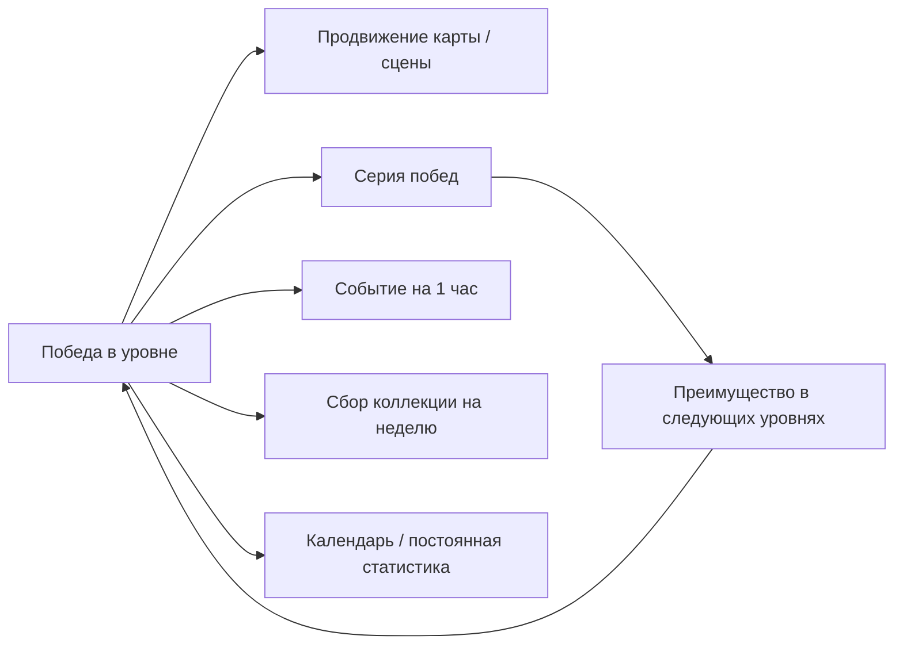
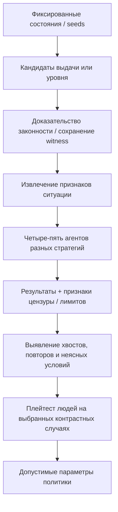
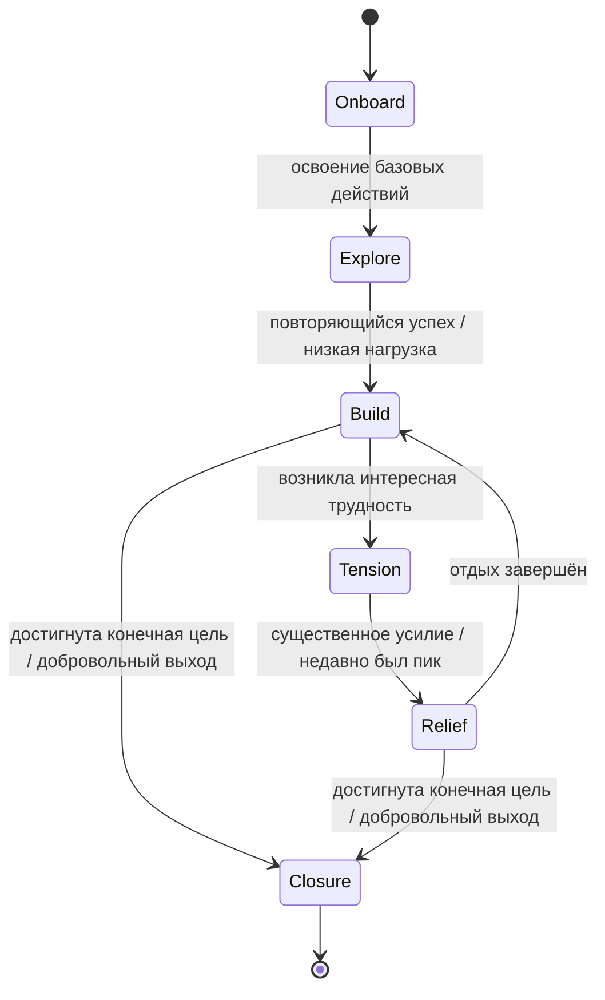

# Скрытая режиссура простых пазлов: reverse engineering игрового опыта

**Исследовательский пакет №2 — 11 ноября 2026 года**  
**Фокус:** Block Blast / блок-пазлы 8×8, Royal Match и Match Villains, Arrows / arrow escape, Water Sort, Number Match, Fill/«Дороги».  
**Назначение:** практическое исследование для небольших мобильных puzzle-проектов, а не готовое ТЗ на внедрение и не инструкция по манипуляции игроками.  
**Связанный документ:** `puzzle-retention-and-adaptive-director-research.md` — базовая теория, Left 4 Dead Director, EA seed selection, DDA, психология и тёмные паттерны. **Этот отчёт дополняет его конкурентной декомпозицией и исследовательскими инструментами, а не переписывает с нуля.**

> **Главный результат:** самые интересные различия между простыми пазлами находятся не в списке механик, а в *политике последовательности*: какой опыт выдаётся в конкретный момент, сколько усилий требуется до следующей понятной цели, какие ресурсы поставлены на кон, кто управляет ходом — человек или система, и что одновременно происходит с мета-целями, рекламой и визуальным откликом.

## Метод и уровень уверенности

Работа основана на четырёх типах свидетельств. Они **не взаимозаменяемы**:

| Маркер | Тип данных | Что позволяют заключить | Чего не позволяют |
|---|---|---|---|
| **[И]** | Исследование с описанным методом/экспериментом | Вывод в изученном жанре, выборке, интервенции | Гарантировать такой же эффект в нашей игре |
| **[О]** | Официальный справочник/карточка/интервью разработчика | Заявленные правила и позицию издателя | Проверить скрытый код, честность тестирования или причинность успеха |
| **[Н]** | Внешний разбор/видео наблюдаемой игры | Порядок увиденных экранов, возможностей и некоторых механик | Восстановить полный алгоритм, всех игроков и текущие версии |
| **[П]** | Наши репозитории/зафиксированные прошлые исследования | Устройство *наших* продуктов и доступные технические границы | Вывести метрики реальных игроков, которых не собирали |
| **[Г]** | Инженерная гипотеза/иллюстрация | Что конкретно проверить или реализовать в прототипе | Притвориться измеренным результатом или особенностью конкурента |

**Что реально сделано в этом пакете:** проверены опубликованные индустриальные и академические материалы, официальные правила и карточки; через подключённый GitHub изучены проектные документы наших блоков, стрелок, сортировки, дорог, семечек и mini-games-kit; результаты сведены в контентные карты, модели взаимодействий и спецификации экспериментов.

**Что не сделано:** приложения конкурентов не устанавливались на телефон, APK не декомпилировались, сетевые запросы не перехватывались, новые серии реальных плейтестов не проведены, первичные видеоролики из Drive повторно не просматривались. Для Arrows использован подробный **уже существующий** технический разбор исходных видеозаписей в пользовательском репозитории. Числа времени/уровней Royal Match — **наблюдения одного аналитика The Experimentation Group** в момент публикации, а не средние по аудитории Dream Games.

**Важно для текущих версий:** игровые обновления меняют порядок открытия контента; приводимые ниже номера — снимки в указанных источниках, не гарантированная схема игры на 11.11.2026. Никаких коэффициентов роста удержания для наших проектов пока не измерено.

---

## 1. Десять выводов, которые меняют техническую стратегию

1. **Block Blast — это не «три случайные фигуры».** Hungry Studio публично описывала свой Block Algorithm как сочетание **почти 100 вложенных подправил**; в отдельном интервью уточнила, что генерация, темп и баланс сложности учитывают **недавние действия игрока и состояние поля**. Это утверждения издателя, не открытая спецификация. Даже если правила просты, их взаимодействия сложнее пары переключателей «легко/трудно» [R03, R03B].
2. **Продуктовая машина может быть важнее одной гениальной механики.** В интервью 2025 года — более 50 A/B-тестов в неделю и около 97% неуспеха; официальное сообщение Hungry за 2025 год утверждает **свыше 10 000 A/B-тестов** и собственный симулятор Block AI. Это разновременные заявления студии, а не независимый аудит. Вывод: секрет может быть в системе отбора вариантов, а не в готовом алгоритме [R01–R03].
3. **Для Block Blast особенно важна форма распределения партий.** Две выдачи с доказанной проходимостью всех трёх фигур могут иметь несравнимую вероятность успеха для реалистичного человека [Г]. Условие «найден хоть один выход» не равно хорошему геймдизайну.
4. **Royal Match в изученном FTUE откладывает настоящую трудность.** Аналитик наблюдал первые 10 уровней по ~47 с в среднем, с первой законченной декорацией примерно за 10 минут; первый помеченный Hard — **уровень 39**, а не 16 [R04].
5. **Match Villains предпочитает раннюю новизну.** К уровню 23 исследователь насчитал семь типов препятствий против четырёх в Royal Match. Препятствия меняют саму последовательность размышления, а не просто число необходимых ходов [R04].
6. **Имеет значение не только число событий, но синхронизация.** В анализируемой Royal Match одна победа продвигает сразу несколько коротких, средних и длинных целей. Это экономит отдельные действия, создаёт несколько смыслов одной победы и одновременно увеличивает цену поражения [R04].
7. **Первое поражение может быть особенно монетизируемым.** По гипотезе TXG, до него одновременно сохраняются преимущества серии и других событий; после него часть ставки уже потеряна. Это аналитическая интерпретация, не опубликованное доказательство внутренней оптимизации Dream Games [R04].
8. **Arrows показывает иной путь: минимальный HUD, но плотная логика состояний.** В имеющихся видеозаписях первая ошибка на *конкретной* заблокированной стрелке стоит сердце, повторная ошибка на ней не списывает повторно; есть свободное первое продолжение, затем rewarded, контекстная подсказка. Лёгкое оформление не означает примитивной системы [R12].
9. **Помогать игроку — не значит играть вместо него.** В публичном отзыве на Amaze GO критикуют автоматическое удаление пачек стрелок: развлечение исчезает, когда пропадает собственный выбор. Это один отзыв, не статистика, но мощная проектная гипотеза об автономии [R10].
10. **Сначала инструменты качества и falsification, потом «умный директор».** Наши «Стрелки» уже отбирают банки по плотности/глубине зависимостей; следующий вопрос — насколько реальные люди считывают решения. Блокам нужен сравнимый offline-bot benchmark; «Дорогам» — модели точек выбора; сортировке — оценка необратимых ошибок. Простая метрика + несколько специализированных агентов предпочтительнее универсальной дорогой модели [R11–R16].

---

## 2. Поле конкурентного сравнения: чем действительно отличаются продукты

| Игра / семейство | Реальное обещание игроку | Основной цикл | Сильный рычаг режиссуры | Мета и цена ошибки | Статус доказательств |
|---|---|---|---|---|---|
| **Block Blast! / Hungry Studio** | «Быстро положить фигуры, очистить линии, улучшить счёт» | Бесконечное поле, тройки фигур, линии и комбо | Выдача и последовательность доступных решений, границы рекордов | Classic/Adventure; детальный скрытый алгоритм не опубликован | [О] интервью, [Н] карточки/анализ, без APK |
| **Локальные 8×8 клоны** (Aimi, Nova, qruqru, Paidot) | Похожий core loop | 8×8 и базовые режимы | Точность drag, читабельность, политика выдачи, ад-паузы | Некоторые заявляют ежедневные задачи, валюту, revive | [П] обзор 39 отзывов; нельзя объявлять клон провалившимся без бизнес-данных |
| **Royal Match** | «Простые победы ради продвижения в сюжете/сценах» | Win level → earn star → decorate → next | Очень плавный FTUE, позднее наслоение целей, экономика | Состязания, серии, ускорители, платный прогресс | [Н] TXG single-playthrough, [О] справка Dream Games |
| **Match Villains** | «Похожий match-3, но неожиданная логика задач» | Match → remove blockers → manipulate special blocker | Быстрая эволюция правил, многофазность уровней | Сценическое пассивное раскрытие; иные событийные правила | [Н] TXG; нет каузального сравнительного теста |
| **Arrows — Puzzle Escape / Lessmore** | «Расцепить красивый плотный узор» | Найти свободную стрелку → нажать → открыть следующую | Размер и форма поля, зависимые пути, случайные ошибки, hint | Сердца, коллекция, daily/трофеи; free→rewarded continue | [П] предыдущий подробный разбор видеозаписей |
| **Amaze GO! / Oakever** | «Спокойно очищать стрелки» | Похожий arrow escape | Плотность и читаемость, подсказки, реакции | Сердца и ads; в отзывах есть критика неконтролируемой сложности | [О] карточка, [Н] единичные отзывы |
| **Water Sort (IEC/SortPuz/Guru)** | «Привести хаос к порядку» | Переливания и открытие буферов | Порядок задач, минимальные ходы, наличие выходов из ошибок | Подсказки/допколбы/темы/разные правила | [П] обзор карточек и 50 отзывов, не плейтест |
| **Road/Fill-пазлы** | «Одним маршрутом заполнить форму» | Выбор ветвей → маршрут → звёзды/награды | Узкие места, глубина планирования, неожиданные ограничения | Наборы, подарки, монеты, темы | [П] наша воспроизводимая 90-задачная кампания |

### Почему не стоит делать рейтинг «успешен / провален» по этим материалам

Публичная карточка, количество загрузок, позитивный отзыв и наличие механики не позволяют измерить retention или прибыль. Разница в количестве установок может быть вызвана рекламным бюджетом, креативами, регионом, продвижением в сторах, age mix, существующим брендом и давностью выхода. Hungry Studio прямо признаёт заметную роль paid UA [R01]. Нужен **matched comparison** по платформе, версии, аудитории, доступности трафика и бизнес-метрике — таких публичных данных почти никогда нет. Поэтому дальше мы исследуем **наблюдаемые отличия опыта**, а не выдаём их за доказанные причины рыночного успеха.

---

## 3. Royal Match: декомпозиция ранней прогрессии и роста ставок

**Источник:** серия публикаций Tom Storr / The Experimentation Group [R04]. Это детальный отраслевой teardown одного наблюдателя, но не исследование всех когорт и не утечка внутренних таблиц Dream Games.

### 3.1 Карта открытия возможностей

| Уровень / фаза | Зафиксированное наблюдение | Зачем это может работать — интерпретация [Г] |
|---|---|---|
| **1–3** | Базовые правила и одна понятная цель декорации | Не заставляет выбирать из пяти несовместимых задач |
| **4** | Grass — новое препятствие | Сначала учит базовым действиям, затем добавляет одно изменение |
| **7** | Pre-level boosters | Сначала освоение без инструментов, затем новая возможность |
| **8** | Royal Hammer | Добавляет тактическую помощь в узнаваемый момент |
| **10** | Завершение первой декорационной сцены | Осязаемое завершение за разумную первую сессию |
| **11** | Cupboard | Следующий класс препятствия после мини-финала |
| **14, 17, 19** | По очереди раскрываются остальные in-level boosters | Игрок узнаёт новые решения, а не сразу огромную панель кнопок |
| **21** | Mailbox | Новизна ещё до сложного уровня |
| **11–22** | По оценке TXG: ~27 blockers в среднем, APS ~1,1 | Закрепление уверенности и скорости |
| **23** | Team Treasure / командное событие | Первая дополнительная цель с неагрессивным горизонтальным сроком |
| **25** | King’s Cup / соревнование | Первое явно сравнительное давление |
| **28** | Book of Treasure / коллекция | Каждый раунд может продвигать больше одной цели |
| **31–32** | Lightning Rush, Butler’s Gift | Короткое временное обязательство и ценность сохранения серии |
| **37** | Royal Pass | Ещё один параллельный контур прогресса |
| **39** | Первое отмеченное Hard; в той же зоне раскрываются мини-игры | Сложность воспринимается на фоне уже сформированной системы целей |

**Детали одного прохождения:** в первых десяти уровнях среднее ~47 секунд на уровень (от ~30 до ~65), и в среднем оставалось ~12 ходов; первая сцена заканчивается примерно за 10 минут. Это **полевой замер аналитика**, не распределение времени пользователей. Порядок открытия функций может отличаться по версии, региону и экспериментальной группе. Нет оснований объявлять «всегда level 39» универсальным контрактом [R04].

### 3.2 Три горизонта FTUE

**Фаза A — 1–10: доказать удовольствие.** Цель конечна, прогресс видно быстро, игрок постоянно действует. У него пока нет опыта, чтобы осмысленно оценить сложную экономику. Первая законченность важнее десяти панелей событий.

**Фаза B — 11–22: закрепить компетентность.** Появляются новые способы решения, но не обязательный жёсткий стоппер. По TXG, Royal Match в этой фазе держит APS около 1,1. Важен не сам магический показатель, а темп «разобрался → успешно применил → увидел новое».

**Фаза C — 23–41: постепенно сделать каждую победу многозначной.** Сначала одна дополнительная цель, затем состязания, коллекция, streak, платная лестница и усложнение уровней. Теперь неудача может затронуть больше одного слоя. В TXG это описано как коммерчески важная связка, но публично неизвестно, какую долю удержания причинно добавляет каждый элемент.

### 3.3 Важная ошибка, которую легко сделать, копируя эту модель

TXG также даёт **общий совет для match-3**: перед концом первой сессии (условно около уровня 16) поставить пик сложности APS примерно 1,6, после серии APS около 1,0–1,2. **Это рекомендация консультанта, а не наблюдение Royal Match!** В том же материале Royal Match, наоборот, описана как игра, удерживающая первый явно помеченный Hard до 39. Смешать эти предложения — значит создать ложный «разбор алгоритма Royal Match» [R04].

### 3.4 Что переносить в маленькую игру, а что нет

- **Переносимо:** одна главная цель до первой завершённой мини-арки; последовательная демонстрация новых возможностей; чёткая точка финала; ритм восстановлений после сложных задач.
- **Не переносить буквально:** десять одновременных ивентов, командную серверную инфраструктуру, battle pass, тяжелую live-ops команду или привязку первой сложности к конкретному номеру. У проекта с 60–120 авторскими задачами это раздует продукт без доказанной отдачи.
- **Проверка:** когда игрок впервые понимает *зачем следующий уровень*, сколько кликов отделяет победу от следующей игровой задачи, заметна ли достигнутая цель без чтения текста, не превращается ли экран награды в задержку.

---

## 4. Match Villains: не труднее, а новее и логически разнообразнее

**Источник:** сравнительные обзоры того же TXG [R04]. Нельзя считать, что к уровню 23 новая игра удерживает лучше: сравнительная кривая D1/D7 не опубликована.

| Момент | Royal Match | Match Villains | Значимое различие |
|---|---|---|---|
| 1–3 | Основа match-3 | Знакомая основа | Обе снижают цену первого понимания |
| **4** | Grass: убрать препятствие | Syrup: нужно **распространять** сироп | Меняется направление задачи: «удалить» против «распространить» |
| **5** | Обычная ранняя система power-ups | Lucky Snitch с возможным двойным эффектом | Новый тип неожиданного события внутри знакомой механики |
| **7** | В основном уже знакомые правила | Violets | Дополнительный тип задачи рано |
| **10** | Safe позднее (в разборе ~41) | Safe требует конкретных цветов | Ранняя смена приоритета выбора цвета |
| **11** | Cupboard | Emerald (аналог Ice, который RM открывает существенно позднее) | Более плотный граф появления препятствий |
| **К 23** | 4 blocker types по исследователю | 7 blocker types | Разница — новизна и богатство взаимодействий, не доказанный uplift |
| Мета-сцена | Декорации могут требовать ручных действий | Пассивное раскрытие сцен и награда | Меньше обязательного кликанья вне головоломки |

**Многофазность.** TXG описывает поздние препятствия Laser (уничтожает power-ups при пересечении), Camera (запирает неиспользованные power-ups), Police (замораживает соседние), Hungry Flower (поглощает рядом). В сочетании с Syrup это задаёт порядок **сначала убрать угрозы для усилителей → затем остальные препятствия → затем распространить сироп**. Истинная интересность возникает из смены *порядка рациональных действий*, а не только добавления цвета и хитов [R04].

**Инженерная гипотеза:** в наших стрелках и сортировке количество механик может быть меньше, если их взаимодействия порождают различимые стратегии. Четыре добре различимые ситуации лучше шестнадцати косметических препятствий, которые не меняют решения. Проверять нужно после реальных попыток, а не количеством тегов в генераторе.

**Контрриск:** высокое разнообразие правил в первые минуты может отталкивать тех, кто пришёл расслабиться. Если эксперимент покажет рост abandon на уроках 4–8, новая механика может быть представлена слишком рано, даже если экспертный аналитик считает её изящной.

---

## 5. Block Blast: главный узел — генерация и обратная связь, а не длинный каталог уровней

### 5.1 Что публично сказано об алгоритме

В материале Gamesforum представитель Hungry Studio заявил, что **Block Algorithm** содержит *почти 100 одновременно взаимодействующих вложенных подправил*, предназначенных для динамического, персонализированного игрового опыта [R03]. **В отдельном интервью тот же издатель конкретизировал сигналы:** подправила управляют генерацией фигур, pacing и балансом сложности на основе **недавних действий игрока и состояния поля** [R03B]. Это наиболее прямое публичное подтверждение *поведенческого* feedback loop из доступных источников, хотя его пороги, формулы и реально используемые персональные атрибуты неизвестны. Отдельно Hungry сообщает о платформе **Block AI**, которая моделирует поведение разных типов игроков и тестирует изменения до релиза [R01–R02]. В официальной публикации 08.01.2026 студия заявила **10 000+ A/B-тестов в 2025 году, свыше 300 параллельных экспериментов каждый день**, а также снижение вероятности проблем игрового опыта после релиза более чем на 50% благодаря симуляции [R02].

**Границы вывода:** не раскрыты правила, параметры, способ идентификации типов игроков, калибровка симулятора, контрольные группы и метрика «проблем»; числа из сообщения издателя не независимая верификация. В 2025 в более раннем интервью говорилось о >50 тестов в неделю — эти две величины относятся к разным периодам/формулировкам и не должны рассматриваться как конфликт или точный темп [R01–R03].

### 5.2 Чему учит это описание без доступа к исходникам

**Неверный вывод:** надо написать сотню if-ов и получить Block Blast.

**Более полезный вывод:** в классике без кампании **последовательность выдач и границы ошибки являются основным контентом**. Игроки в одной и той же геометрии поля могут получать качественно разное приключение без единого нового блока, если отличаются: риски, узнаваемость комбинации, распределение безопасных ходов, шанс восстановиться после жадного решения, полезность подсказки, частота максимальных очищений, вероятность раннего конца.

Сами эти параметры — **наши предлагаемые измерения [Г]**, не расшифровка 100 правил Hungry. Систему нужно описывать через измеряемую **политику выбора кандидата**, а не обещание магического предугадывания желания игрока.

### 5.3 Почему копии 8×8 не равны друг другу

Наш прежний проектный обзор `BLOCK_PUZZLE_COMPETITOR_RESEARCH_2026-10-23.md` [R13] включал Block Blast / Hungry Studio, RuStore-кандидатов Aimi, Nova, qruqru и Paidot, а также Woodoku, Blockudoku, Woodoku Blast. Собрано 39 **целенаправленно выбранных** отзывов: это качественный корпус, не случайная репрезентативная выборка. Из него нельзя вычислить долю недовольных или утверждать, что приложение «мошеннически» подкручивает фигуры.

Важны разные бизнес-контракты продукта:

| Слой | Что пользователь может считать «тем же самым» | Что на деле нужно сравнивать |
|---|---|---|
| Правила | Те же 8×8 и очистка линий | Честная обработка пересечений, drag snapping, вращения/нет, конец игры |
| RNG | Три привычные фигуры | Совместная проходимость, хрупкость, повтор, реакция на занятость поля |
| Интерактивность | «Можно перетащить» | Палец не перекрывает фигуру, touch cancellation, preview, ощущение контакта |
| Игра/результат | Номер счёта и комбо | Предсказуемость причин комбо и визуальное признание крупного действия |
| Help | Подсказка или продолжение | Действительно ли меняет состояние, не уничтожает ли уже заработанную стратегию |
| Реклама | Rewarded / interstitial | На каком шаге, есть ли no-fill, сохраняется ли достигнутое, не перебивает ли серию действий |
| Привлечение | «Тоже block puzzle» | Источник пользователей, правдоподобность ролика, CPI, store conversion и локали |

**Сильное ограничение:** сравнение по одному публичному рейтингу не позволяет назвать проигравшего коммерчески. Компания с лучшим продуктом, но в сто раз меньшим UA может иметь меньше установок.

### 5.4 Как измерять «качество выдачи», не подменяя его лёгкостью

Для фиксированного состояния поля `B` и кандидата тройки `T` определим:

- `placements(B)`: сколько размещений всех доступных фигур возможно сейчас (зависит от списка фигур; геометрически ёмкие позиции не обязательно полезные).
- `triplet_solvable(B,T)`: существует ли полная законная последовательность размещения всех трёх фигур с разрешёнными очистками — **бинарная проверка с отдельным признаком timeout**.
- `first_move_robustness(B,T)`: доля **допустимых первых размещений**, после которых существует завершение тройки. Слабый показатель: считает заведомо бессмысленные действия и не отражает предпочтения человека.
- `plausible_first_robustness(B,T,π)`: то же, но первые ходы взвешены вероятностью выбора ограниченного набора стратегий `π`. Более содержательно, но зависит от качества этих стратегий.
- `regret_gap`: разница между результатом сильного и простого агента за заранее заданный горизонт. Большой gap может означать интересное планирование **или** скрытую ловушку; трактовать только вместе с плейтестом.
- `combo_affordance`: достижимость и визуальная читаемость красивой очистки, а не частота принудительного выдаваемого «фейерверка».
- `novelty`: отличие ситуации от недавно пережитых решений, а не просто отличие RGB клеток.
- `risk_of_stall`: частота ранних проигрышей в rollout ограниченных агентов; отдельно учитывать max-step cutoff и `unknown`.

**Два примера синтетических кандидатов** — числа придуманы исключительно для демонстрации интерпретации:

| Кандидат | Полная тройка решаема | Взвешенная доля первых «безопасных» ходов | Достижимая красивая очистка | Вероятный характер |
|---|---|---:|---|---|
| A | Да | 0,72 | Да, после понятного подготовительного хода | Широкое пространство для ошибки |
| B | Да | 0,18 | Да, но только после одного неочевидного первого хода | Хрупкое решение, потенциальная ловушка |

В обоих случаях `solvable=true`. Но у B адаптивный подбор может ухудшить игру именно потому, что **бот-знаток видит решение, а человек нет**. Дизайнер должен решить, когда уместна хрупкость и насколько её можно объяснить.

---

## 6. Arrows: у минималистичной игры тоже есть сложная режиссура

### 6.1 Воспроизводимая карта по уже записанным видео Lessmore

Источник — наш собственный документ `ARROWS_VIDEO_ANALYSIS_2026-11-08.md` [R12]. Он основан на 5 главных роликах продолжительностью 27:23 (всего 8 роликов ~37:44), обзорной выборке 821 кадров плюс более плотный покадровый анализ сцен. **В этой исследовательской итерации ролики не пересматривались заново.**

| Эпизод в записи | Что видно | Какова функция в темпе [Г] |
|---|---|---|
| Level 1 | Крошечное поле, указание на нажатие | Мгновенный навык без теории |
| Ранние 2–5 | Простые изгибы и освобождение пути | Установить правило «извлеки доступную» |
| **Level 6** | Первое крупное Hard-поле в узнаваемой форме сердца; обучение зуму | Резкая смена масштаба и первый пик, а не просто +1 стрелка |
| После 6 | Возврат к более коротким задачам | Настоящая передышка после пика |
| **Level 10** | Доступна Collection | Вторая цель только после знакомства с полем |
| **Hard 16** | Крупное поле и объяснение направляющих | Контекстное обучение инструменту именно когда нужен |
| **Level 20** | Открывается Challenge и календарь | Возвращение в игру уже имеет независимый ежедневный контур |

**Штраф за ошибку не равен «каждый неверный тап = -1 жизнь».** На записи первая попытка убрать конкретную заблокированную стрелку окрашивает её и списывает сердце; повторные ошибки на той же стрелке не списывают снова. Если убрать препятствия, ранее красная стрелка может быть удалена. При первом наблюдаемом исчерпании сердец доступно бесплатное продолжение; в следующем аналогичном эпизоде — rewarded или Restart. Точный reset-цикл free continue неизвестен [R12].

Подсказка появляется контекстно после периода отсутствия прогресса, затем rewarded и **подсвечивает доступный ход**, не совершая его вместо игрока. Точные секунды появления из текущего источника не установлены. Такой разделённый дизайн сохраняет собственное действие игрока и не требует постоянной панели бустеров.

### 6.2 Конкурирующие arrow-позиционирования

- **Amaze GO! / Oakever [О]:** официальное описание обещает спокойный, почти медитативный процесс без визуального шума; неверный тап снимает сердце, есть guidance по удержанию и hints [R10].
- **Amaze GO! / отзывы [Н]:** отдельные опубликованные сообщения августа–сентября 2026 жалуются на ошибочные срабатывания узких стрелок, рекламу, изменение цены ошибки и автозачистки большого количества стрелок. Это субъективные заявления о разных версиях, не независимая проверка бага или его массовости [R10].
- **Easybrain Arrow Puzzle [О]:** официальная карточка упоминает прогресс и daily-формат; у конкурентов могут совпадать коды правил, но отличаться ощущение поля и объём меты [R17].

**Новый исследовательский тезис:** в стрелках есть минимум три независимые цены ошибки: (1) реальная логическая ошибка, (2) ошибка чтения запутанной геометрии, (3) ошибка попадания пальца. Наказывать их одинаково — сомнительное решение. Игра может быть математически справедлива, но интерфейсно несправедлива.

### 6.3 Контроль с нашим банком Arrows

В нашей версии 0.9 по документу `CONTENT_BANK_V4.md` [R14] перестроены уровни c05–c120. Новые поля заполняют минимум 98% целевых силуэтов, генератор офлайн отбирает 4–24 кандидата и проверяет разные порядки освобождения. Примеры:

| Поле | До ревизии | После ревизии | Ограничение интерпретации |
|---|---|---|---|
| c06 / Hard | занято ~75%; изначально свободных 20/29; depth 6 | ~99,5%; 5/31; depth 10 | Сложнее *структурно*, но ощущения не измерены |
| c20 / Nightmare | ~53,6%; 48/87; depth 9 | ~99,9%; 13/136; depth 30 | Больше логических зависимостей и возможных ошибок считывания |
| c120 / Nightmare | ~45,9%; 35/54; depth 7 | ~99,6%; 10/97; depth 28 | Плотное поле может стать неинтересным, если игрок «ищет пиксель», а не решение |

**Следующий шаг — не ещё сильнее уплотнить силуэты.** Требуется новый вектор оценки: доля видимых на текущем зуме свободных стрелок; контраст наконечника; расстояние между потенциальными touch targets; цена визуальной путаницы; вероятность «случайного успеха» при спаме; скорость первой содержательной очистки. Отдельные человеческие проверки нужны до любых выводов об улучшении retention.

---

## 7. Взаимодействие систем: где рождается неочевидная сила

### 7.1 Один ход обслуживает несколько целей



Такое наслоение не обязано создавать отдельные игровые режимы. Оно повышает **число осмысленных результатов на один и тот же ход**: одна победа одновременно снимает несколько маленьких неопределённостей. В Royal Match TXG наблюдает одновременное действие десяти событий; у маленькой игры это вряд ли рациональная цель [R04].

### 7.2 Цена первого поражения

По интерпретации TXG, **первое поражение после серии** иногда наносит максимальный ущерб: игрок теряет бустер серии, статус события, право на бонус и может испытать потребность сохранить текущую последовательность. Если система предлагает дополнительные ходы, она продаёт спасение не только отдельной партии, но и **нескольких будущих состояний** [R04].

Официальная справка Dream Games подтверждает конкретную подобную механику: Super Light Ball открывается после достижения level 292, требует 10 побед для активации, работает до первого проигрыша, затем требует заново 10 побед [R05]. Но **не следует путать Super Light Ball с Butler’s Gift**, который TXG относит к ранним событиям примерно уровня 32. Они различаются правилами и этапом появления.

С точки зрения добросовестного дизайна здесь есть выбор: сделать stakes значимыми, не вынуждая человека спасаться рекламой. Например, удерживаемые за серию **косметические** награды менее опасны, чем такое усиление, без которого следующий уровень специально становится мучительным.

### 7.3 Отличать «сделал победу ценнее» от «сделал поражение выгоднее разработчику»

| Система | Польза, если выполнено честно | Где превращается в тёмный паттерн | Что измерять |
|---|---|---|---|
| Win streak | Признаёт последовательные успешные попытки | Искусственные проигрыши ради рекламы или покупки сохранения серии | Серии, жалобы на несправедливость, отказы от продолжения |
| Daily | Даёт конечную ежедневную цель | Невозможность восстановить жизнь/награду после пропуска без предупреждения | Возвращение и недобровольный churn после пропуска |
| Boosters | Расширяют выбор при сложности | Ухудшение исходной игры после знакомства с усилением | Доля побед без бустера, жалобы, повторные попытки |
| Revive | Сохраняет вложенное время | Реклама оплачена, но возвращает в безвыходный тупик | Реальная вероятность продолжить после revive |
| Timed event | Новая конечная цель | Таймеры скрыто продлеваются, завершённые цели двигаются | Доверие к дедлайнам, завершённые события |
| Adaptive difficulty | Убирает скуку и несправедливые тупики | Калибровка под рекламу/платежи без интереса игрока | Различия опыта между ad/no-ad группами |

**Принцип для своего портфеля:** игровые правила и вероятность честного решения не должны ухудшаться из-за того, что игрок смотрел rewarded, отказывался от rewarded или давно не платил. Просмотр рекламы — транзакция выдачи помощи, не входной сигнал генератора тяжёлых ситуаций.

### 7.4 Зачем удачным играм нужно несколько долгосрочных ритмов

Предлагаемая система минимальных горизонтов для наших пазлов [Г]:

| Горизонт | Игрок должен увидеть | Пример дешёвой реализации | Когда показать |
|---|---|---|---|
| 5–30 секунд | Микроуспех или читаемую причину неуспеха | Очистка, освобождение стрелки, связка переливаний | Во время gameplay, без отдельного экрана |
| 2–8 минут | Законченное игровое задание | Мини-кластер уровней или достижимая цель | После нескольких побед |
| 1–3 сессии | Удерживаемый прогресс | Карточка коллекции, глава, рекорд попыток | По завершении важного этапа |
| 1–7 дней | Понятный повод вернуться | Daily archive, месячная цель, недельная коллекция | После доказанной ценности core loop |

Здесь **нет утверждения**, что каждую шкалу следует внедрять, и нет универсального времени для жанра. Модель предназначена для отбора, какие уровни смысла уже существуют и не дублируют друг друга.

---

## 8. Почему APS — полезный, но опасный показатель

`APS = число попыток / число успешных завершений` за определённую группу, уровень и окно. Значение ~1,0 соответствует почти безошибочному прохождению *среди тех, кто завершил*, но если мы исключаем ушедших после неуспеха, статистика систематически приукрашена. Нельзя сравнивать APS двух игр без определения «попытки» (restart после ухода, revive, replay, пропуски) и работы с цензурированными данными.

**Иллюстративный контраст TXG:** две задачи с одинаковым медианным APS ~1,8 могут иметь узкий и широкий разброс; вторая может быть трудной для отдельной группы из-за непонятного правила, а не «интересного вызова». Числа 1,7/1,8/1,9 против 1,6/1,8/2,8 в статье — **учебные примеры**, не опубликованная статистика конкретного Royal Match level [R04].

**Критическая оговорка:** TXG иногда называет «хорошими» уровни с высоким spend. Это не критерий удовольствия. Если задача хорошо продаёт бустеры из-за плохой читаемости, увеличившийся ARPDAU не подтверждает качество геймплея.

Для нашей аналитики необходимо рядом с APS показывать:

- `win_on_first_attempt` и `fail_to_retry` по каждой задаче;
- долю игроков, **не завершивших** уровень к концу окна; количество попыток с учётом незавершённых;
- `time_to_first_legal_action`, `time_to_first_meaningful_progress`;
- `error_type` — геометрия, неверное понимание правил, ошибочный ввод, отсутствие решения;
- разброс результатов внутри когорты и **по правилам/формам задач**, а не только по уровню;
- контрольный показатель собственных действий игрока после помощи: подсказка показала ход или сыграла его за игрока.

Не следует сравнивать bots и людей по минутам: скорость симуляции — вычислительная, не человеческая. Для ботов правильнее измерять **принятые ходы, число решений, риск тупика и форму переходов**.


---

## 9. Практическая архитектура: сначала лаборатория игровых ситуаций, потом director

Цель: **проверить, что конкретная политика улучшает распределение игрового опыта**, а не внедрить «AI» как маркетинговую фичу. У нас нет данных миллионов игроков, зато есть чистые игровые правила, генераторы с seed и возможность воспроизводимых симуляций.

### 9.1 Контур offline-проверки



**Обязательно разделить три сущности:**

1. `RulesOracle` — проверяет только игровую законность (не знает про рекламу, UX и «нужную» продолжительность).
2. `QualityEvaluator` — оценивает кандидатов. Его score не должен сам менять игровое состояние.
3. `Policy` — выбирает из допустимых кандидатов. Именно она является объектом сравнения и версионирования.

Если поиск достиг лимита, результат `unknown`, а не `false`: это важное требование уже закреплено в наших документах для блоков [R22].

### 9.2 Минимальные искусственные игроки

| Агент | Решение | Что обнаруживает | В чём ошибается сам агент |
|---|---|---|---|
| **GreedyClear** | Максимизирует немедленно очищаемые клетки | Поощряется ли интуитивный ход | Игнорирует будущие проблемы |
| **SpaceKeeper** | Сохраняет крупные свободные области и размещаемость каталога | Применимость «разумной осторожности» | Не всегда понимает выгодную временную жертву |
| **ShortLookahead** | Перебирает следующие 2–3 решения в фиксированном бюджете | Требование планировать и опасные развилки | Может переоценивать будущие случайные выдачи |
| **NoisyHumanProxy** | Не всегда выбирает лучший ход; с заданным шумом предпочитает визуально очевидные | Хрупкость к непрофессиональным действиям | **Не является моделью реального человека**, пока не проверен на плейтестах |
| **RandomLegal** | Выбирает случайное допустимое действие | Чистый «пол» сложности и ловушки | Совершает бессмысленные ходы; никогда не считать его средним игроком |

У агента не должно быть недоступного игроку знания о будущих случайных тройках. Если для перебора используются конкретные seeds будущего, это отдельный агент `OracleFuture`, **только диагностический верхний предел**, не модель пользователя.

Для Arrows, Water Sort и Fill нужно реализовать не только имена этих стратегий, но и **разные игровые эвристики** (ниже). Грубый общий `heuristicScore` на все жанры получится красивой, но обманчивой абстракцией.

### 9.3 Схема прогонов

```ts
// Псевдо-TypeScript. Это спецификация поведения, не готовый модуль.
for (const puzzleSeed of fixedEvaluationSeeds) {
  for (const policyVersion of ["baseline-v1", "quality-v1"]) {
    for (const agent of agents) {
      const results = runManyEpisodes({
        puzzleSeed,
        policyVersion,
        agentVersion: agent.version,
        maxTurns: TURN_CAP,
        maxNodesPerDecision: NODE_CAP,
        wallClockCapMs: OFFLINE_CAP,
      });
      // Ни «не нашёл» ≠ «нет решения», ни «достиг turn cap» ≠ «победа».
      store(results);  // completed | lost | timeout | censored | invalid
    }
  }
}
```

**Нужен единый seed-лист** для политик, иначе случайность маскирует различия. Для кандидатов с разным количеством вызовов RNG фиксировать отдельные под-потоки (или precomputed candidate pool), чтобы сравнение было честным. Возврат от `runManyEpisodes` должен включать `policy_version`, `content_version`, `rules_version`, `agent_version`, границы поиска и `seed`.

**Метрики распределения, не только средние:** медиана, p10/p90 ходов до проигрыша, доля сверхдлинных партий, доля падений за первые N выдач, число повторных «одноходовых» очисток, количество необратимых тупиков, стоимость подсказки, недоступность продолжения. Всё — **по состоянию и сегменту стратегии**, а не как один рейтинг «умная политика победила».

### 9.4 Как калибровать на людях без фальшивой статистики

Небольшой плейтест из 5–10 человек *не даёт точной оценки retention*. Он способен найти ошибки модели: например, бот считает ход очевидным, а люди вообще не замечают фигуру; или GreedyClear выживает отлично, а игроку скучно повторять одну операцию. Использовать контрастные заранее выбранные ситуации и записывать:

- что человек хотел сделать и почему (короткий think-aloud **после**, если разговор отвлекает);
- какая часть поля непонятна;
- что он считал «нечестной» смертью;
- когда возникало желание самостоятельно попробовать ещё;
- какие эффекты помогли ориентироваться, а какие только задерживали;
- при необходимости видео касаний с отдельным разрешением пользователя.

До реальной аналитики **не делать выводов** вида «бот показал +17% удержания».

---

## 10. Puzzle Director v0: управлять последовательностью, а не назначать исход

### 10.1 Состояния ритма



Это **предложение**, а не устройство L4D или Block Blast. `Closure` — важное отличие от бесконечного максимизатора времени: разрешить человеку закончить с приятным ощущением и сохранить понятную следующую цель.

**Не надо вычислять «эмоции» из одного числа.** В v0 достаточно трёх независимых групп наблюдений:

- **нагрузка**: хрупкость, длительность тупика, доступность значимых ходов, серия попыток;
- **новизна**: как давно были похожая структура/способ решения/возможность комбо;
- **готовность завершить**: достигнутая цель, истекла ожидаемая короткая сессия, явная пауза/выход пользователя.

Директор выбирает тип *следующей* ситуации, а не незаметно меняет исход текущего математически фиксированного пазла.

### 10.2 Safety policy прежде любого scoring

1. Не подменять уже показанное поле, правила и инварианты сохранённой попытки.
2. Сохранять доказательство решения и честный RNG/seed; не врать о почти-победе.
3. Не ухудшать сложность по ad-view, IAP, отказу от рекламы или исходу коммерческого предложения.
4. Не наказывать за длительный выход/паузу; отсутствие активности может означать отвлечение.
5. Ограничить частоту смены политик (`min_episode_length`, hysteresis), не «дёргать» сложность каждый ход.
6. На timeout/ошибку evaluator переключаться на известную **валидную** и детерминированную fallback-политику; фиксировать это в диагностике.
7. Для общих ежедневных задач/таблиц рекордов — фиксированная постановка. Сравнимость и честность важнее скрытой помощи.
8. Игровое состояние должно сохраняться независимо от анимации, рекламы, сети и оценочного модуля.

### 10.3 Контракт политики выдачи блоков

```ts
// Концептуальные типы — не производственный API.
type Beat = "explore" | "build" | "tension" | "relief";

type CandidateEvaluation = {
  seed: string;
  pieces: ReadonlyArray<ShapeId>;
  proof: "solvable" | "unsolvable" | "unknown";
  firstMoveRobustness: number | null;
  plausibleRobustness: number | null;
  comboAffordance: number;
  novelty: number;
  pressure: number;
  regretGap: number | null;
  searchNodes: number;
  truncated: boolean;
};

type SelectionContext = {
  beat: Beat;
  lastEpisodes: ReadonlyArray<DiagnosticSummary>;
  rulesVersion: string;
  sessionSeed: string;
  // Намеренно НЕТ adViews, revenue, paymentHistory.
};

function selectCandidate(ctx: SelectionContext, candidates: CandidateEvaluation[]) {
  const eligible = candidates.filter(c => c.proof === "solvable");
  // В fallback можно использовать только заранее проверенную генерацию.
  if (eligible.length === 0) return deterministicSafeFallback(ctx);

  const scored = eligible.map(c => ({
    ...c,
    utility:
      beatUtility(ctx.beat, c.pressure, c.plausibleRobustness) +
      noveltyWeight(ctx) * c.novelty +
      comboWeight(ctx.beat) * c.comboAffordance -
      fragileTrapPenalty(c) -
      repetitionPenalty(ctx.lastEpisodes, c),
  }));

  // Ограниченная стохастика, фиксируемая seed: не выбирать всегда один и тот же «лучший» шаблон.
  return seededSampleFromTopK(scored, ctx.sessionSeed);
}
```

`beatUtility` не должен означать «чем больше давление, тем лучше». Например, **в relief** можно предпочесть *умеренно доступную комбинацию*, а **в tension** — достаточно широкую, но требующую планирования. В этой версии мы **не оптимизируем ожидаемую длину сессии напрямую**: такой objective способен наградить бесконечное топтание на месте.

### 10.4 Политика переключения режима: защищаться от самообмана

```text
Если игрок три выдачи подряд не делает значимого прогресса,
  не объявлять автоматически «игрок слабый»;
  проверить: был ли слишком узкий коридор решений, технический input error, пауза.
Если несколько выдач подряд проходят без нового типа решения,
  повышать новизну структуры до повышения сложности.
Если после тяжелого эпизода была красивая очистка,
  дать ей завершиться и не перекрыть следующими бустерами/рекламой.
Если игрок достиг объявленной цели,
  показать реальный итог и дать ясную точку остановки.
```

**Защита от эндогенности:** когда политика дала облегчение, последующая победа не является автоматически свидетельством роста навыка. Логировать, под какой политикой получено наблюдение. При оценке навыка учитывать только сопоставимые ситуации и не менять сегмент по одной победе.

### 10.5 Не использовать «предсказание ухода» как безусловный триггер

Люди с высокой оценкой риска ухода не обязательно те, кому конкретное вмешательство принесёт пользу. Принцип — оценивать **разницу** между потенциальными исходами с помощью и без неё. В маленькой игре это начинается с простого A/B по заранее определённой гипотезе и запрета менять одновременно всё. Нет достаточных данных — оставляем контрольный режим.

---

## 11. Жанровые реализации: что менять в наших конкретных играх

### 11.1 Блоки 8×8 — приоритет №1 для director

Наш опубликованный план предусматривает две ранние политики: **«помещается хотя бы одна фигура»** и **«вся тройка имеет доказанный путь»**, сравнение на одинаковых seeds и минимум 1000 симуляций на каждую из комбинаций 2 политик × 2 стратегий; затем 5 людей × 3 попытки на политику. Это проектный план от 23 октября, **не отчёт о выполненных симуляциях** [R22].

Предлагаемое расширение без переделки игры:

| Инструмент | Данные | Инженерная ценность | Стартовый приоритет |
|---|---|---|---|
| Банк из 100–300 «трудных для оценщика» полей | Seed + сериализованное поле + каталог фигур | Регрессии и сравнимые кандидаты | P0 |
| Поиск полного размещения тройки | Witness или `unknown` | Отсечь нечестные выдачи | P0 — в плане уже есть |
| 3–4 эвристических агента | Ходы/очистки/проигрыши | Найти крайние случаи слабой политики | P0 |
| Хрупкость правдоподобных ходов | Распределение первых действий | Диагностировать скрытые ловушки | P1 |
| Detector повторяющихся «бесплатных» очисток | История форм и исходов | Против бесконечного скучного успеха | P1 |
| Переключение фаз Build/Relief | Недавние diagnostic flags | Плавная кривая, а не качели | P2 после тестов |
| Персонализация под конкретный аккаунт | Сопоставимые эпизоды нескольких сессий | Гипотеза, требует telemetry/калибровки | HOLD |

**Особый риск нашего проекта:** если policy гарантирует «на каждую тройку существует решение», но систематически даёт нужную комбо-структуру, игрок перестанет принимать стратегические решения. Это уже появлялось как претензия к некоторым клонам в нашем обзоре отзывов, однако конкретные алгоритмы конкурентов не подтверждены [R13]. Поэтому нужен негативный сигнал **`repeated_trivial_combo_rate`**, а не только число достигнутых рекордов.

**Особый риск реализации:** evaluator должен жить за пределами горячего рендера/gesture path. В кандидатах — ограничение nodes, deadline внутри дорогих операций, кеш по ключам состояний, Worker и cancel по `gameId/revision`; все эти базовые контракты уже отражены в DECISIONS [R22].

### 11.2 Arrows — выбирать следующие поля, а не тайно менять текущее

В нашем `CONTENT_BANK_V4.md` сильная база **структурного** отбора уже есть: заполнение силуэта, начальная доля свободных стрелок, длина цепочек, число изгибов, воспроизводимость seeds [R14]. Дополнительные диагностики:

- `first_valid_action_visibility`: сколько доступных стрелок реально различимы при стартовом зуме, а не только по правилам;
- `near_target_overlap`: число тесных соседних наконечников, которые особенно легко задеть неверно;
- `unlock_cascade_depth`: сколько предстоящих легальных ходов становится доступно после удачного выбора;
- `hard_thought_vs_hard_touch`: отличить логически сложное поле от неудобного для пальца;
- `surface_readability`: число пересечений, вынуждающих постоянный зум/пан, доля поля вне кадра;
- `unforced_failure_proxy`: сколько ошибок совершает ограниченный noisy-агент до первой значимой очистки.

**Рекомендация:** не внедрять перетасовку открытого уровня. Если нужны adaptive элементы, применять их при выборе *следующей* фиксированной задачи или при явном запросе подсказки. Отдельные deterministic daily не персонализировать — иначе нарушится справедливое сравнение прогресса и результатов.

**Отдельный UX-тест:** если человек физически коснулся соседней стрелки, штраф за такую ошибку нельзя считать честным показателем навыка. Требуются реальный телефон, экранная запись и тест при разных размерах поля. Автотест на точную геометрию не заменяет это.

### 11.3 Water Sort — основная сложность не число цветов

Наш прежний обзор [R15] перечислял 8 конкурентов и 50 выбранных отзывов; реальные APK не запускались. В собственном проекте уже есть разнообразные правила (слои с памятью, замороженные/большие колбы, буфер, бесплатные/платные инструменты) согласно README. Для следующих исследований важнее **стоимость отката и количество тупиков**, чем случайная перестановка цветов.

Рекомендуемые диагностические признаки:

| Признак | Как считать | Что проверяет |
|---|---|---|
| `min_solution_moves` | Bounded optimal solver (если удалось доказать) | Минимальный путь, но не привлекательность |
| `solution_count_estimate` | Сэмплирование, обязательно помечать как оценку | Может ли игрок свободно импровизировать |
| `false_progress_rate` | Доля правдоподобных переливаний, ведущих к заметному ухудшению | Ловушки «вроде сортирую, а стало хуже» |
| `undo_burden` | Число отмен до возврата к решаемому состоянию | Цена эксперимента |
| `buffer_pressure` | Занятость временных колб в ходе решения | Узкие места и планирование |
| `rule_visibility` | Требуемое число скрытых раскрытий/объяснений | Не становится ли «трудность» проблемой информирования |

Для Water Sort особенно опасен директор, который меняет задачу после рестарта: человек больше не сможет использовать знания о прошлой попытке. Лучше выбирать отобранный следующий seed между уровнями и сохранять полный active state. Если помощь выдала колбу, нужен реальный путь восстановления, а не маркетинговая кнопка.

### 11.4 Road Lines / Fill — не путать количество клеток с количеством решений

Наш банк 90 задач строился офлайн из 955 попыток генерации; для каждого уровня сохранено доказанное допустимое решение, множество масок, правила «стены/номера/финиш». Технические отчёты прямо предупреждают: число клеток и оценка ветвления — **не измерение человеческой трудности** [R16].

Более полезные признаки:

- число *содержательных развилок*, на которых игрок реально может выбрать разные продолжения;
- длина самого длинного участка вынужденных ходов без выбора;
- сколько ходов игрок делает до обнаружения ошибки (длина «ложной перспективной ветки»);
- дистанция до обратимого состояния после неверного поворота;
- насколько подсказка оставляет игроку возможность самостоятельно закончить;
- отсутствие «пустой видимой сложности», когда уровень большой, но весь путь почти вынужден.

Для 90 фиксированных полей разумнее отобрать **ручную кривую сложности и контрастные передышки**, чем строить runtime-директор. Сохранять последовательность уровней и прогресс совместимо с уже принятой архитектурой.

### 11.5 «Семечки» / Number Match — основной риск: огромный объём и непрозрачный прогресс

В репозитории `seeds-bits` описаны 100 тетрадей / 2400 проверенных задач, ежедневный архив, общий баланс подсказок и сохранение частично решённых полей [R18]. Для этой игры автоматизированный анализ может проверять:

- как быстро игрок видит первую легальную пару, не прокручивая огромный список;
- число действий без видимого сокращения задачи;
- цена добавления нового ряда и возможные долгие состояния;
- сколько подсказка раскрывает **информации**, а не просто «даёт ход»;
- получает ли игрок достаточно заметных промежуточных закрытий в длинной тетради.

Но именно в Number Match вмешательства должны быть аккуратными: динамическая подмена числа/пары внутри начатой задачи разрушит доверие к задаче. Лучше работать с обзором, подсветкой, честной подсказкой и выбором следующей нагрузки.

### 11.6 Не заводить один тяжёлый `UniversalPuzzleDirector` в mini-games-kit

`mini-games-kit` уже содержит правильные общие узлы: seed RNG, календарь/streak, hint budget, tier progress, сохранения с версиями и durable receipts, реакция на ввод/звук, мобильный lifecycle [R17]. Он **не является нейросетевым игровым движком** и сам декларирует отказ от накопления ненужной универсальной архитектуры.

На уровне kit разумно переиспользовать только проверенные контракты:

```text
RandomSource       -> воспроизводимость
EvaluationReport   -> совместимый формат диагностики (когда появятся два потребителя)
PolicyVersion      -> метки для сравнения вариантов (часть игрового контента)
GameEvent          -> контекстная телеметрия без привязки к SDK
SafeFallback       -> контракт результата timeout и предыдущего состояния
DurableReceipts    -> награды после рекламы (уже присутствуют)
```

А **оценки хрупкости, границы решений, A/B-политика, модель оплаты и выбор уровня должны остаться в конкретной игре** до повторного успешного использования. Не переносить гипотезу в kit только потому, что её легко абстрагировать.

---

## 12. Game feel и peak-end: второй директор, который не меняет вероятность победы

Один из самых дешёвых путей улучшить качество опыта — **изменить интерпретацию действия, а не игровую математику**. Особенно это важно для пазлов, где первые секунды часто определяют впечатление.

### 12.1 Опасность «больше частиц = больше удержание»

В исследовании Kao, *The effects of juiciness in an action RPG*, участники (N=3018) играли в четыре версии одной action RPG с нулевой, умеренной, высокой и чрезмерной насыщенностью эффектами. Нулевая и чрезмерная версии показали худшие результаты по времени, опыту и мотивации относительно умеренной/высокой [R07]. Это **другой жанр**, поэтому переносить проценты в mobile puzzle нельзя.

В нашей ситуации корректная гипотеза — **иерархия значимости**:

| Событие | Какой feedback нужен | Чего избегать |
|---|---|---|
| Касание/drag | Немедленный звук/визуальная реакция и непрерывный preview | Задержка из-за частиц, анимация поверх пальца |
| Корректный обычный ход | Короткий контакт, ясный результат | Полноэкранное празднование после каждого действия |
| Появилась возможность комбо | Читаемый сигнал «что я сейчас открыл» | Открытие случайно, игрок не понял почему |
| Большая очистка/серия | Более мощный звук/сбор результата, уникальный акцент | Постоянное давление при каждом касании |
| Проигрыш | Честное объяснение и понятный следующий выбор | Ложное «почти победил», внезапная рекламная ловушка |
| Конец крупной цели | Короткая завершённая сцена, понятное дальнейшее направление | Экран невозможно пропустить, цель сразу заменяют новой |

### 12.2 Peak-end: не «делать конец всегда лёгким»

Исследование Gutwin и коллег на CHI 2016 изучало разные последовательности объективно сопоставимых игровых событий. **Восприятие сложности задним числом** заметно зависело от ярких и последних моментов; эффекты на удовольствие и желание повторить были неоднородными [R08]. Отсюда полезная инженерная гипотеза: *что игрок вспомнит о своей последней попытке*, может определяться не только средней трудностью, но и финальным завершением.

Это **не разрешение тайно менять уже начатый уровень**, выдавать фальшивые победы или устраивать принудительный «последний взрыв». Хорошая реализация: после честной сложной задачи итог показывает значимые действия, закрепляет достижение и не лишает контроля. После проигрыша важно иметь понятное, быстое действие — переиграть, выйти, использовать необязательную помощь.

### 12.3 Эксперимент без изменения сложности

Сравнить A/B на **одинаковых** уровнях и seeds:

- **A:** базовый результат/переход, без задержек и специальных акцентов;
- **B:** акценты только для значимых событий, ясно показанная причина крупной очистки, мгновенная возможность Continue/Skip;
- **Guardrails:** не увеличивать обязательное время до следующего интерактивного действия, поддерживать reduced motion, отсутствие потери входящих касаний, отсутствие блокирующей рекламы во время окончания анимации;
- **Outcomes:** доля немедленного replay/Next, время до первого действия в следующей задаче, субъективная оценка контроля/ясности, длительность удовлетворённой сессии и будущий возврат.

Такой эксперимент может быть дешевле и безопаснее, чем вмешательство в математическую честность выдачи.

---

## 13. Первый 20-минутный опыт: протокол настоящего сравнительного плейтеста

В этом отчёте нет записи новых первых 20 минут каждого APK. Ниже — **законченная исследовательская спецификация**, чтобы следующий плейтест дал сравнимые, а не эмоциональные результаты. Для Royal Match и Match Villains часть карты восстановлена по TXG; для Arrows — по имеющемуся видео. Для остальных оставлены чётко обозначенные неизвестные. **Не следует выдавать спецификацию будущего измерения за уже проведённый замер.**

### 13.1 Как записывать

На каждом конкуренте:

1. Зафиксировать точную сборку, OS, экран, регион/локаль, offline/online, результат consent и дату.
2. Запустить с чистых данных, записать непрерывное видео первых 20 минут **с включённым звуком**, если разрешено; отдельно пометить всплывшую рекламу и её реальную длительность.
3. Не пропускать экранные подсказки до фиксации времени. Не читать внешние гайды во время попытки.
4. Каждому событию назначить один тип: `CORE_ACTION`, `NEW_RULE`, `FIRST_WIN`, `FIRST_LOSS`, `HELP_OFFER`, `META_UNLOCK`, `GOAL_COMPLETE`, `AD_SHOW`, `PAUSE`, `ABANDON`, `RECOVERY`.
5. Фиксировать *время от появления до первого осмысленного действия*, не просто «уровень длился 50 секунд».
6. Для действий отмечать `forced`/`optional`, `player_controlled`/`auto_played`, `clear_consequence`/`opaque`.
7. Сделать отдельный **second-session replay**, чтобы увидеть, появился ли правдивый повод вернуться и не изменилось ли поведение рекламы.
8. Проверить ещё одного пользователя/seed/устройство для отделения фиксированного scripted-поведения от случайной версии.

### 13.2 Формат сравнения двух игр

| Измерение | Royal Match [Н] | Match Villains [Н] | Arrows Lessmore [П] | Сравнительная интерпретация |
|---|---|---|---|---|
| Первое «я понял» | Почти сразу, простая цель | Знакомый match-3 1–3 | Нажать свободную стрелку на маленьком поле | Разный навык, поэтому минуты непосредственно не сравниваются |
| Первая изменившая правила вещь | Grass на 4 | Syrup на 4 | Усложнение изгибов и цепочек в ранних уровнях | Есть ли новая стратегия или только новая картинка |
| Первый законченный внешний этап | Сцена к 10 (~10 мин в одном опыте) | Пассивные сцены; точное время не измерено | Collection к 10, но это не обязательно «конец» | Сам факт unlock ≠ завершённая цель |
| Первый тяжёлый момент | Hard label на 39 в обзоре | Порядок сложных уровней не восстановлен | Hard на 6 и далее более короткие задачи | Важно чередование нагрузки и новизны |
| Первое событие возврата | Team на 23 | Ивенты доступны к ~23 по анализу | Daily Challenge на 20 | Пользователю уже доказана ценность core loop? |
| Первое поражение/помощь | Конкретная первая потеря в данных TXG не дана | Не измерено | Первая ошибка по стрелке; free, затем video в одном эпизоде | Не придумывать отсутствующие моменты |
| Реклама | В разборах упомянута коммерческая система, не полный ad trace | Нет сопоставимого ad trace | Rewarded hint/lives + interstitial после победы наблюдались | Требуется новый последовательный замер |

### 13.3 Что считать «плохим FTUE» по делу

Не «мне кажется скучно», а наблюдаемые условия [Г]:

- 90 секунд без принятого самостоятельного решения после объяснения;
- два последовательных обучающих окна, которые закрывают поле и не требуют реального игрового действия;
- первая поражающая механика появилась **до** того, как игрок получил информацию о правиле;
- цель экрана 1 не имеет видимой связи с причиной перехода на экран 2;
- человек нажимает `Next` и получает несколько принудительных служебных экранов до игры;
- сильная визуальная награда не совпадает во времени с её причиной;
- предложение rewarded появляется там, где игрок ещё не понимает *какую проблему* решает;
- игра объявляет «почти победу» без доступного настоящего решения.

Эти пороги — **ориентиры для QA и гипотезы**, не валидированные психологические границы.

---

## 14. Монетизация, привлечение и ложные сигналы успеха

### 14.1 Почему победитель не определяется одним retention-краном

Публичные рассказы Hungry [R01–R03] одновременно говорят про алгоритм, симуляции, бесконечные A/B-тесты **и** заметную роль платного привлечения игроков. Предполагать, что без большой UA-инфраструктуры наша копия автоматически будет повторять коммерческую траекторию, нельзя.

В данных AppsFlyer издательская аналитика отмечает, что существенная доля IAP revenue casual приходится на платно привлечённых пользователей: **61% — доля IAP-выручки casual от paid installs в рассматриваемом отчёте, а не доля установок**. Этот показатель сильно отличается между регионами (например, LATAM — 37%), поэтому его нельзя механически переносить на RuStore [R20]. В игре с преимущественно рекламной монетизацией этот показатель не описывает наш бизнес-кейс.

AppMagic в отчёте Mobile Market Landscape 2026 показывает заметный рост определённых подкатегорий Puzzle/Sort в 2025 по сравнению с 2024 [R19]. Там используются **оценки рыночного размера и IAP revenue**, а не полные рекламные доходы каждого приложения. Нельзя подменять рост рынка выводом о достижимом органическом спросе нового российского Android-приложения.

### 14.2 Куда поставить рекламный вопрос

**Неверно:** «интерстициал каждые 60 секунд, значит LTV растёт».

**Корректнее:** оптимизировать именно качественный момент завершения, доступность паузы и последующий возврат, учитывая торговлю между рекламным доходом текущей сессии и будущим удержанием. Исследование 21 мобильной игры показало, что поведение сильно зависит от конкретной игры; универсальная оценка эффекта рекламы ненадёжна [R21].

Рекламный journey надо рассматривать отдельно:

```text
opportunity (можно показать)
    -> eligibility (не во время активной попытки/анимации)
    -> request
    -> filled / no-fill / error
    -> displayed
    -> dismissed / reward callback
    -> durable benefit applied
    -> return to playable state
    -> next voluntarily started session
```

Промежуточный `reward callback` не должен считаться завершённым «успешным событием», пока право не сохранено и реально не применено. В наших project docs/mini-games-kit как раз есть контракты receipt durability [R17, R22].

### 14.3 Показательно, но не напрямую переносимо: долгосрочная оптимизация рекламы

Работа 2026 года *Adaptive Design for In-App Advertising Games* описывает управление сложностью для rewarded-puzzle с учётом долгосрочных рекламных исходов. Авторы сообщают о двух полевых экспериментах с приростом rewarded просмотров примерно 19,23% и 13,58% [R22A]. Это не доказательство, что нам следует искусственно создавать фрустрацию, и не измерение увеличения «счастья» пользователя: **objective исследователей — монетизационная метрика**, а производственная пригодность зависит от контекста.

В наших проектах полезнее начать с прозрачной метрики «показанная помощь действительно позволила продолжить» и проверить, не падают ли добровольные повторные сессии после частой рекламы.

---

## 15. План экспериментов: проверяем гипотезы, а не покупаем сложность

### 15.1 Приоритеты по ценности для небольшого портфеля

| Приоритет | Гипотеза | Предлагаемый тест | Что может опровергнуть | Цена |
|---|---|---|---|---|
| **P0** | Слабая выдача блоков создаёт избыток ранних неожиданных проигрышей | Сравнить две существующие политики и несколько агентов на фиксированных seeds | Разницы в хвостах нет; люди предпочитают более случайную | Низкая–средняя |
| **P0** | Существующий Arrows bank сложен структурно, но может быть труден для **чтения** | 10–20 контрастных полей: время первого легального тапа, ошибки касания, обзор | Люди уверенно читают почти все поля, ошибки логические | Низкая |
| **P0** | FTUE потерял ритм из-за служебных экранов | Запись первых 20 минут 2–4 сравнимых игр и своего билда, timestamp trace | Время между играми и ясность целей уже лучше аналогов | Низкая |
| **P1** | Графика не всегда информирует о смысле победы | Одинаковые правила/seed: baseline vs иерархия значимых feedback | Красивее, но не понятнее/нет replay uplift | Средняя |
| **P1** | Повторяющиеся безопасные комбо создают длинные, но скучные партии | Оценка повторяемости, контрпример в ручном плейтесте | Длинные серии воспринимаются приятно, без скуки | Средняя |
| **P1** | Понятная цель на ближайшие 5 минут лучше раннего обилия наград | Измерить ясность цели и voluntary_next, затем A/B одной мета-цели | Люди заходят только ради core loop, цель мешает | Средняя |
| **P1** | Неразличимые touch targets в Arrows создают воспринимаемую несправедливость | Реальные устройства 320–430dp, фиксация mis-tap и жалоб | Почти все ошибки — осознанный выбор неверной стрелки | Низкая–средняя |
| **P2** | Состояние Build/Relief помогает блокам избегать крайних партий | Отдельная policy после P0, без изменений рекламе | Хвосты ухудшаются; игроки замечают «подкрутку» | Средняя |
| **P2** | Следующая цель под формат сессии полезнее одинакового daily для всех | A/B выбора короткой/длинной задачи (без персональных классификаторов) | Никакого прироста добровольного возврата | Средняя |
| **HOLD** | ML персонификация по «эмоции» поможет всем играм | Нет достаточного датасета и чистой метрики | Не проверяем до появления данных и baseline | Высокая |

`voluntary_next` = добровольно запущенный следующий этап; это метка аналитики, не требуемое имя поля. Все предполагаемые пользы — **гипотезы**.

### 15.2 Качественный протокол сначала

**Offline gate:** валидность, seed reproducibility, timeout/unknown, отсутствие подаренной бесконечности, отсутствие rollback потери, честная одинаковая семантика.

**Human gate:** 5–10 человек, контрастные ситуации, объяснение неочевидных решений, независимая запись input errors и впечатлений. Это обнаружение дефектов, **не статистический A/B**.

**Field gate:** заранее выбрать одну основную метрику (например, `new_session_on_D1` или `voluntary_next_after_loss`) и guardrails: p95 задержки input, crash/ANR, отказ после рекламы, жалобы на unfair loss, длительность обязательных экранов. Разделение делать по пользователю и **фиксировать вариант на весь тест**, чтобы избежать cross-contamination. Окончательные выводы — по размеру выборки, доверительным интервалам и заданному времени сбора.

Нельзя выдавать десятки тысяч пользователей как обязательное магическое число: нужное `n` зависит от исходной доли, ожидаемого обнаруживаемого эффекта, допустимой ошибки и структуры повторных измерений. При низком трафике делать только честные QA-выводы, а не «+14% retention по восьми игрокам».

### 15.3 Метрики, разделённые по реальному назначению

| Цель | Основная метрика | Обязательные соседние показатели |
|---|---|---|
| **Интересен ли core loop?** | voluntarily-next / second-session return | проигрыши и первый прогресс, повторяемость, время без действия |
| **Справедлив ли challenge?** | undeserved-loss proxy + manual player rating | solvability, hit-test errors, rule visibility, censor rate |
| **Корректен ли director?** | разница распределений прохождения/тупиков | seed equivalence, assignment logs, версия политики |
| **Полезна ли помощь?** | progress-after-help без повторного списания | lost-on-revive, durable receipts, source (free/ad) |
| **Есть ли повод вернуться?** | D1/D7 когорты + 2nd-session depth | выполненные цели, закрытая арка, забытая/сброшенная серия |
| **Не испортили ли монетизацию?** | ad revenue / eligible session и D7, если трафик позволяет | no-fill, ad-abandon, crash, добровольный возврат |
| **Сработал ли feel?** | voluntary next + time-to-next-action | subjective clarity, skipped celebration, reduced motion |

Нигде **«средняя длина сессии» не является единственной метрикой успеха**: её можно поднять плохой навигацией, бесконечной наградной анимацией или слишком трудным уровнем.

### 15.4 Условия для прекращения эксперимента

Не просто «метрики не выросли». Прекратить/откатить, если:

- у `candidate_policy` неизвестные/невалидные выдачи начинают попадать к игроку;
- распределение проигрышей резко ухудшилось у NoisyHumanProxy и плейтест подтверждает безнадёжность;
- вырастает разница опыта между пользователями с рекламой и без неё, вызванная именно generation policy;
- контекстная подсказка делает действие за игрока вопреки обещанным правилам;
- начатая задача/серия меняется или теряется при resume;
- анимация/реклама блокирует следующий ход без явной причины;
- обещанный ежедневный результат / награда становятся недоступны из-за ошибочной даты или late callback.

---

## 16. Телеметрия: какие данные нужны *именно для этого исследования*

### 16.1 События

| Event | Обязательные свойства | Назначение |
|---|---|---|
| `game_attempt_start` | gameId, contentVersion, policyVersion, seed, mode, levelId | Определить условия попытки |
| `candidate_selected` | gameId, decisionId, candidateId, proofStatus, evalVersion, policyBeat, fallback | Почему конкретная выдача появилась |
| `player_action` (агрегировать) | gameId, turn, actionType, accepted, rejectReason, inputMode | Отличать ошибку пальца от законной ошибки |
| `puzzle_state_checkpoint` | gameId, turn, pressureBand, legalActionCount, comboCount | Динамика нагрузки без постоянного сырого дампа |
| `help_offered` | gameId, helpType, source, whyNow | Когда предложение появилось |
| `help_consumed` | gameId, revision, receiptId, status, actualProgress | Подсказка реально полезна / не списана повторно |
| `attempt_end` | gameId, result, turnCount, duration, classifiedExitReason, censored | Верный denominator попыток |
| `session_end` | sessionId, lastMeaningfulEvent, voluntary, lastGoalState | Финал, возможность вернуться |
| `ad_lifecycle` | intentId, placement, requested/filled/shown/dismissed/rewarded/applied | Отделять возможность, просмотр и эффект |
| `goal_completed` | goalId, scope, progressBefore/After, optional | Проверить видимый конечный результат |

**Пример условного JSON** — поля и значения иллюстративные, не данные игрока:

```json
{
  "event": "candidate_selected",
  "game_id": "local-run-007",
  "mode": "classic",
  "rules_version": "classic-1",
  "content_version": "catalog-3",
  "policy_version": "robust-pacing-1",
  "evaluation_version": "offline-agent-set-2",
  "seed": "repro-00142",
  "decision_id": 17,
  "candidate_count": 14,
  "proof_status": "solvable",
  "search_truncated": false,
  "beat": "relief",
  "reason_codes": ["recent-high-pressure", "avoid-repeat-combo"],
  "ad_history_used": false,
  "fallback": false
}
```

**Не делать дорогой бесконечный поток сырых действий в аналитику.** Для отладки достаточно локально захватывать диагностический trace с ограничением размера и без персональных секретов. В релизную телеметрию — разумные агрегаты, с учётом реальной политики приватности и согласий платформы.

### 16.2 Контрольные отчёты

1. **Seed reproducibility**: повторные прогоны дают одинаковые решения, исключая допустимые и зафиксированные тайм-ауты.
2. **Policy comparison by agent**: медиана/p90/ранние потери/восстановления для каждого агента, не сваливать в среднее.
3. **FTUE timestamp audit**: хронологическая лента первых 20 минут по каждому тестируемому продукту и своей сборке.
4. **First-loss funnel**: попытка → первое поражение → предложен revive → заполнен ad → reward применён → реально продолжил → повторный запуск игры.
5. **Closure report**: чем закончился сеанс, какая цель была ясно завершена, остался ли понятный следующий повод зайти.
6. **Risk dashboard**: проблемы с touch, непонятным правилом, невыданной наградой, потери состояния.

---

## 17. Почему один пазл продаётся, а другой нет: проверяемые причинные альтернативы

**Один исход — несколько возможных объяснений.** Если у игры A больше установок, это совместимо с каждым вариантом ниже. Ни один сам по себе не следует из результата магазина.

| Наблюдение | Интерпретация, которую легко ошибочно принять | Необходимая альтернативная проверка |
|---|---|---|
| У A больше установок | «Её алгоритм выдачи лучше» | Размер и стоимость UA, креативы, бренд, органика, возраст приложения |
| У A длиннее средняя партия | «Она интереснее» | Хвост долгих безысходных партий, forced transitions, доля добровольных повторов |
| У A выше первый win rate | «Она лучше подобрана под навык» | Чувство автономии, разнообразие решений, отсутствие постоянной сверхпомощи |
| У A больше rewarded | «Её помощь полезнее» | Был ли вызван искусственный тупик, сколько игроков вернулось на D7 |
| У A больше daily-достижений | «Её календарь удерживает» | Какая аудитория уже оставалась в игре и была доступна для daily; эффект внедрения |
| У A красивее победа | «Её эффект дал +N% retention» | Одинаковые аудитории, same-seed A/B, измеренный next-session return |
| У A много механик | «Важна полнота копии конкурента» | Затраты обслуживания, FTUE-перегруз, сколько систем реально используются |
| В отзывах B пишут про подкрутку | «B специально заставляет проигрывать» | Доказанное поведение генератора, воспроизводимые seeds и версии |

**Практическая позиция:** у небольшого разработчика сильнее всего контролируются качество первого опыта, семантика ошибки, понятность награды, отсутствие повторяющихся тупиков и точность монетизационного момента. Конкурировать с многомиллионной исследовательской инфраструктурой Dream/Hungry напрямую — неразумный scope. Зато можно избежать ошибок, которые масштабные команды находили тысячами экспериментов, применив *локальную проверяемую лабораторию*.

---

## 18. Исследовательский backlog: что остаётся неизвестным после этого пакета

| Открытый вопрос | Почему важен | Как действительно проверить | Что **не** считается проверкой |
|---|---|---|---|
| Содержимое «почти 100 подправил» Block Algorithm | Определяет структуру персонализации | Официальные выступления/патенты/реальный controlled capture нескольких версий | Догадка на основе трёх партий |
| Подстраивает ли оригинальный Block Blast выдачи под конкретного игрока и как | Ключевая разница с нашей policy | Лонгитюдные фиксированные тесты и независимый аудит, если доступен | Жалобы «дали неудобную фигуру» |
| Реальная D1/D7 разница Royal Match и Match Villains при одинаковом UA | Понять причинный вклад novelties | Данные издателей / воспроизводимый дизайн | Число типов blocker на level23 |
| Что сильнее удерживает в Arrows: рисунок, зависимость стрелок или мета | Выбрать правильный продуктовый труд | Плейтесты вариантов с одинаковой сложностью и разным оформлением | Рост количества стрелок |
| Когда эффекты замедляют игру | Оптимальный тайминг feel | Измерение frametime, пропусков, качества внимания, предпочтения игроков | Смотрится красиво на скрине |
| Какие виды подсказок сохраняют самостоятельное решение | Особо важно для игр за рекламу | A/B highlight vs explanation vs automatic move при фиксированной задаче | Просто число просмотров рекламы |
| Можно ли перенести индивидуальные предсказатели между играми | Стоимость общей платформы | Данные хотя бы двух сравнимых продуктов | Общая папка с кодом |
| Какие механики улучшают коммерческий итог в RuStore без дорогой UA | Выбор бизнеса | Наши реальные cohorts/ad ILRD/UA tests | Международный IAP revenue топов |

**Рекомендация следующей практической итерации:** выбрать *одну* игру как лабораторию (блоки), провести offline simulation на 4 стратегиях и сопоставить две политики выдачи. Параллельно — короткий FTUE-видеопротокол для наших стрелок и соответствующего конкурента с ручной классификацией ошибок и времени до первого осмысленного действия. **Ни один из этих пунктов не отмечается сделанным**, пока не появились реальные логи и видеозаписи.

---

## 19. Техническое задание для следующего исследовательского цикла (без преждевременного кода в kit)

### Артефакт A — Block Quality Laboratory

**Вход:** сериализованное 8×8 поле, тройка фигур, законные move rules, seed, budget.  
**Выход:** witness полного размещения или `unknown`; список допустимых первых размещений; proxy-robustness, combo affordance, novelty, agent rollouts с флагами `completed/lost/censored`.  
**Приёмка:** воспроизводимость на 100+ hard-state fixtures; запрещено выдавать timeout за доказательство; одинаковый seed-list для базовой и новой policy; p95 текущего UX не ухудшился.  
**Не входит:** ML, объявления «уровень игрока», реклама как признак сложности, изменение игровых правил после проигрыша.

### Артефакт B — Arrows Readability Audit

**Вход:** выбранные поля Hard/Nightmare c06/c20/c120 и 10–20 средних уровней, их стартовый зум, геометрия touch targets, legal moves.  
**Выход:** таблица `начальная доля свободных`, `видимая доля`, `ошибочные цели`, `первое осмысленное действие`, `потребовался зум/guide/hint`, `почему ошибся`, видеодоказательства (при согласии).  
**Приёмка:** отделены ошибки логики и попадания пальца; найден или опровергнут реальный игроком узкий интерфейсный момент.  
**Не входит:** переделка всех 120 полей без доказательства.

### Артефакт C — FTUE Comparative Trace

**Вход:** записи 0–20 минут выбранного конкурента и нашего приложения (одинаковая инструкция запуска).  
**Выход:** event timeline и диаграмма `{текущая цель, новый игровой принцип, момент помощи, путь до следующей задачи, пауза, реклама}`.  
**Приёмка:** все строки со временем/кадром/источником/версией; неизвестное отмечено `unverified`.  
**Не входит:** вывод об удержании по одному прохождению.

### Артефакт D — Meta & Ad Interaction Audit

**Вход:** actual rules основных наград, help/continue, daily, streak, ad lifecycle из конкретной версии.  
**Выход:** граф зависимостей «что игрок теряет при первой неудаче», контроль durables, точки законного завершения сессии, потенциальные противоречия целей.  
**Приёмка:** нет награды, прогресса или обещания, которое можно потерять из-за late callback, сбоя, time zone или скрытой перенастройки уровня.

---

## 20. Источники: проверяемые ссылки и ограничения

Ниже — **источники**, на которые ссылаются метки [Rxx] выше. Ссылки ведут на опубликованные материалы либо на принадлежащие пользователю репозитории. Для материалов по нашим репозиториям зафиксирован документ, а не обещана актуальность всей игры на момент чтения. Академический результат не равен продуктовой гарантии; блог эксперта не равен подтверждённому production-алгоритму.

| ID | Материал | Тип / важное ограничение |
|---|---|---|
| **R01** | [Mobilegamer.biz: Block Blast maker Hungry Studio A/B tested its way to the top](https://mobilegamer.biz/block-blast-maker-hungry-studio-a-b-tested-its-way-to-the-top-of-the-charts/) | Интервью Hungry; >50 A/B/нед., ~97% неудач, роль UA — **слова компании** |
| **R02** | [Hungry Studio / Block Blast: 70M DAU and 10,000 experiments in 2025 (08.01.2026)](https://www.blockblast.com/news/70m-dau-10000-experiments) | Официальное корпоративное сообщение, 10k+ тестов, 300 параллельно, Block AI — **не аудит** |
| **R03** | [Gamesforum: How Block Blast Shattered Records with AI and A/B Testing](https://www.globalgamesforum.com/news-media/how-block-blast-shattered-records-with-ai-a-b-testing-and-a-bold-bet-on-long-term-players) | Интервью издателя; «~100 nested sub-rules» как **заявление представителя** |
| **R03B** | [Gamesforum: How Casual Games Build Global Audiences — the Block Blast Approach](https://www.globalgamesforum.com/news-media/how-casual-games-build-global-audiences-the-block-blast-approach) | Второе интервью издателя: генерация, темп и сложность учитывают **recent player actions / board state**; правил и кода нет |
| **R04** | [The Experimentation Group / Tom Storr: Field Notes](https://www.theexperimentation.group/our-work/field-notes) | Отраслевой разбор Royal Match, Match Villains, Royal Kingdom, Block Blast; примеры и рекомендации эксперта, не код и не массовый A/B |
| **R05** | [Royal Match official support: Super Light Ball](https://dreamgames.helpshift.com/hc/en/3-royal-match/faq/234-what-is-the-super-light-ball/) | Правила из официальной поддержки, включая уровень 292 и reset после проигрыша |
| **R06** | [Difficulty Modelling in Mobile Puzzle Games (2024)](https://onlinelibrary.wiley.com/doi/full/10.1155/2024/5592373) | Рецензируемая статья по Lily’s Garden; agent features, cold-start models; специфика игры и выборки |
| **R07** | [Kao (2020): The effects of juiciness in an action RPG](https://www.sciencedirect.com/science/article/pii/S1875952118300879) | Исследование N=3018, **action RPG**, а не простой пазл |
| **R08** | [CHI 2016: Peak-End Effects on Player Experience in Casual Games](https://chi2016.acm.org/wp/chi-2016-proceedings/) | Экспериментальные игры, эффекты памяти сильнее и стабильнее, чем желание повторить |
| **R09** | [Lomas et al. CHI 2017: Is Difficulty Overrated?](https://doi.org/10.1145/3025453.3025638) | 3 эксперимента / >20 тыс. сессий в **образовательных** играх; выбор сложности и novelty |
| **R10** | [Google Play: Amaze GO! / Oakever (com.oakever.arrows)](https://play.google.com/store/apps/details?id=com.oakever.arrows) | Официальная карточка и отдельные датированные отзывы, **не проверенный нами дефект** |
| **R11** | [Google Play: Arrow Puzzle / Easybrain](https://play.google.com/store/apps/details?id=com.easybrain.arrow.puzzle.game) | Карточка конкурента; утверждения о правилах и daily из публичного описания |
| **R12** | [DanilaH/arrows: ранее выполненный анализ 8 видео](https://github.com/DanilaH/arrows/blob/main/docs/research/ARROWS_VIDEO_ANALYSIS_2026-11-08.md) | Наши видеонаблюдения, источник V06/V11/V15/V19/V22; **записи не пересматривались сейчас** |
| **R13** | [DanilaH/blocky-block-puzzle: сравнение Block Blast и клонов, 39 отзывов](https://github.com/DanilaH/blocky-block-puzzle/blob/main/docs/research/BLOCK_PUZZLE_COMPETITOR_RESEARCH_2026-10-23.md) | Наш качественный анализ карточек/отзывов, нерепрезентативная выборка |
| **R14** | [DanilaH/arrows: Content Bank V4](https://github.com/DanilaH/arrows/blob/main/docs/CONTENT_BANK_V4.md) | Подтверждённая **структура** уровней, регрессии и генератор; не тест сложности на людях |
| **R15** | [DanilaH/watery-water-sort: анализ 8 конкурентов и 50 отзывов](https://github.com/DanilaH/watery-water-sort/blob/main/docs/source/research/WATER_SORT_COMPETITOR_RESEARCH_2026-10-23.md) | Наш обзор карточек/отзывов без запуска APK |
| **R16** | [DanilaH/road-lines: банк 90 и его валидация](https://github.com/DanilaH/road-lines/blob/main/docs/BANK_VALIDATION.md) | Реальные deterministic witnesses/инструменты авторинга, не человеческая оценка |
| **R17** | [DanilaH/mini-games-kit: API guide](https://github.com/DanilaH/mini-games-kit/blob/main/docs/API.md) | Текущие общие примитивы, экспериментальный API, намеренно не универсальный движок |
| **R18** | [DanilaH/seeds-bits: README](https://github.com/DanilaH/seeds-bits/blob/main/README.md) | Наш Number Match: размеры банка, hints и daily/настройки; README может отставать от кода |
| **R19** | [AppMagic: Mobile Market Landscape 2026](https://appmagic.rocks/files/view/upload/Reports/EN_MobileMarkeLandscape2026.pdf) | Рыночные оценки за 2025; категории и **IAP**, не полный доход от ads; PDF-страницы 56–57 |
| **R20** | [AppsFlyer: App marketing/monetization reports](https://www.appsflyer.com/resources/reports/app-marketing-monetization-report/) | Индустриальные данные о paid / IAP; география/категории ограничивают интерпретацию |
| **R21** | [AIIDE: The Sensitivity of Retention to In-Game Advertisements](https://ojs.aaai.org/index.php/AIIDE/article/view/12906) | Исследование 21 игры, неоднородность связи рекламы/возврата |
| **R22** | [DanilaH/blocky-block-puzzle: decisions and road map](https://github.com/DanilaH/blocky-block-puzzle/blob/main/docs/DECISIONS.md), [ROADMAP](https://github.com/DanilaH/blocky-block-puzzle/blob/main/docs/ROADMAP.md) | **План** сравнения политик и бюджетов, не отчёт о его выполнении |
| **R22A** | [Adaptive Design for In-App Advertising Games (2026)](https://papers.ssrn.com/sol3/Delivery.cfm/6137709.pdf?abstractid=6137709) | Исследовательская работа и заявленные полевые эффекты, objective — rewarded views |

### Как использовать результат в разработке

- Для чтения **что именно документировано** — разделы 3–7 и таблица R01–R22A.
- Для выбора **какие новые инструменты строить** — разделы 9–11 и 19.
- Для понимания **чего нельзя честно утверждать** — разделы 2, 8, 13, 14 и 18.
- Для следующего пакета с настоящими логами/видео — брать секции 13, 15, 16 как неизменный измерительный протокол; результаты не смешивать с проектными гипотезами.

**Сводный вывод:** не начинать с обещания «наша игра будет под каждого игрока». Начать с системы, которая обнаруживает скучные, нечестные, непонятные и слишком тяжёлые ситуации **до выхода релиза**, затем научиться уверенно чередовать несколько проверенных типов опыта. Только после доказательств из собственных когорт выбирать персонализацию. В этой последовательности гораздо больше реальной ценности для небольших puzzle-игр, чем в копировании всех событий Royal Match.
